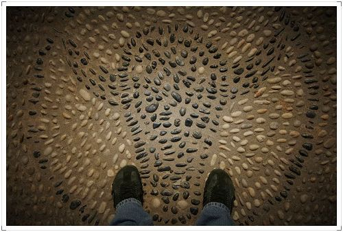
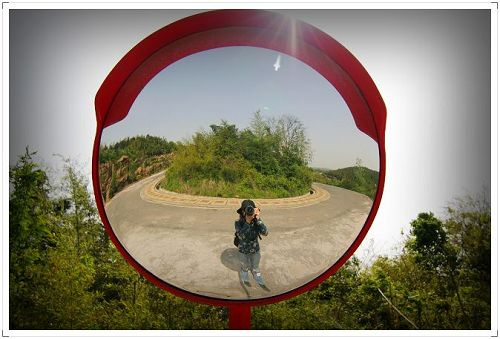
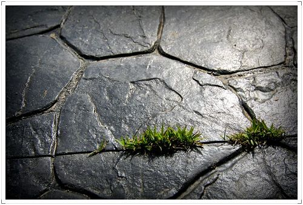
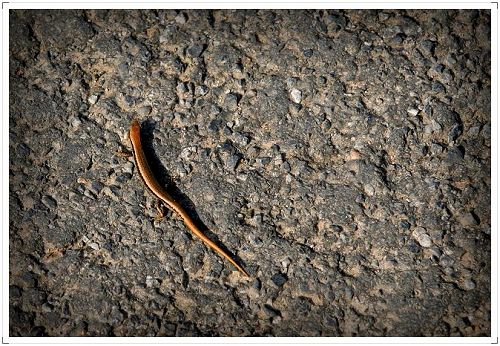
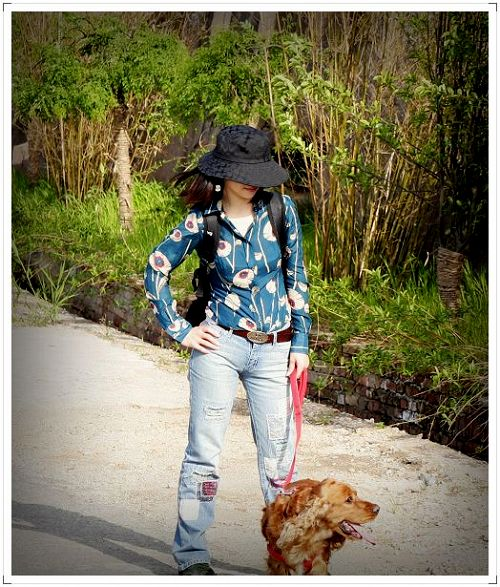
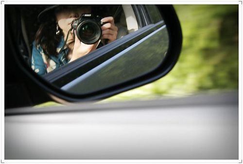
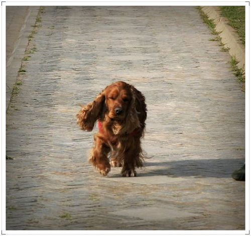

# 爬．山

完全变样的牛首山，被修建成度假村似的，里面随处可见种树除草修路的工人。顺着柏油路走了一个多小时上到山顶，开阔的景色和凉爽的山风才得以补偿上山的辛苦。luke也一定累坏了，说实话我并不喜欢爬山，只是顺着路走，发现是上山的方向时已经进退两难，只好硬着头皮往前行。路上遇到骑车上山的牛人，令我佩服得五体投地....如果不想爬山，进去之后的三岔路口往右走吧~  
  
据说东郊的水榭一到周末快成帐篷党聚集地了，常见到里面挤着三五个人...不如到牛首山来扎帐篷吧，这里有的是地方，一人扎一顶帐篷都可以！  
  
[**\*\*\*更多照片\*\*\***](http://photo.lifetea.org/v/live/niushoushan/)  
  
用鹅卵石拼铺的牛头，要费不少工夫吧；  
  
  
U行弯道；  
   
  
咱活得没它顽强；  
  
  
好奇的Luke遇到一只壁虎；  
   
  
幸好穿了衬衣，不然要晒死了。  
   
   
  
Luke被阳光刺得眯着眼睛走路，傻样儿~  

---

## 评论（7）

**邃** · 2009-04-26

这样穿很酷。

**候鸟** · 2009-04-26

帽子真好看，可惜我头太大，帽子基本与我无缘。

**itsmin** · 2009-04-26

嘿，这身打扮看着很爽耶。

**Maggie** · 2009-04-26

看的时候我一直是微笑的，快乐其实很简单。

**[一鸣](http://blog.sina.com.cn/wwsyyc)** · 2009-04-26

你的Luke简直就是个宝啊，跑起步来很憨豆啊。
请问，它几岁了？

**lilian** · 2009-04-26

再一次感叹：这才是生活！！！

**[少爷](http://jennyshaoye.blogbus.com/)** · 2009-04-27

狗狗好可爱啊,另外你的衬衣很不错

