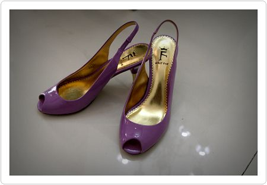

# 猪．传染

美国流行猪流感了？[**猪流感**](http://msn.ynet.com/china/view.jsp?oid=50769707)可以预防，勤洗手，少去人多的地方。猪肉烹饪过程中会杀死病毒，可以放心食用。据说此次美国爆发的猪流感是禽流感、猪流感及人流感的合并体，也有新闻说是变异的猪流感，从墨西哥传入，欧洲和新西兰也有几例。猪流感没有禽流感致命，死亡率仅为百分之六点几？（南京卫生防疫局官员答记者问）禽流感的死亡率达到百分之九十几哦。猪流感主要靠飞沫传染，大家没事宅着吧，本来我就不喜欢去人多的地方，挺好。  
  
新一周开始我又犹豫到底拍还是不拍每天穿衣记录？最终还是拍了：）  
周末带着买彩票的心理走进浪涛美发店，不管怎么样，自上次剪短头发已经一个多月过去了，头发本来就长，后来长得象清朝被剪了辫子的男人一般。这次彻底剪成短发了，清爽许多。虽然彩票没中奖，但损失也不大，反正我头发长得快：）  
  
  
这鞋跟细得可以当作凶器来用，比如遇到某些个满口污言乱语的醉汉，敢敲我脑袋？拿鞋跟戳死你，或者直接朝下部飞起一脚。不过我还想到个好办法，备一个防狼喷雾剂，只要敢敲我脑袋直接掏出来就喷..喷完再把他从公车上踹下去。  

---

## 评论（7）

**itsmin** · 2009-04-27

这一篇信息量够大，从时事新闻到时尚服饰到防狼术，真不是盖的。哈哈。

**Maggie** · 2009-04-27

鞋跟这一段太有智慧，拍个flash应该很有意思

**Christina** · 2009-04-27

你要遇到欺负你的挫人，你怎么办？

**邃** · 2009-04-27

哈哈，你这自保还挺新鲜的，效仿啦。

**jeneffer77** · 2009-04-28

还可以轻抬此脚重落彼脚，狠狠地拧着踩下去，保准您听到杀猪般的嚎叫—-最近猪流行。。。。

**[shanshu](http://shanshu.blogbus.com/)** · 2009-04-29

你的鞋还真是够多的。。。哈

**BigFat** · 2009-05-01

爆发的是墨西哥。目前美国人民情绪稳定。

