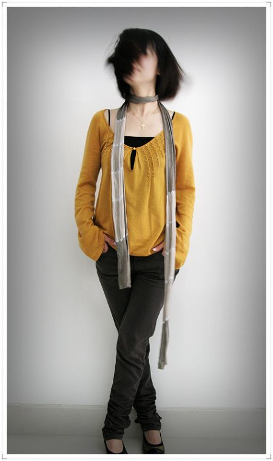
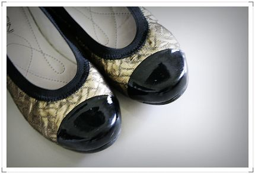

# Dress Blog

剪短发后戴眼镜好象不适合了：（  
上衣的颜色其实是第二张那个样子。  
   
  
  
一年前买的这双鞋商场现在打折到300多元咯~  
  
  
展示一下别致的裤脚。  
  
  
编辑这篇BLOG时，听见新闻里说某历史老师不仅用钢筋抽打学生，还把该学生从四楼扔下去....吓死我喽！这两天广播新闻上重复播放[**习水县嫖宿幼女案**](http://news.google.cn/news?hl=zh-CN&q=%E4%B9%A0%E6%B0%B4%E5%AB%96%E5%AE%BF%E5%B9%BC%E5%A5%B3%E6%A1%88&um=1&ie=UTF-8&ei=mpb2SYmfFJiIkAWky8TjCg&sa=X&oi=news_group&resnum=1&ct=title)，嫖客里居然还有5个政府官员（这一点也不奇怪）。即使案发后记者到习水县暗访，联系上一个包工头，该男子仍然找来三个满脸稚气的学生妹，最大的17岁，最小的才11岁......谁让咱喜欢看新闻听新闻呢？这算不算八卦浅质？

---

## 评论（10）

**[一鸣](http://blog.sina.com.cn/wwsyyc)** · 2009-04-28

明朝末年，几位绅士在南京制作一张神女榜，想把当地色艺双绝的妓女都弄到榜上去。为了制好这张榜，主办人在秦淮河上租了两艘大船，请来很多名流做评委，让妓女们挨个登船献艺，同时让评委从装扮、仪态、唱功、诗文等角度分别打分，哪个妓女的综合分数最高，哪个妓女就是榜单上的花魁。按说这个规则还是很科学很合理的，可是活动声势实在太大，把秦淮河两边大大小小的妓院都惊动了，有些聪明的老鸨为了让自己的姑娘出名，争着给评委塞银子，甚至还邀请主办人去自己的院子里免费嫖娼。评委和主办人都落了好处，不能不给人家回报，于是乎，榜单上出现了很多关系名额，真正色艺双绝的妓女反倒名落孙山。《有多少评委都成了嫖客》

看到楼主这篇关于嫖客的八卦后想到一个新词《有多少官员都成了嫖客》

**邃** · 2009-04-28

不算不算，这样的新闻不是娱乐圈的新闻，关注民生，关注时事新闻，有助于和社会接轨。呵呵。  
嘻，小围巾好看，戴上它全身色彩顿时鲜活起来。  
还有你的鞋子，要是平跟的我更加喜欢。

**lilian** · 2009-04-28

周一到周四,裙子配高跟鞋;周五回归休闲

**sususu** · 2009-04-28

短发很灵动啊

**Christina** · 2009-04-28

平跟的，商场现在有卖的：）还有一款是银灰色，去买吧！

**temple** · 2009-04-28

鞋子是啥牌子啊？：）

**Christina** · 2009-04-28

VANCINI的。

**[三月四月](http://11)** · 2009-04-29

第2张拍得很有感觉，喜欢这见件黄衣服

**may** · 2009-04-29

hi，美女，请问在哪个商场卖的啊？

**Christina** · 2009-04-29

在新街口的金鹰买的：）  
今年在金鹰天地也看到这鞋的。

