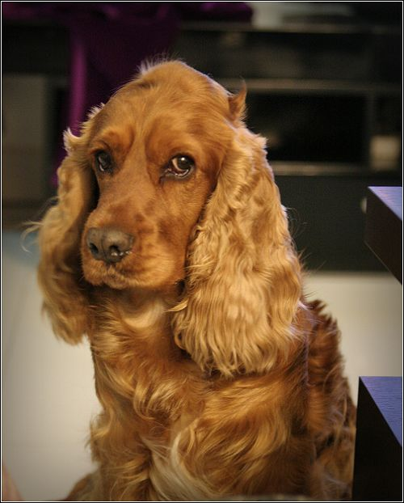
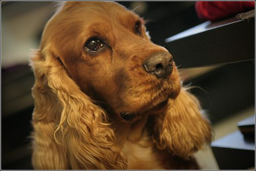
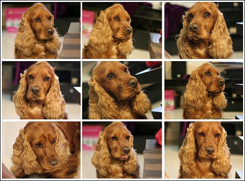
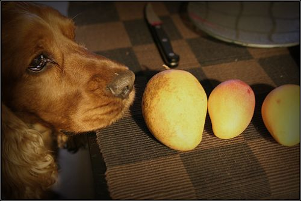
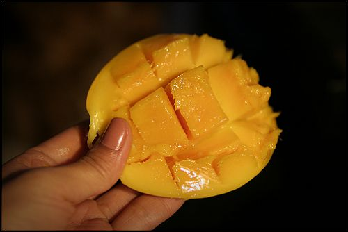

# 小胖&芒果

这眼神貌似网络小胖。很不幸，在它头顶的皮下长了一个脂肪瘤，怎么动怎么摸它都没反应，去宠物医院看过，那里的人说只要不继续长大不影响生活最好不要开刀。我也这么想的，在国内带宠物去宠物医院看病也象买彩票....有一次遇到一位阿姨，那阿姨好奇的说这只小狗戴着顶帽子啊~我差点没晕过去。  
  
这只被人喊“小巴狗”、“小黄狗”的戴着帽子的小胖从不挑人，对人非常友好，但是挑同类。比如它最喜欢的是白熊小姐（白色萨摩耶），对其它同类一概没兴趣。别的狗狗和它吵架，它也没任何反应的从人家身边飘过...但是，任何雄性同类都不能趴在它背上，那时它就不是小胖的眼神了。  
  
  
这是一只爱吃面食会唱歌的帅小胖，只要大声持续的对着它唱歌，不一会儿它就会跟着鬼哭狼嚎起来，请注意不是汪汪汪哦，而是眯起眼睛把嘴撅起来发出持续的声调，虽然没什么音阶旋律，但我认为那就是它美妙的歌声。  
  
没有不好的狗狗，只有不懂狗的人类。因为它太乖，应该这么说它是一条成熟而独立的成年犬。有时间我会尽量带它外出，希望它的性格能活跃一些。  
  
  
它满脸忧郁地坐着...在等待好吃的。  
喜欢扯它嘴上的皮，又柔软又松弛。  
  
  
排排坐，吃果果：）  
  
  
俗话说：浓缩的就是精华。可是大芒果的确比小芒果甜蜜啊~  

---

## 评论（8）

**Maggie** · 2009-04-28

去过泰国后，超爱芒果。俺对小胖二字有一点小敏感，呵呵。

**Christina** · 2009-04-28

啊哦~~~~~~~~~~~~~~~  
据说广东春天的芒果比秋天的好吃？还是秋天的比春天的好吃啊？NND~谁能告诉我…茼蒿、芦蒿怎么才能记得住呢？

**jeneffer77** · 2009-04-29

好可爱的luke，头上的肿块如果不特别说还真没有注意到—怎么能说戴顶帽子这么夸张呢。

它第一张照片好像有点抵触情绪。后来就自然多了，赫赫。很神奇，他怎么能有那么多表情内？

**[xxingl](http://xxingl.blog.sohu.com/)** · 2009-04-29

原来记得说是养两个月，当时还觉得等要送走得时候怎么舍得。现在看来就养下去啦

**[三月四月](http://11)** · 2009-04-29

我们家的妞妞一口气能吃2个大芒果……

**Christina** · 2009-04-29

你家妞妞真会吃，我家luke不吃水果的~

**shao ye** · 2009-04-29

Luke is a super dog. My maisy did not have operation on this Monday because the vet said it might effect her pregnancy. I hope the lump is just a fat lump too.

**Christina** · 2009-04-29

希望maisy一切安好！  
我家Luke也一切安好：）

