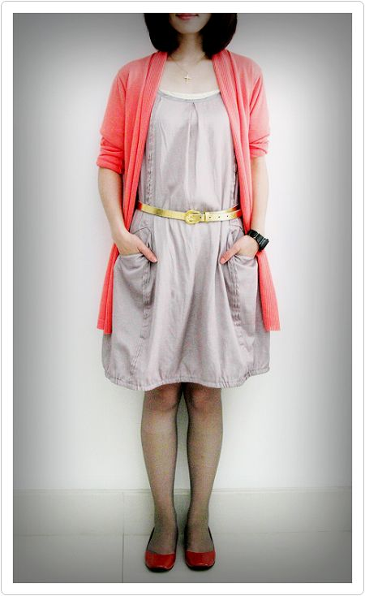
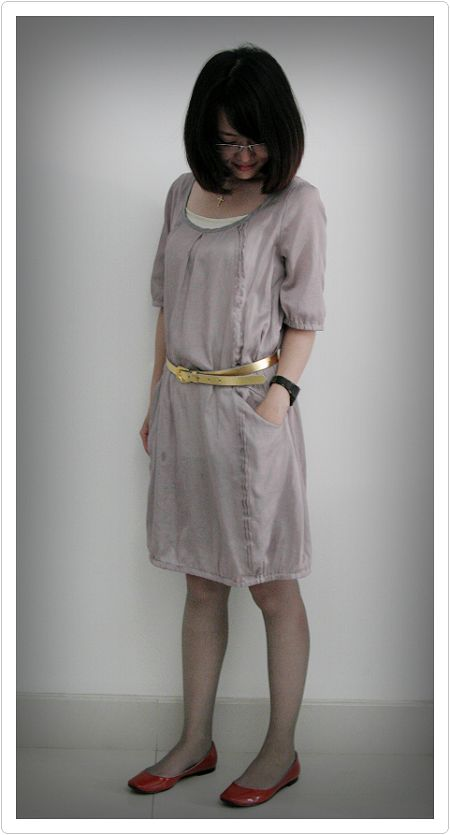
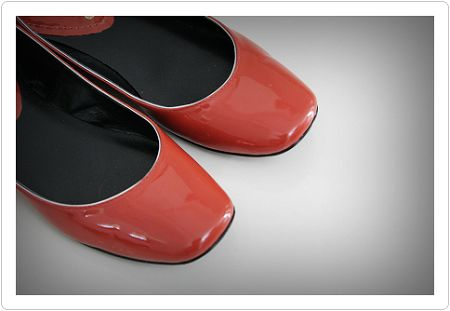

# Dress Blog

节前最后一天工作。天气干燥地冒出火气疙瘩了。  
纽约的朋友在线上说：“你这样打扮在纽约不算土鳖，是不错的，但不属于有个性的。”  
个性这个东西我也爱，如果工作环境允许，每个人都有充分发挥的自由空间。记得以前虎子少年时曾经想穿耳洞，他父母说：“如果你以后职业允许，当然可以，可是现在不行。”  
  
第一张的上衣颜色比较准确，偏暖的柔和的橘红色；  
  
  
以前特别不能接受金色的或者镶钻的腰带，也许莱迪、华欣地下商城卖的泛滥，总给人廉价品质低劣的印象。可是今年我也买了一条金色腰带，因为好喜欢它的做工。  
  
   
  
偏暗的橘红色鞋，靠近鞋尖的底部各有三颗并列的小小的铜铆钉。  
  
  
17：37终于完成手上的工作，眼也花腿也酸了，这时候姐姐打电话来说高架上堵车....节日还没开始就塞车啦？假期没任何外出的打算，准备在这个城市里消磨时光，仔细想想又没有什么特别的活动可安排，还是宅在家里休息看电影读小说，一天用来看望父母。假期的时间总是不经用滴~

---

## 评论（19）

**[joanna](http://yanmer.cn/blog)** · 2009-04-30

进来养养眼，快改成时尚博客啦，sartorialist类。生活得很精致

**coco** · 2009-04-30

好看。你要是不拍，肯定大伙儿会提意见的。坚持啊！

**Christina** · 2009-04-30

中午下班遇到一女同事，她问：“今天怎么没上传PP？好期待啊~”我当时真是受宠若惊咯。

**兔子田** · 2009-04-30

我也是，我今天都刷了好几遍了。。。喜欢这一身。。。  
嘻，我也是南京的。

**Christina** · 2009-04-30

太好了，又一位南京滴：）

**[一鸣](http://blog.sina.com.cn/wwsyyc)** · 2009-04-30

喜欢这些照片，垂下明亮的眸子，含着羞怯和文静。

很奇怪，最近为啥最后都是鞋子的照片呢？

**Christina** · 2009-04-30

好鞋半身衣，鞋子在搭配中起着很重要的作用。  
全身的相片看不清楚鞋子的摸样啊，所以单独拍一张。你这个问题提的有点…弱：P

**[一鸣](http://blog.sina.com.cn/wwsyyc)** · 2009-04-30

哈哈哈哈，受教育了：）

好鞋半身衣，确实第一次听说，我的着装一般是正装，可选择空间不多，一般在色调搭配上比较注意。鞋子只要选好牌子，就没有什么问题。  
以后要多看Christina的文章，积累女性着装注意要点，可以当女性朋友们的好参谋：P

**邃** · 2009-04-30

确实凸显不出个性。  
呵呵，你那小细腰也没有穿出来。  
我也狂爱小平跟鞋。

**[三月四月](http://11)** · 2009-04-30

今天这身我好喜欢，颜色特嫩，看着舒服  
另：新发型不错，为什么我每次去浪涛都很失败

**shao ye** · 2009-04-30

photos look like paintings…very nice

**Christina** · 2009-04-30

既然买彩票，一定要自己选，告诉理发师你要剪成什么样的。我特害怕那种很薄的头发，我喜欢蓬松厚厚的，显得多多的发型。  
其实我不适合短发造型：（

**[三月四月](http://11)** · 2009-04-30

我也很喜欢蓬松厚厚，但是我本身头发就太少了，还面临着遗传谢顶的危险，伤心……

**[joanna](http://yanmer.cn/blog)** · 2009-04-30

“个性”？《欲望都市》里的角儿们也谈不上个性，就是中产、有钱人的格调打扮。穿的所谓的个性，不用说国内的街头回头率，纽约也一样。就象,哪个国家的农民都那模样\*-\*  
我的脸大，可我就是讨厌发型师把我头发弄蓬松，还遮住耳朵。所以一直以脸盆的姿态混迹在街头<<<……

**蚊问问** · 2009-04-30

超级喜欢外套的红和裙子的灰。裙摆的蓬松感很到位

**Christina** · 2009-04-30

确切的说裙子不是灰色，是淡淡的藕色。  
露耳朵的发型适合我的脸型，可是我还是钟情于蓬松随意的发型，那种风吹乱了，用手抓一抓就可以的发型。

**Maggie** · 2009-05-01

那个钟点确实非常非常地堵，害得我都迟到了。

**Christina** · 2009-05-01

啊哦，你今天唱主角啊，你没到大会不能开始滴，发言没打结吧？

**暴暴** · 2009-05-01

自拍吗？感觉不错

