# 活着，只为等待死亡！

上一次去动物园还是儿童时期，恰好放假打算去看看真的熊猫。劳动节的下午赶到红山动物园快四点了。里面的人比动物还多，操着各地口音的大人带着小孩，放眼望去乱糟糟一片，好似赶集即将散场的画面，这种时候我总是心生厌恶，人类就象蝗虫一样吞噬着大自然。早些时候看过一部幻想记录片，大致意思是说人类用上千年制造出的文明世界，从人类消失的那天开始，大自然只需要两百年就可将其夷为平地，恢复原状。  
  
没想到南京唯一的动物园如此糟糕，动物们被关在各自的院落和笼子里，没有良好的卫生环境，仅仅稍微高级点的灵长类动物还有点小娱乐设施，其它的基本就是水泥钢筋围起来的生活。人有人的命运，这些动物呢？一生将在水泥钢筋里等待死亡。  
  
恨透了那些站在笼子外面对着里面睡觉的动物大呼小叫、往里面砸东西、用硬物敲打笼子的人类！因为你的到来它们就应该来段精彩的表演或者杂耍吗？什么样的大人带着什么样的小孩，他们不感到廉耻，他们对生命本身就没有尊重！  
  
或许，那些动物对于人类卑劣行为早已习以为常，活着，对于它们来讲就是等待死亡！  
  
猴山更象是个垃圾场，看着那些纵容孩子往下扔东西的家长，想象着他们的孩子长大后的人生，以及由他们组成的这个社会，油然而生地心寒！  
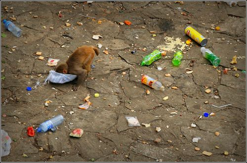   
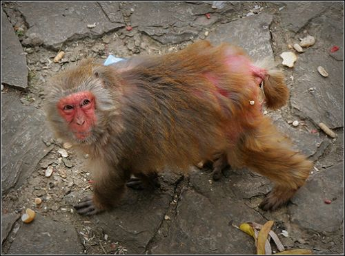   
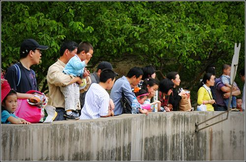   
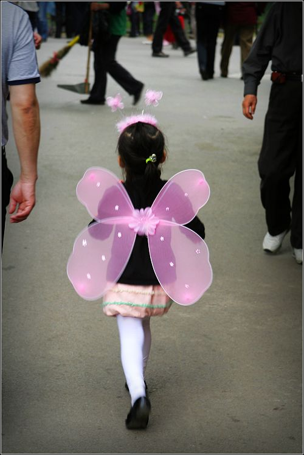  
  
  
  
**\*\*狮子与老虎的故事\*\***  
三只狮虎兽，是雄狮和雌虎杂交的后代。成年狮虎兽体型据说比狮子老虎都大，体重达400公斤以上。如果它们诞生于此，那么它们将不知道外面还有属于它们的广褒天地。那么它们也许会安于现状，而活得稍微快乐些？  
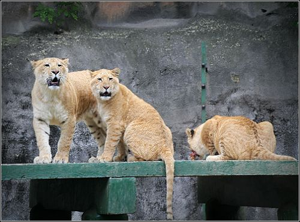  
  
动物园将狮子、东北虎和孟加拉虎各一只放在同一个饲养圈里。不知道哪个鸟人想出来的艘主意，是为了繁殖狮虎兽吗？  
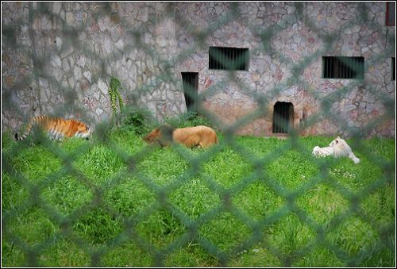  
  
雄狮子从远处走向围栏边，人群渐渐沸腾，大人小孩吆喝着从别处涌到我们四周。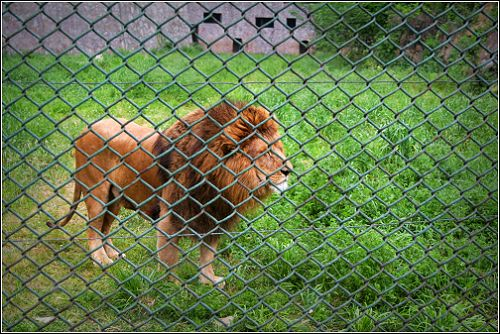   
  
接着这只狮子朝着某个方向大声吼叫了几声，那声音低沉而穿透力强，着实令人震撼。  
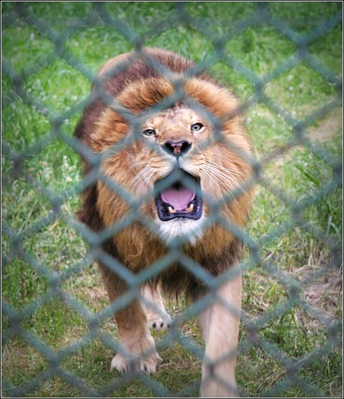  
  
然后它卧在草坪上，看着那个方向，显得极其忧郁。  
有人会反问：你怎么知道它是忧郁呢？  
  
因为我发现隔着狮虎兽的院子的另一边是两只成年雄狮和雌狮。与隔壁那只雄狮相比这只混养的雄狮显得格外魁梧高大，有森林之王的气质。它这么卧着，静静地凝视，听着那边狮笼传来回应的吼叫.......象被关押在监狱里的犯人，靠着某些渠道仍然与同类保持着交流，你能说它是没有感情的冷血杀手吗？而外面的人类极其丑陋地兴奋着，象一群野蛮的小丑！  
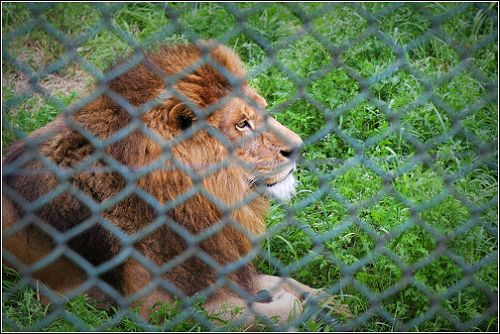  
  
如果你家里有宠物的话，就不会无视它们的眼神：茫然、漠然、鄙视、空洞、愤恨，毫无生气。有一件事情让我相信动物是有心理活动的，小区有户人家养了只小狗，因为主人怀孕而将它弃之门外，后来这只小狗见到这家主人就怒吼。知道它的时候它已经在小区里流浪，靠好心人喂些食物活着。警察叔叔抓无证狗狗时，它就消失了。  
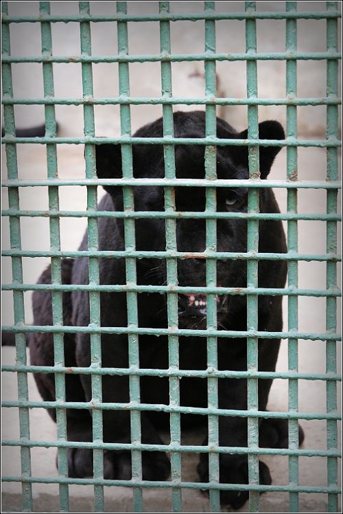   
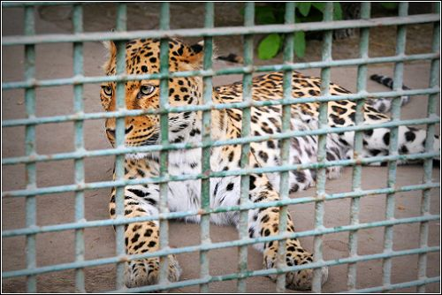   
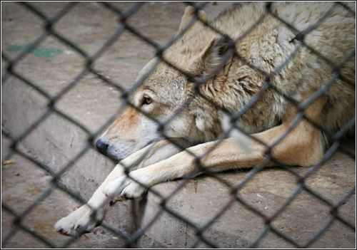   
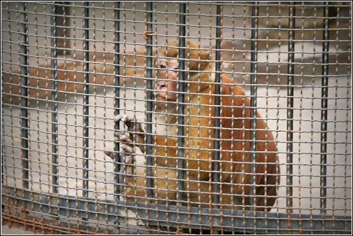  
  
孤独的河马生存于咫尺之间，它身后的人造水池里蓄满了污浊的绿水，墙壁上喷着班驳的粪便，它躺在那里一动不动，睁着眼睛等待黑夜来临。  
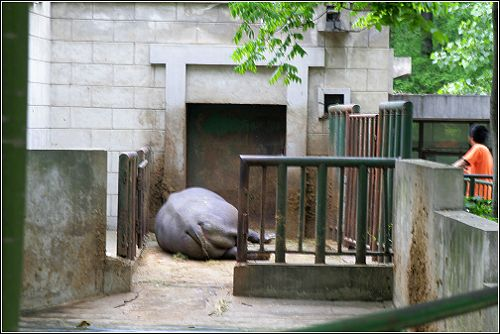  
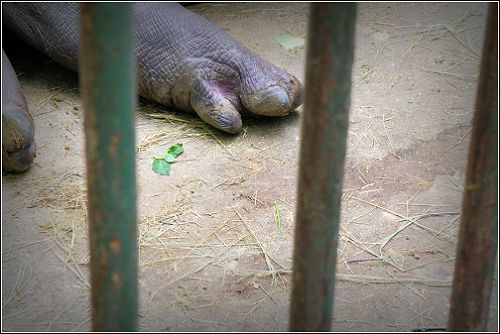  
  
去的太晚的缘故动物园已经赶人出园了，没能找到熊猫馆，匆匆地看了一眼趴在玻璃窗后面的猩猩，因为房间里没有开灯而显得异常昏暗，那只猩猩象小孩子一般天真地望着玻璃外面的人类。它的饲养员在门外大声催促，她这就要下班，将她的工作遗留在黑暗的房间里过夜。这只透着渴望与无辜眼神的猩猩，只能拿着它的小树枝孤独地睡去？希望它的睡梦中有无比美妙的梦境，有成片茂盛的树林和果实，有自己的伙伴，有......本属于它的猩猩的命运！  
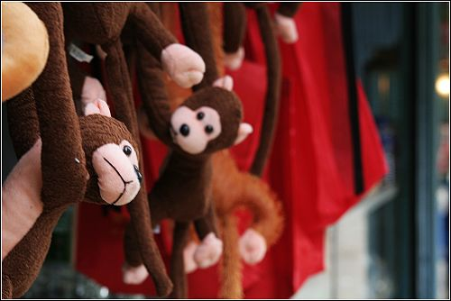  
  
我们来到这里是要感受动物的快乐？还是感受人类的快乐？总之从动物园出来我一点也不快乐，也丧失了小时侯有关动物园的快乐记忆！曾经梦想过当一名动物饲养员的我在颤抖，感到作为人类的耻辱，我哭泣着怨恨这貌似文明的世界。想要拯救它们，却分明感到虚弱的如它们一般无助。同时我还感受到了愤怒！！！  
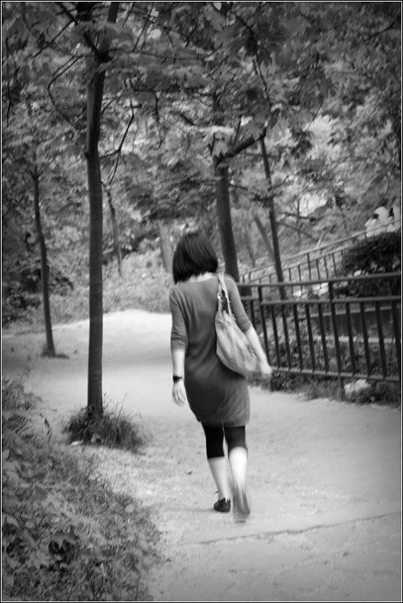

---

## 评论（11）

**Michelle** · 2009-05-02

还是在自然保护区看野生的动物的感觉好一些，少一些压制，多一些自由和体贴。百兽之王是人类，威武傲气的大狮子也只能没有尊严的“苟且偷生”。人类社会里又何尝不是处处的无尊严和苟且偷生呢。载舟覆舟的大自然将会给“文明”的人类一个个毁灭性的答案。

**[golax](http://golax.blogspot.com/)** · 2009-05-02

以兽为宠总好过逼人为奴，两害相权取其轻。但愿它们没有类似人的情感和灵魂。

**Maggie** · 2009-05-02

好狰狞的铁丝网，让我忽然很想去肯尼亚。小茶拂袖离去的背影真帅。

**[joanna](http://yanmer.cn/blog)** · 2009-05-02

猴子周边的垃圾场面……无语了

**[一鸣](http://blog.sina.com.cn/wwsyyc)** · 2009-05-02

有一件事情让我相信动物是有心理活动和情感神经的！这点我非常认同。是群聚类的动物都会有心理活动和情感神经。
动物园确实是我们虐待动物的”动物炼狱“，海洋公园动物还好些，最起码它们不会遭受一些无聊透顶的骚扰！
人类不会被核武器消灭，一定会被病菌消灭，禽流感、猪流感……鬼知道后面还有什么流感！

**候鸟** · 2009-05-03

动物也分命好的，命不好的，非洲大草原的那些动物应该是最幸福的吧。  
和谐社会就是如此和谐的。

**[光光](http://gaoguangguang.blogbus.com)** · 2009-05-03

小时候很喜欢去动物园，现在去国内的任何动物园都觉得很难过，基本和你感受一样。包括这次去的一个野生动物园，其中一个老虎狮子的表演，中国的驯兽师完全是靠打，把动物打怕了这样来驯服它们。我看了个开头就走了，当时特别希望这些老虎狮子野性大发作。还有最变态的一个地方是，中国人喜欢老虎和狮子交配出基因缺陷的狮虎兽，人得变态到何种地步才会想出这种主意，这些人干嘛不去和猩猩交配呢。真是气死人了。国外的动物园好很多，除了仍然不喜欢看被困的猩猩以外，其它都还好。

**Christina** · 2009-05-03

从动物园来看，小小的泰国都比我们人道，体面，文明！昨天我边哭边写完这篇blog，不敢去想那些动物的眼睛，憎恨回忆那里的人类！人类最可悲的是不知道自己的丑陋。

**[shenwen](http://shenwensw.blogbus.com/)** · 2009-05-03

苏童有一篇小说叫《世界上最荒凉的动物园》。  
关在笼子里的动物与笼子外面的人，遭受的痛苦和屈辱谁更甚呢？只是动物园里的动物用公开展览的方式，以试图博取人们欢笑的形式，让人直接触目惊心。  
话说，我很少再去动物园。看一次难过一次，因为我无能为力。

**[njtiger](http://njtiger.cn)** · 2009-05-06

熊猫馆在北门，一进大门上坡就是。

**Faye** · 2009-05-19

自然界，弱肉强食，适者生存。淘汰总是残酷的。对于人类的淘汰何时到来？

人类有幸站在食物链的顶端，但却和别的猛兽一样，对其它生命形态缺乏尊重。

动物园的初衷是什么？为了达到这样的目的，人类应该怎样付出？什么样的制度才能保证动物园以文明的形式存在？

