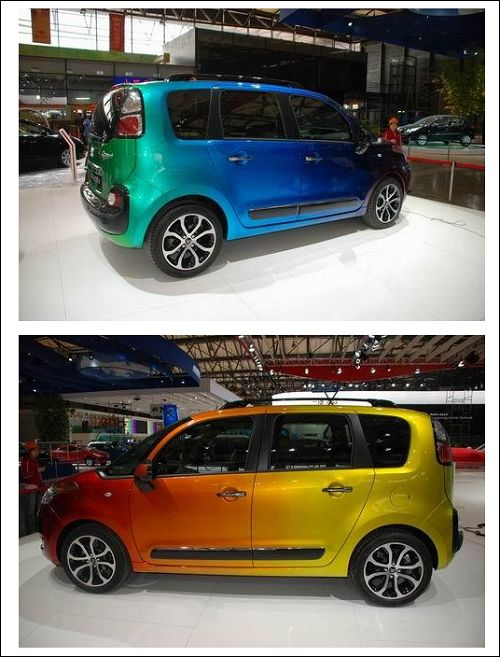

# 彩虹车

这次上海车展出了一款雪铁龙全新“C3毕加索”MPV款新车，车身为彩虹般的渐变色。  
\*\*尺寸：4.08X1.73X1.62米  
\*\*五个座位  
\*\*行李架下的空间将达到500升（按VDA标准）  
\*\*全景式玻璃车顶  
\*\*仪表台的材料使用了高质量的软质塑料  
\*\*四款发动机选择：VTi95和VTi120汽油发动机，以及HDi90和HDi110柴油发动机  
  
估计这车的性能也好不到哪里去，借一时尚的外衣增加卖点而已。擦块漆，补起来难度大了。说到毕加索，N年前曾有茶友留言说他们东大的老师都买这车...奇了怪，我到现在还记得？今天在街上看到[**“MG SW3”**](http://www.autoday.com.cn/news/2008-06-24_12218.html)，忽然觉得这车的外型象被打包的package，黑色前保险杆、防擦条及后保险杠象是封箱带，让这个package看起来非常结实，呵呵~  
  

---

## 评论（2）

**[shanshu](http://shanshu.blogbus.com/)** · 2009-05-04

我在想这个碰掉漆后，怎么补？渐变色好看是好看，但是补漆挺费神的。

**[薇安](http://bulaoge.com/?vivianxu)** · 2009-05-06

你去上海看车展啦，听说人暴多，我就不愿去挤热闹。

