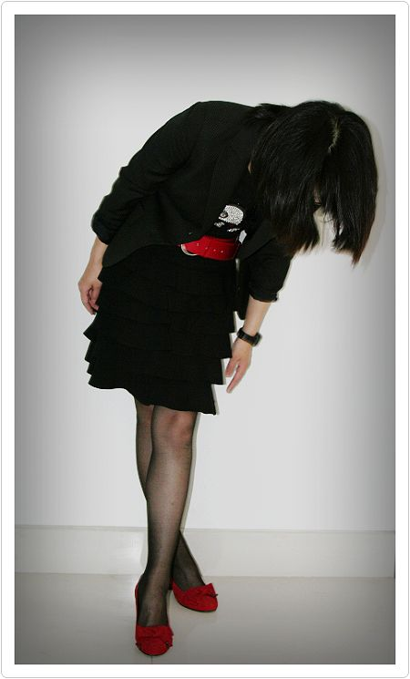
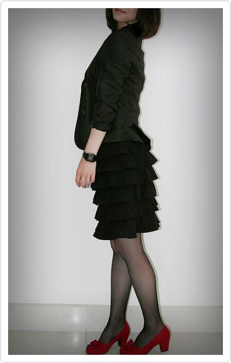
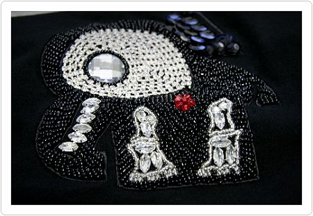
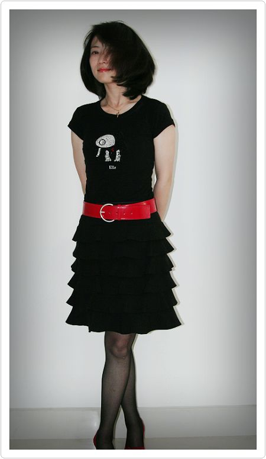
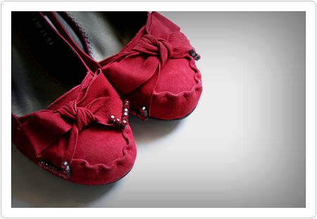

# Dress Blog

黑底细条纹双开叉西服+黑色小象体恤+黑色蛋糕裙+红色腰带+红色磨砂皮鞋  
  
\*\*5年前的蛋糕裙，百搭款，仍然深得喜爱；  
   
  
\*\*黑底细条纹双开叉西服，袖口被挽起两道，削弱了正装效果；  
  
  
亮片、钻石和珠子锈出的饱满的小象图案，摒弃了亮片的低俗；  
   
  
  
\*\*难打理的红鞋子，舍不得经常穿它。  

---

## 评论（14）

**[一鸣](http://blog.sina.com.cn/wwsyyc)** · 2009-05-04

鞋子很漂亮，记得某位大师曰过：”好鞋半身衣“，^\_^

**Sherry** · 2009-05-04

这鞋面真好看~

**Maggie** · 2009-05-04

喜欢第三张。呵呵～～～

**[三月四月](http://11)** · 2009-05-04

我好喜欢磨砂皮鞋的，但是觉得坐公车穿它太奢侈了，难打理，所以只能观望。

**Christina** · 2009-05-04

据说磨砂皮鞋可以用鞋粉清洁、上色，但是真好麻烦！

**Maggie** · 2009-05-04

擦鞋店是可以帮弄的，可是，到底是有色粉剂，搞不好会弄脏袜子。总之，磨砂鞋只是偶尔穿穿搭搭色的，好难伺候。

**[joanna](http://yanmer.cn/blog)** · 2009-05-04

每天都穿得这么好看，让人养眼。^o^  
鞋子细节很漂亮，不过那个蝴蝶结应该很难打理吧？第二张侧身照片，想象里面是抹胸式的连身裙，什么效果？:-)手上戴几个blingbling的大圈，什么效果？  
好期待哦

**guangguang** · 2009-05-04

磨砂皮可以就拿到水里洗，用牙刷刷，干了一样，反正我是这么干的。

**Christina** · 2009-05-04

光光，你太牛了，颜色会被洗淡吧？抹胸的连衣裙是有滴，不过bling bling的手圈就算啦，呵呵~

**mercy** · 2009-05-04

5年前的裙子？你太厉害了。  
磨砂皮俺也是拿水刷过，刷鞋粉太麻烦了。  
我超级喜欢你T-SHIRT上的那头小象~~

**流星** · 2009-05-04

你的入门照片总是很有味道。比较艺术。

**Maggie** · 2009-05-04

这小象太奇妙了，老眼昏花的我以为是一颗大蘑菇下面蹲了两个美女呢。呵呵～～～

**[少爷](http://jennyshaoye.blogbus.com/)** · 2009-05-05

哇,这回把身材显出来了. 让人忌妒啊~~~~~

**yoyovi** · 2009-05-05

是PINKO家的T吧?!今年好像出的猴子的,期待ing..

