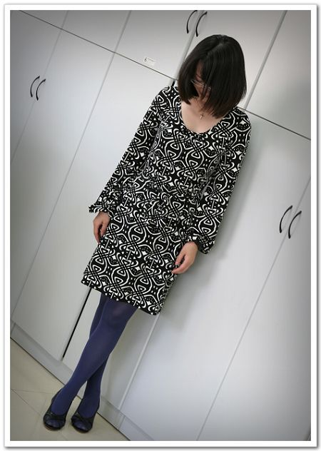
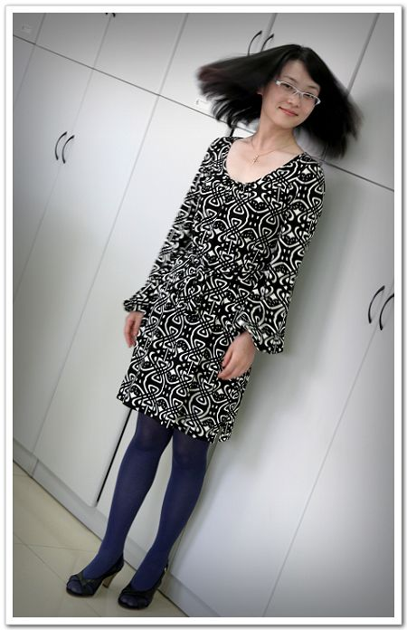

# 唏嘘不已。

中午和以前的老领导们吃饭，不过不如和同辈的老朋友相见来得痛快，毕竟职位高出好远，在社会生活里也是永远走在前面的人。很开心，什么都没有改变似的，只是吃饭这个活动无法静下来交谈，总是热闹而奔放的进行着。  
  
中间有人递手机给我，一听就猜出来是谁，比我大一岁的她在北京定居发展，正在登机准备去德国参加20多天的培训...当年在她面前我的内心可是无比清高，甚至居高临下的姿态...所以说袋子里装了100只球，即使拿出的99只是白球，千万不可断定最后一只也是白球，没准儿就是袋子里唯一的黑球呢。  
  
其中一个领导在阅读和书写上对我有着渊源流长的启蒙作用，当年看过他的钢笔字我模仿过很多年，如今这字体早已改头换面，且因依赖电脑疏于练习而渐行渐远。《收获》也是从他处获得的一件珍藏多年的宝贝。此前很多年里无法进入阅读状态，停顿了一段时间。当重拾阅读的心境和欲望，我又继续订购每两个月一本的《收获》。上述两件事儿对于我的人生是极其宝贵的体验也受益非浅！  
  
“你现在还写文章吗？”  
他说：“早不写了，那些都是带着理想色彩的东西，和现实不符......你可千万别哭啊...”  
  
对于走仕途的人是没有自我的，我认为。文学的确对他帮助不大，但在人的心灵空间里是否还会存有一些值得依赖的美好呢？  
  
假如当年重新选择人生道路，假如留在那里，假如....人生没有假如，人生的十字路口说拐弯就拐弯了，哪容你考虑许久？人类总有羡慕他人生活的习惯，事实上他人生活也只是听到或看到的摸样，不身在其中岂能体会出酸甜苦辣？那么最重要的唯有努力并积极地过好现在的生活，才是对自己人生应付的责任！  
  
中午没回家，Dress Bolg在办公室完成的。外面是件藏青色七分袖的短外套，中午的温度万万穿不上身了，回到公司外套遗忘在车上，所以只能拍下这件眼花缭乱、有着大大灯笼袖的连身裙。据说后天最高温度达30度，夏天终于来了。  
   

---

## 评论（14）

**默默** · 2009-05-05

正好处在工作万分繁忙，却得不到肯定和认可，心情非常低落时，看见这句“最重要的唯有努力并积极地过好现在的生活，才是对自己人生应付的责任！”我想，应该可以平和地继续去工作了，不为他人，只是对自己负责！谢谢你——茶！  
上高中时喜欢上《收获》，捏着10元钱趴在邮电所卖杂志柜台外买一本欣喜好久。可现在，哎。。。。。。

**Christina** · 2009-05-05

对的，书摊上买不到《收获》，要么定购，要么到邮局才能买到。

**暴暴** · 2009-05-05

坚持理想啊……只是，我依然还是想坚持我的摄影理想啊。只是不知道什么时候才能走出现在这种闭塞的境地哦

**邃** · 2009-05-05

生活和理想就是你上我下的较量，人生的满足大多数都是在失去和得到之间寻找平衡。  
更多时候希望在一转头的瞬间，发现没有走远的理想。

**喜刷刷** · 2009-05-05

哈哈，原来这袜子是和那隐形的外套搭配的啊。今天小茶显得很高呢，这奇妙的裙子。

**guangguang** · 2009-05-05

我就是觉得为什么你不戴隐形眼镜呢？

**Christina** · 2009-05-06

隐型眼镜对眼角膜不好，郊游时戴一戴，平时还是眼镜方便，我怕麻烦的。

**New Yorker** · 2009-05-06

这套很赞，给人耳目一新的感觉。

有些人一生有很多变化，因为他总是在路上追寻。我自己也是，当年身边的人没想到我现在会在华尔街知名公司工作，去年回去，把多年失去联系的人吓了一跳。自己到没觉得什么。就好像自己天天照镜子，所以看不出自己容貌的变化，但是如果一个人很久没见到你，就立马能感觉到你的变化。安定有安定的好处，变化有变化的辛苦。。。

**Sherry** · 2009-05-06

你的衣服真是一套又一套~欣赏不过来咯!

**候鸟** · 2009-05-06

我妈常跟我说，人看人好看，其实并不然。  
所以坚持做自己就好，虽然我也难以做到：）  
上周看到一段话，送给你：  
我有点小自信，也不少小自卑。我偶尔很骄傲，也时常会气馁。我会羡慕别人的美貌会嫉妒别人的才华也会眼馋别人的财富，但是我知道一回到你和爸爸身边，一回到他身边我就可以做自己，不用去跟别人比较的自己。我不比别人好，也常常会败给自己。但是我知道，这就是我。我无法改变的我，我不忍心改变的我，你们永远都不嫌弃的我。

**Sherry** · 2009-05-06

想到理想和现实的差距，好伤感。。

**[薇安](http://bulaoge.com/?vivianxu)** · 2009-05-06

我喜欢看你的dress bolg

**[三月四月](http://11)** · 2009-05-06

昨天和一个四年没见的朋友吃饭，说我一点没变，容貌样子，穿衣风格，语言性格，完全和过去一样，让我不知道该开心还是难过

**Christina** · 2009-05-06

当老朋友说我一点没变的时候我基本理解的是外在的，所以不会难过，嘿嘿~

