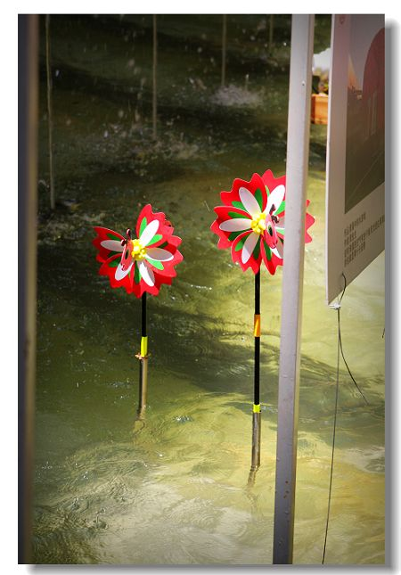
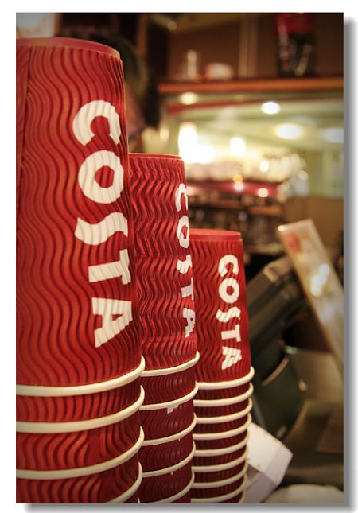
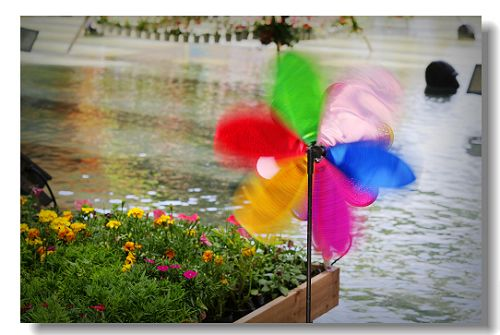
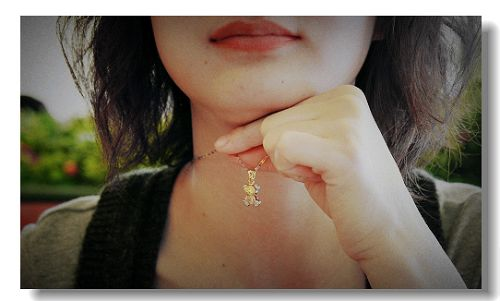
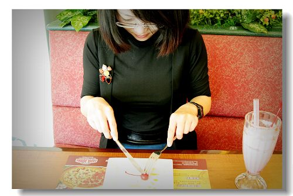
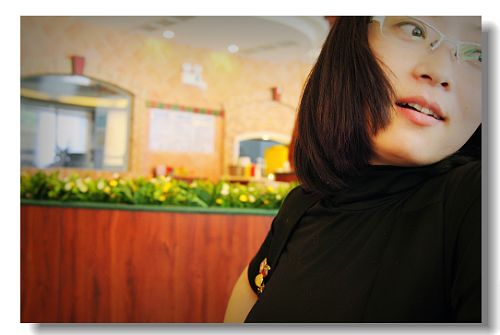
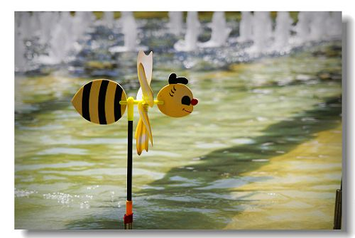
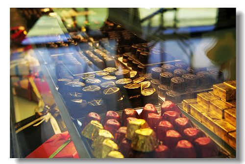
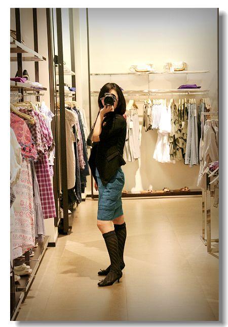
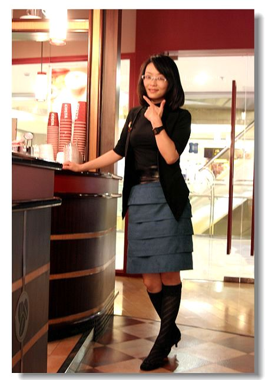

# 中午．快乐

风车，俏皮；  
  
  
costa人性化设计的外带杯；  
  
  
转动出五彩气流的风车；  
  
  
她的童心妈妈送的小熊项链；   
  
  
理想和现实的差距在于：理想在樱桃上，而现实却不在樱桃上；  
  
  
好朋友说喜欢自己拍的这张，这就传上来博取其欢心啦；  
  
  
水游城-1楼的中午人很少，从天井散射进来的阳光被波光凌凌的水包裹着，柔和了建筑，这样的设计与风水有关吗？  
  
  
好看？好闻？还是好吃啊？  
  
  
看着就很享受！  
  
  
  
\*\*\*\*\*\*\*\*\*\*\*\*\*\*\*\*Dress Blog\*\*\*\*\*\*\*\*\*\*\*\*\*\*\*\*  
@ZARA  
  
  
@COSTA   

---

## 评论（6）

**coco** · 2009-05-06

喜欢第4张。“理想”的头发、嘴唇、上衣和胸针……呵呵

**[joanna](http://yanmer.cn/blog)** · 2009-05-06

袜子很漂亮哦，怎么防止下滑？  
真秀气，樱桃还拿刀叉解决，我直接塞嘴里D

**Christina** · 2009-05-06

那是在玩樱桃，不吃的啦~  
袜子基本没下滑过，不是很紧的那种。

**蚊问问** · 2009-05-07

巧克力拍的好美   
很喜欢你在COSTA 这组

**暴暴** · 2009-05-07

看来你也有一个忠实的跟拍人呢。真好。都有相机的话互相拍，也是幸福生活的一部分。

**Christina** · 2009-05-07

忠实的跟拍人？有就好了，可惜没有啊~  
我们两一起吃饭，拿着我的相机相互拍咯。

