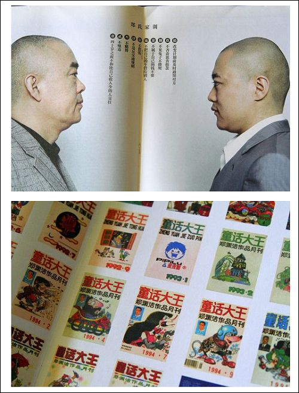
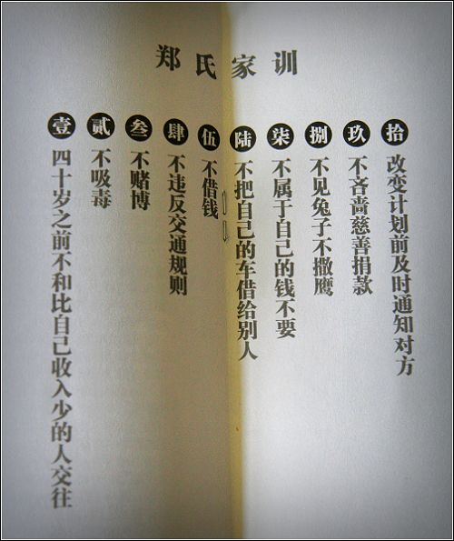
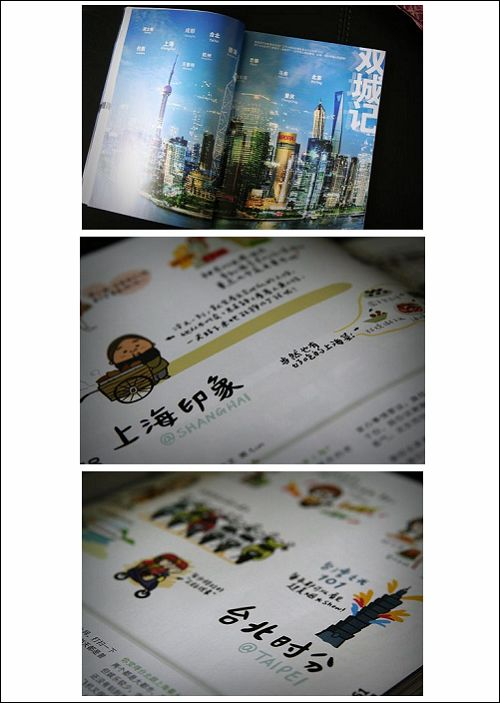
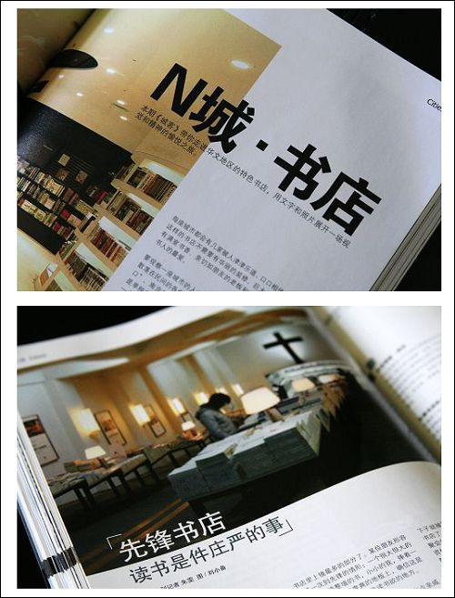
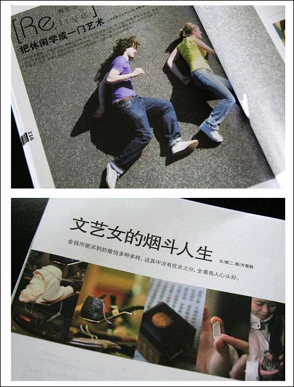
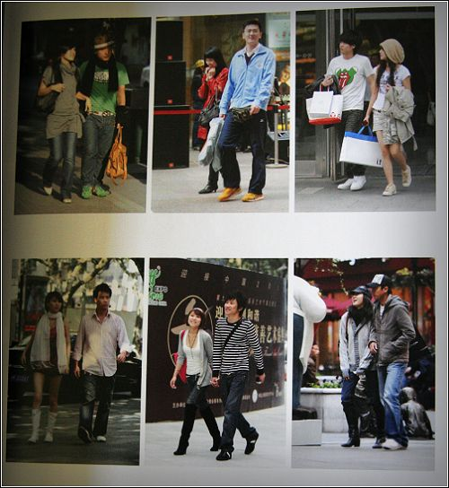
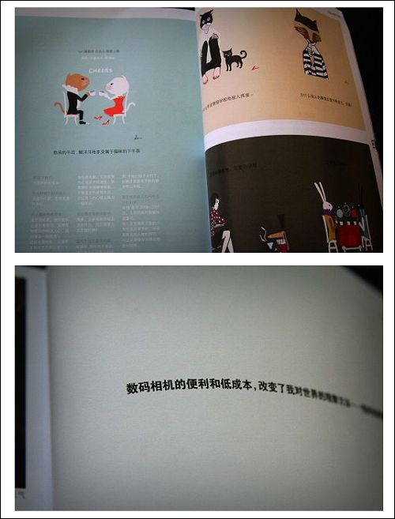
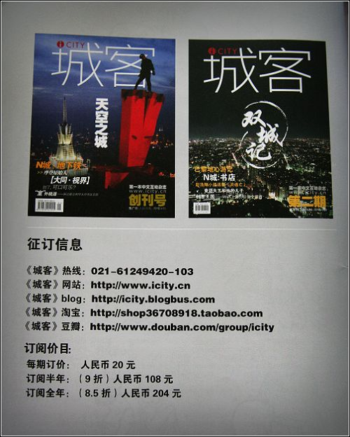
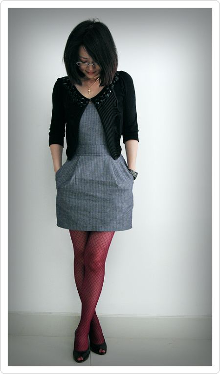
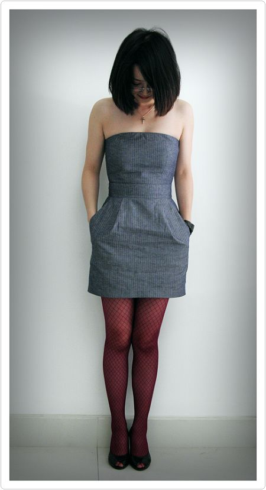

# 《城客》：双城记

第二期blogbus的《城客》几经周折终于寄到我这儿，感谢横戈惦记，每每让我有免费的杂志阅读。这期最先被关注到的是“童话大王”字样，这在以前早被忽略不计会随手翻过的页面。  
  
虽然写的是童话大王，文字却真切写给成年人阅读的经验与经历，郑大王说“35岁以下的人不知道皮鲁鲁和郑渊洁的，恐怕只有两个，一个是我儿子的女友，另一个是我侄子的女友。让我得意的是我成功地用联姻的方式填补了这个空白。”不好意思，我也不知道皮鲁鲁和郑大王哎，体会到童话美好也是因为[**童话写手“问问”**](http://mosquito511.blogbus.com/) ，所幸的是郑大王用《城客》填补了我这个无知又无趣的人的空白。最近几个朋友电话询问“问问”同学情况，说喜欢她的文字和相片，想认识她，其实我不过和你们一样只看其字未见其人哦！拜托，不要逼我么~  
  
   
  
譬如这十条“郑氏家训”就很靠谱，尤其1、5、6、10；  
  
  
还喜欢“双城记”。一个整日坐班以写blog调节生活滋味的枯燥的上班族，能坐在家里一缆众山小，还有比这个既节约成本又不浪费可贵的年休假更令人爽快的事儿吗？  
  
  
早早听横戈提到《城客》准备做一个N个城市里的书店的展示，其中有南京的“先锋书店”，专门找了在南京的刘小备拍摄“先锋书店”，不过文字没有点出先锋书店的情感渊源，毕竟还是要生活在南京久了的读书人写，体会才更深刻呵？多少有些潦草，匆匆带过似的，不细腻，不如北京那三家书店写的好。无论怎样，先锋还是会给远离南京的南京读书人带去念想滴，这就不错了。  
  
  
第二期《城客》内容颇为丰富，从时尚到娱乐，从摄影到美食，从大众喜闻乐见的情事到小众欣赏的Re design....还有目前最最风行的街拍，摄影质量明显高于网络上展示的街拍。  
   
  
  
这个...这个是某某人喜欢的插画，这期大部分《城客》文章都配有可爱的插画，如今插画也是流行内容之一了？有意思的是好些文章都是blogbus用户所写，这也是那些大牌杂志所不具备的亲近感。  
  
  
对于一本新出道的杂志来讲，我们的确看不到未来会怎样。  
就象人类尝试一件新事物，心里总会没底儿。  
认真细致和执着地走好每一步，其它的顺其自然吧~  
《城客》在香港销售也很好，我在想如果扩大到欧美市场呢？  
海外华人是不是更需要这样一本杂志来了解国内生活，解决乡愁？  
  
  
  
\*\*\*\*\*\*\*\*\*\*\*\*\*\*\*\*\*\*\*\*\*\*\*DRESS BLOG\*\*\*\*\*\*\*\*\*\*\*\*\*\*\*\*\*\*\*\*\*\*\*  
   

---

## 评论（8）

**[joanna](http://yanmer.cn/blog)** · 2009-05-07

小抹胸哦……艳红的网袜哦……  
最近迷恋《我的青春谁做主》中赵琳的短发造型。

**[三月四月](http://11)** · 2009-05-07

小时候是喜欢郑大王的，最喜欢的还是舒克和贝塔。但是这几年，他暴光过度了，顶着光头什么节目都上，没了神秘感，似乎怕被人遗忘，而且他是一个爱带脾气开车。其实他影响了我们这代人就够了，现在的孩子都看什么《淘气包马小跳》之类的书，我翻了一下，语言还蛮跟得上时代的，郑大王的单纯故事已经有点落后了。另：今天的衣服真是亮眼啊，白白的胳膊让人想咬一口，过年买了网袜，却一直没勇气穿，偶尔在家拿出来穿穿，拍拍，自我嘲笑一下

**Christina** · 2009-05-07

三月四月，你在blogbus开BLOG吧，写的真好！

**[三月四月](http://11)** · 2009-05-07

总觉得自己眼光还比较局限，写东西不小心就会做作，所以暂时还是观望为主

**lilian** · 2009-05-07

茶更新得真快呀，几天不上来都写了那么多了。

**邃** · 2009-05-07

这身衣服好看。

**灰子** · 2009-05-07

哇，哇，好靓哦～最近可以看fashion show啦～

**[山树](http://shanshu.blogbus.com/)** · 2009-05-08

天呐，俺可从不敢尝试网格袜。甚至没几条裙子，因为腿型不好看。  
看你穿来，真是漂亮。

