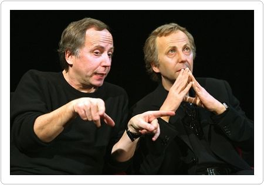
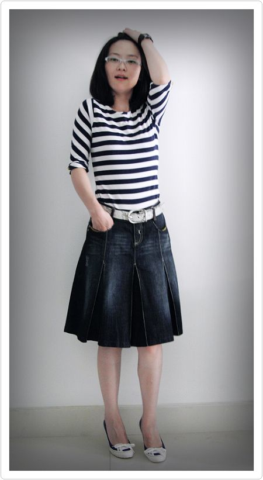

# 总有不堪的回首

谁回首以前留下的痕迹都会觉得有幼稚的部分存在吧？无论办杂志、玩摄影还是码字儿的。偶尔看到以前写的，心里时常一惊：呀，原来当时自己是这样的？  
  
“想停止矫情与抒情的范儿，换个方式。”我说。  
maggie：“这样的‘中国茶’有人味儿，不需要换。”  
  
只要不是朋友看完某人blog在电话里用“怪怪的”三字儿形容就好。但凡活成人群中的人精的blogger，总使人望而却步。稍微傻点儿并不是为了讨大男人欢心，而是愚钝的人总比精明的人活得快乐的多，不是吗？  
  
美好的周末又要上场了，这周只看了一部电影[**《The Girl from Monaco 》**](http://bk.pplive.com/movie/39601)（摩纳哥女孩），因为封面上的男主角[**Fabrice Luchini**](http://www.imdb.cn/name/nm0524528)是在《Paris》里饰演一位和少女谈恋爱的中年男人，他的特立独行和随心所欲，以及面容中坦露的脆弱深深吸引了观众，也由此对他留下深刻的印象。这部片子的女导演认为Fabrice身上有着某种优柔寡断和孩子气的东西，就好像他还没有完成从青春期到成年的过渡期。电影中他演绎一个对自己剥蚀和风化，而在律师职场上的叱诧风云却丝毫不能阻挡他在女人面前缴械投降，放弃了一切批判精神！谁在自己喜欢的人面前不是这样呢？电影中的两个男演员我都很喜欢，因为他们混合了我所喜欢的性格和外在表现力。  
  
片中那个年轻漂亮无所顾忌的女郎所呈现的生活方式、那个没有任何风格的香媚的闺房以及她所持的两性观念，带给我们惯常思维的冲击力与目前中国社会现行的伦理道德观念几乎差不多。我不怀疑1912的房檐下时常也会发生电影中的种种，但仍然会被琴弦拨乱神经。我们就是这样一点点的麻木，然后一点点的适应，然后逐渐老去。  
  
   
  
\*\*\*\*\*\*\*\*\*\*\*\*\*\*\*\*\*\*\*\*\*DRESS BLOG\*\*\*\*\*\*\*\*\*\*\*\*\*\*\*\*\*\*\*\*\*  

---

## 评论（6）

**[三月四月](http://11)** · 2009-05-08

佩服你一直坚持写blog的毅力，今天我也搞个沙发坐坐，下次再来就是周一了，好久没看到那酷狗了，有点想念

**Christina** · 2009-05-08

只要做喜欢的事情，就不会有“坚持”的成分在里面，一定是主动的、自愿的、废寝忘食，没有刻意坚持的感觉存在，呵呵~非常的顺其自然~

那只酷狗在家，和我一样天天混吃等死，但比我逍遥自在！

**[joanna](http://yanmer.cn/blog)** · 2009-05-08

酷狗真的死了会怎样？  
去年夏天回来，在安徽呆了不到两周就回到杭州。年底我的狗去天堂了，至此，我再不愿回家，另可父母来杭州，其实，怕的是看到熟悉的场景，想到它。所以，从那之后，我再很少提到它，手机里存的去年夏天回家给它拍的视频也不去翻看，看起来是个绝情的主人……此刻，眼睛湿润了，所以，我根本不能提到它，想到它的一丁点片段。

**Christina** · 2009-05-08

joanna不要难过哦，它是去天堂了呀~

**[少爷](http://jennyshaoye.blogbus.com/)** · 2009-05-09

你还是没有胖起来啊!

**Christina** · 2009-05-11

但也不瘦，呵呵~  
最近好象脸比过去要圆了：P

