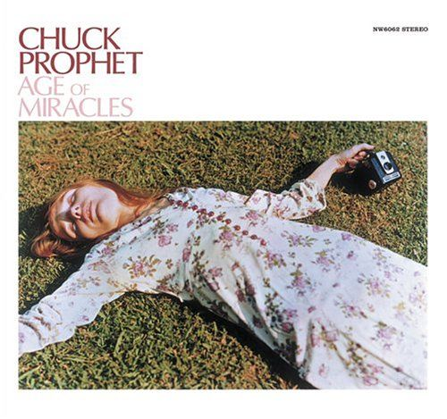

# You Did.

刚看完纯粹的美国式电影[**《Teeth》**](http://www.verycd.com/topics/269788/)，这部电影之后男人们在ML时是否会有所顾忌？电影并没有强调视觉上的感官刺激，也不算一部上乘之作。"Vagina Dentata-Mythology”源自阴道里长牙齿的传说，而所谓恐惧，大部分来缘于人类对未知世界的担忧以及对阴暗世界的猜测。也许还可以追朔到各地各时期存在性器崇拜的历史痕迹。  
  
事实上这部电影一点也不恐惧，它讲述的是“生我之门灭我之道”，男人们通过各种方式获得性，而女人又会以性来报复男人。大概就是这部电影所隐喻的含义？  
  
整部电影结束后，我上百度确认“阴道是否会长牙齿”的疑问，象我一样关心此问题的人不在少数，妇科专家给出一个坚决地否定。印象深刻的还有[**Chuck Prophet**](http://music.sina.com.cn/yueku/s/20138.html)演唱的片尾曲[**《You Did》**](http://www.diymusic.com/modules/jamroom/player.php?type=music&id=198990)，喜欢他的声音，规律的节奏感，旋律也好听！该歌曲被收录在“Age of Miracles”专辑里：  
   
i got a letter this morning  
i got a letter this morning  
i got a letter this morning  
  
who put the "bomp" in the bomp-shooby-dooby-bomp  
who put the "ram" in the rama-lama-ding-dong  
you did  
  
i got a letter this morning  
who put the "bomp" in the bomp-shooby-dooby-bomp  
who put the "ram" in the rama-lama-ding-dong  
you did  
you did  
  
wake me up if i should drift away  
i don't wanna miss a thing  
take my hand and lead me all around  
i don't care  
where we're going  
  
who dug the crude and made it flow  
who proved that anything was possible  
you did  
  
i got a letter this morning  
who built the house and brought it down  
who raised the roof and never made a sound  
you did  
you did  
  
i got a letter this morning  
wake me up if i should drift away  
i don't wanna miss a thing  
take my hand and lead me all around  
i don't care  
where we're going  
  
i got a letter this morning  
i got a letter this morning  
i got a letter this morning  
who rose right out of the morning mist  
opened my heart like a baby's fist  
you did  
  
i got a letter this morning  
who cleared the static and made it sing  
who put the wheel on the gravy train  
you did  
  
i got a letter this morning  
you did  
wake me up if i should drift away  
i don't wanna miss a thing  
i got a letter this morning  
take my hand and lead me all around  
i don't care  
where we're going  
  
who put the "flip" in the flippity-flop  
who put the "hip" in the hippity-hop  
who put the "boom" in the boom-boom-shaka-laka  
you did  
  
i got a letter this morning  
who put the "bomp" in the bomp-shooby-dooby-bomp  
who put the "ram" in the rama-lama-ding-dong  
who put the "wang" in the wang-dang-noo baby  
you did  
  
i got a letter this morning  
i got a letter this morning  
i got a letter this morning  
  
i got i got a letter this morning  
who put the "flip" in the flippity-flop  
who put the "hip" in the hippity-hop  
who put the "boom" in the boom-boom-shaka-laka  
you did

---

## 评论（1）

**lusfe** · 2009-05-09

阴齿，看了verycd的评论，以负面为多，是不是因为评论者以男性为多呢？

