# 咖啡时光

两个人，两杯咖啡，两碗鸭血粉丝汤，一部相机，一个下午。  
有一些快乐分享，有很多感受交流，也有乱七八糟的抱怨要排泄。  
  
认识久的人很多，能坦诚交流并分担彼此内心的对象却寥寥无几。社会上多的是吃喝玩乐的伴儿，既浪费精力也浪费金钱。我们都遇到过当面微笑转身捅刀子的所谓“朋友”，人性就是这样丑陋的！千万不要以年龄来判断人类的纯洁、善良、阴险与狡诈，也不要怀疑“相从心生”的道理哦，对“脸不正、皮笑肉不笑”还是近而远之的好。  
  
在各式面孔中既认定对方作知己朋友，会接受所有好和不好，矛盾当面交流，建议直接提出，对外维护好友形象和利益。除了这些基本原则外，喝咖啡时还谈到“真诚而稳固的友谊是需要时间过滤和沉淀的”！信任是所有稳定关系存在的前提，那么好吧，让我们保持对彼此的信任继续分享下一个7年。  
  
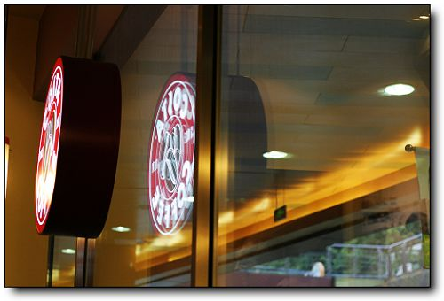   
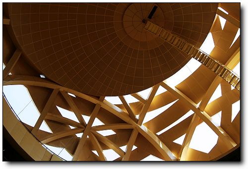   
  
明天是母亲节，商家非常及时地提供地方供顾客写下只言片语；  
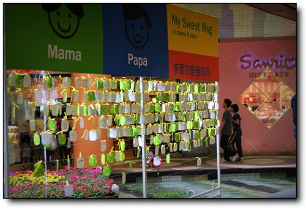  
  
妈妈，我爱您！  
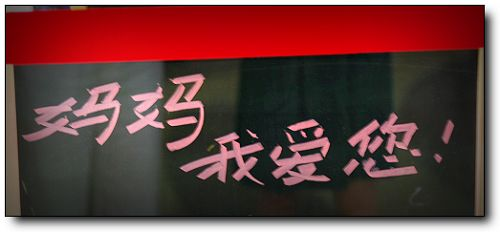  
  
约了下午一起喝咖啡。   
路上打Sherry手机，占线...  
到她家门口再打，还是占线...  
换打座机，号码有误...啊呸...  
那么发个短信吧，终于与组织取得了联系...  
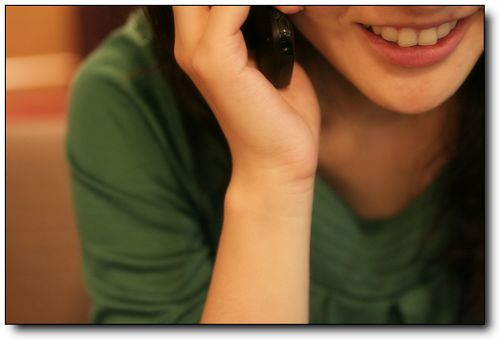  
  
在我火急火燎千方百计联系她的时候，估计她就是这个表情在与同学侃大山。  
虽然我有迟到的陋习，但却缺乏耐心等待别人迟到，啊...那个放火...点灯啥的比喻一下比较恰当；  
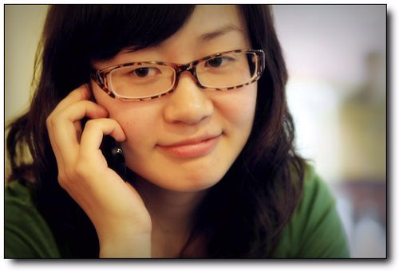   
  
真是心有灵犀，不约而同地都穿了绿衣衫见面，修炼到这份儿上不容易啊！  
有意思的是常一起厮混的好朋友连生理周期都会越来越接近（包括网络通讯的方式），即使分隔两地。  
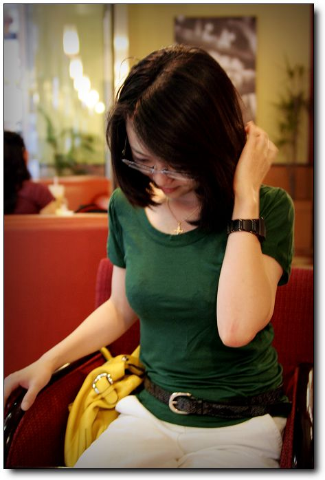   
  
粉嫩的肤色，黑油油的头发，醇红色的地板，熟绿的连衣裙，艺术吧？  
不露脸的摄影的确带来美好想象，可她露着兔子牙柔软而甜蜜的笑脸更可爱。  
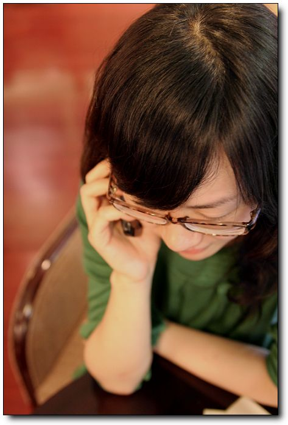   
  
据说北京满大街都是短发，不管年轻的还是年老的，有人恨不能赶紧将头发留长，南京恰恰相反，这会Sherry看到满眼一样的中长卷发腻歪极了，就当我们义务地改善一下人群形象的单调也好~不知是过了新头三分丑还是自己渐渐适应，我已经接受自己的短发了。  
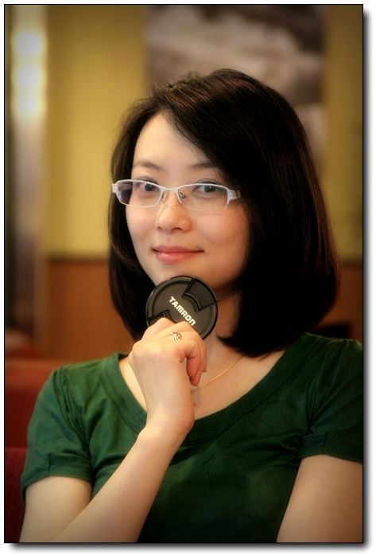  
  
Sherry进去咨询冰沙的事情，为傍晚电台电话直播采访做准备；  
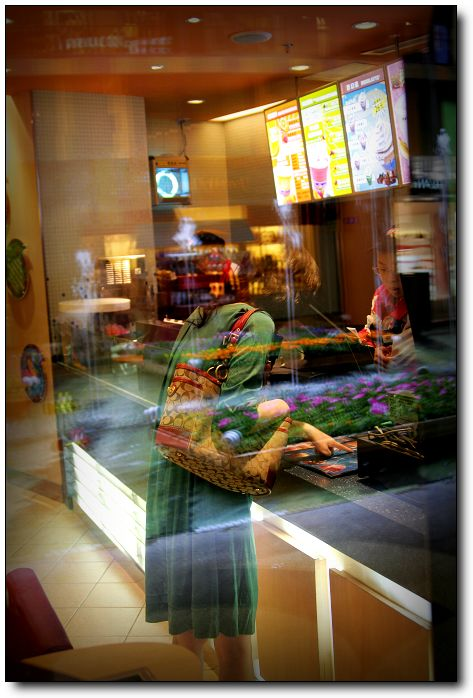   
  
如果是晚上，这些喷泉会发出五彩亮光，会很好看吧？  
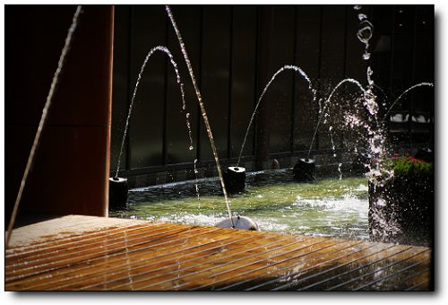  
  
看到这个头戴粉色花朵的女孩儿，肃然起敬，真想冲上去和她握个手，鼓励她继续这种勇敢的我行我素精神！  
  
有次在飞机上和一个女孩聊天，她高中自己联系去了英国。在女校英国同学们除了学习外还兼会多种乐器，以及马术之类的技能，这是最令中国留学生感到力不从心的。学校里平时以黑灰衣服为主，所以一有活动女孩们喜欢在头发上戴粉红或大红的鲜花，而且看到粉色的东西会好喜欢...这样啊？  
  
国内头上戴花最著名的当属杨二车娜姆，网络上对这个女人极尽讽刺挖苦，无论是因为她头戴大红花还是颇具争议的表达方式亦或个人私生活，在我看来完全没有必要，每个人在不影响他人利益的前提下为什么不可以按照自己的方式活着？在制造并传播流言蜚语的评论者中，我坚信男性所占比例会高于女性。现在你在人群里打一秆子下去能打中几个纯爷儿们？俗气的女人热爱制造并传播是非，男人的八卦功夫也愈来愈彪悍，这世界除此之外好象没别的美好事物存在，太匪夷所思了。  
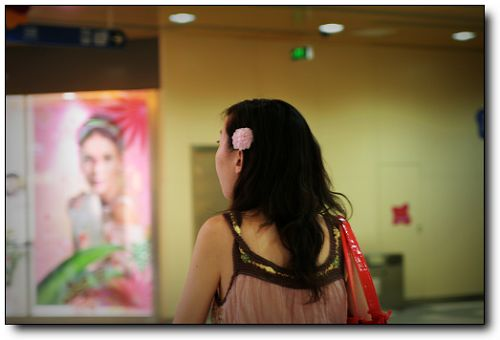   
  
这个“街拍”拍得懒呢，坐椅子上不带动一下，端起相机就拍。  
南京MM们审美意识比往年有提高，赞一个！否则连我这个女人都会为“满街尽是华欣妹”而感到在这个城市里生活着的悲哀。  
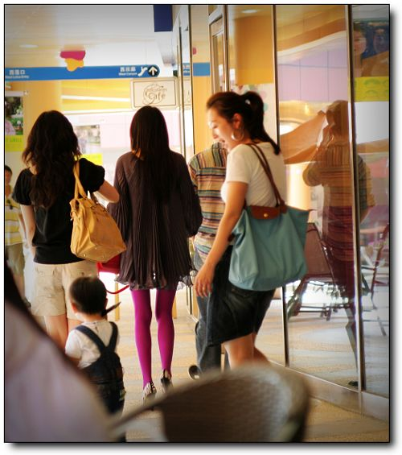   
  
哈哈~两个人吃鸭血粉丝汤吃得都很投入啊，Sherry就差挽起裤管下去捞了；  
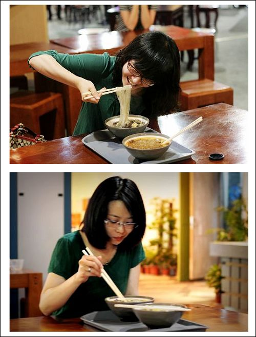  
  
“回味鸭血粉丝汤”空着很多座位，倒是又麻又辣的川味小吃人多多哦。  
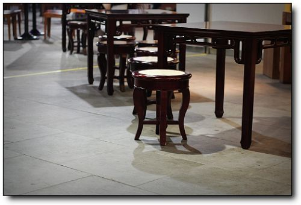

---

## 评论（19）

**[prettymom](http://prettymom.org)** · 2009-05-09

both you and your friend are wearing green, is it coincidence or what? :)  
it’s always nice to go out with friends and chats. i miss that.

**Christina** · 2009-05-09

是巧合啊，没有预谋的，呵呵！

**喜刷刷** · 2009-05-09

若不是好朋友，吃粉丝的不会那么忘我，写旁白的也不会那么传神。呵呵，很心满意足的周末呢。

**Christina** · 2009-05-09

哈哈哈哈哈哈哈~~~~~Sherry吃粉丝的样子笑死我了~~~~~~~~~~

**[一鸣](http://blog.sina.com.cn/wwsyyc)** · 2009-05-10

咖啡店好像很不错哦，下旬去南京分公司出差，茶介绍一下吧，在什么地？

**Christina** · 2009-05-10

水游城的COSTA咖啡店。

**[一鸣](http://blog.sina.com.cn/wwsyyc)** · 2009-05-10

谢了，以前在上海分公司的时候，每月去南京，常和同仁去的是南大门口的那个书吧谈KPI，想想挺对不住书吧的氛围的。
这个月去南京，就请同仁去COSTA咖啡店，效果应该会好些，呵呵。

**Sherry** · 2009-05-10

晕~  
恶搞的照片也放上来啦。。  
娱乐大众了。。

**候鸟** · 2009-05-10

Sherry的牙真好看！

**[山树](http://shanshu.blogbus.com/)** · 2009-05-10

衣服色调一致，眼镜框也差不多。哈哈，志同道合者。

**jiajialing** · 2009-05-10

鸭血粉丝阿。。。口水哗哗的。。。。。  
S美美的眼镜蛮不错的哦。。呵呵

**大姜炖去** · 2009-05-10

sherry的那张电话照真是憨态可掬，呵呵

**bing** · 2009-05-11

身材不错哦

**[三月四月](http://11)** · 2009-05-11

我常觉得有时候和女伴一起出行，开心的程度超过和男人出去，特别放松，彼此迁就

**邃** · 2009-05-11

哈哈，这么热闹了，第十四张照片留下个背影美女哦。还有可爱的宝宝和年轻的妈妈。

**Michael** · 2009-05-11

橄榄绿看起来很精神

**lilian** · 2009-05-11

母亲节跟LG也去了COSTA，那个大杯撑得我晚饭也省了。呵呵，好久没跟组织联系，这个周末想约人去吃小龙虾了……

**viola wang** · 2009-05-11

nice shots

**Ivy** · 2009-05-12

鸭血粉丝汤，想死我了。

