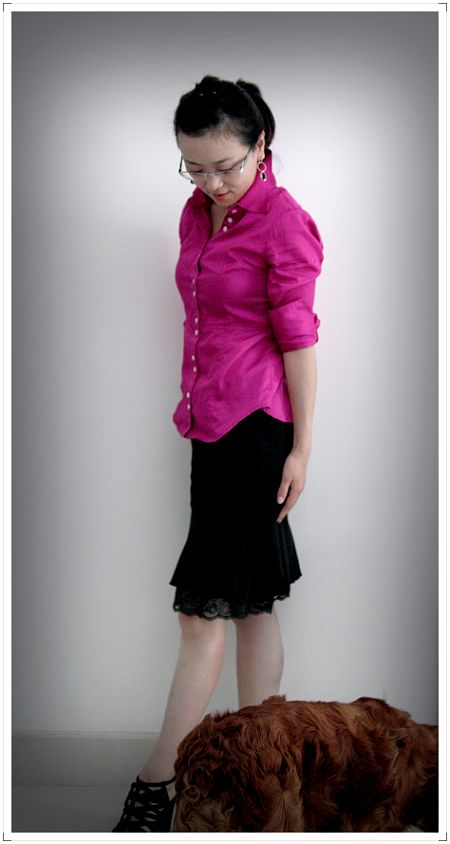
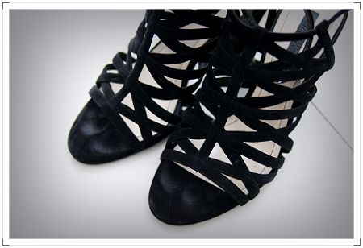

# 闷

下了雨的早晨显得有些闷热，办公室的中央空调停了，房间象一个闷罐子。  
闷着毛孔和呼吸，闷着心情。  
外在的力量是否足够支撑得起内在的快乐？  
今天，就让今天这样过去吧~  
  
\*\*\*\*\*\*\*\*\*\*\*\*\*\*\*\*\*\*\*\*\*DRESS BLOG\*\*\*\*\*\*\*\*\*\*\*\*\*\*\*\*\*\*\*\*\*  
   
   

---

## 评论（18）

**wenzi** · 2009-05-12

哈哈，有个小家伙跑来偷影了哦。

**喜刷刷** · 2009-05-12

很少见你用发卡，来个特写啊

**lilian** · 2009-05-12

换凉鞋了呀，我还坚守着丝袜和皮鞋迟迟不肯进入夏天呢，呵呵。

**Christina** · 2009-05-12

特写：  

**默默** · 2009-05-12

呵呵！罗马风格的凉鞋，挺复古的。好看。

**Christina** · 2009-05-12

大多时候是三角架帮忙。

**shao ye** · 2009-05-12

the colour of your top is lovely

**Christina** · 2009-05-12

呵呵~在上海买的，一直没穿，觉得有点长…

**Sherry** · 2009-05-12

鞋子我喜欢，只是这高跟我不敢穿了，会显得我瘦得更飘逸。。

**Christina** · 2009-05-12

Sherry，你比我高四公分呐，我穿了这鞋子才和你一样高呀，和我见面的时候还是穿平底鞋好了，呵呵！

最近我胖了5斤，101斤了，怪不得有人在电梯里问我是不是胖了呢，先胖脸的人总是很倒霉滴！~

**lilian** · 2009-05-12

衬衣长的话可以里面配个抹胸或小背心穿，也挺好看的!

**Christina** · 2009-05-12

不是肥啊是长，而且背后象扇子似的造型，塞裙子里后面鼓着，也许配紧身裤会好点吧？

**lilian** · 2009-05-12

对啊，配上抹胸衬衣就可以敞开或只扣一二粒扣子，底下配个紧身七分裤啥的，这样视觉上上衣过长的比例就缓和多了，可以试试看，不一定每个人都喜欢的，呵呵！

**喜刷刷** · 2009-05-12

小T每次都可以好脾气地有求必应，有问必答，真感动哟！这灰灰的天被你这一抹红提亮不少呢

**邃** · 2009-05-12

裙子还是蕾丝的，上面配粉红色的，太有创意了。  
唉，受你小小的影响，我最近爱穿平底鞋了，你却一双一双的高跟抛出来。

**蚊问问** · 2009-05-12

这个天就是外面凉屋子里热 我要到外面打地铺睡觉去

**大姜炖去** · 2009-05-12

好像是没休息好

**Jasper** · 2009-05-13

LOMO style~~~~

