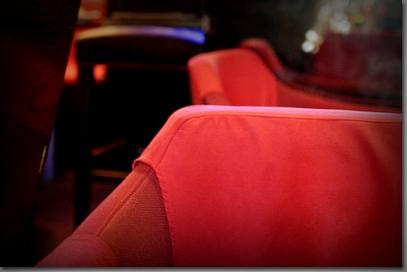
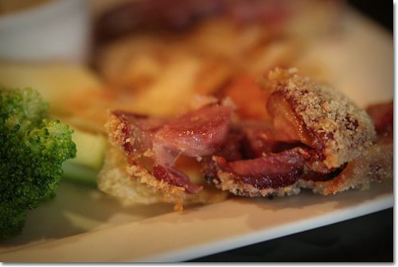
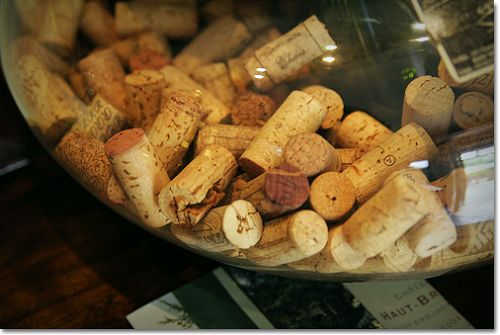
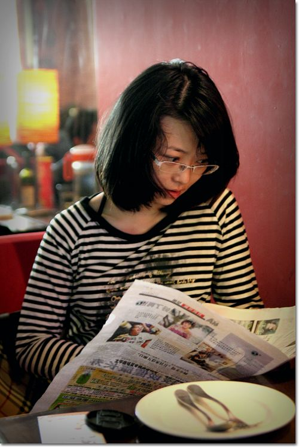
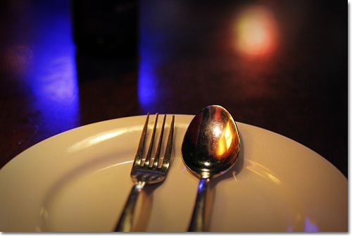
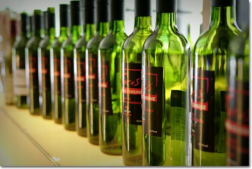
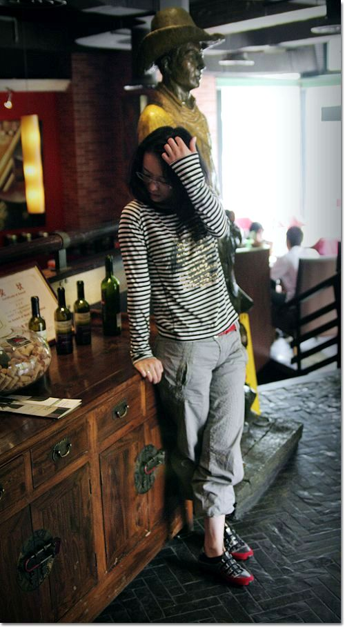
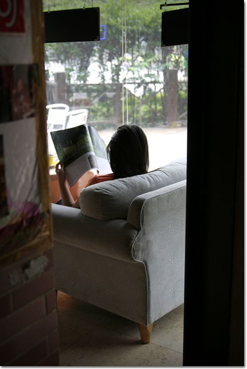
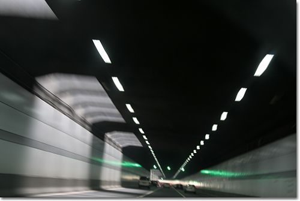

# 周．末

痛恨不属于自己的周末。  
即使是悠闲的。  
  
  
  
很喜欢德国猪手配酸菜和土豆泥，可是这家将土豆泥换成土豆片，酸菜直接用韩国泡菜充当，看在猪手烧的不错的份儿上能接受。佐料用了我喜欢的奶酪加了芥末搅拌在一起，味道很好。  
   
  
  
随手拿起别人的报纸翻了翻，很.....久没看报纸了，这是下一周电视节目预告的报纸，小时侯我家也订的。自从人类有了电脑和网络还需要报纸吗？是啊，除了新闻其他电视节目也很少看了...  
  
  
奇怪吧，没有餐刀。上菜的顺序也乱得可以，汤在主菜之后才上来。虽然没那么讲究，但既然打着西餐厅的招牌好歹象那么回事吧，也许这就是一个吃快餐的地儿？  
  
  
刷上同色油漆应该也好看~  
  
  
着实被一大盆瓶塞吸引了，这么多瓶塞一起呆着也挺壮观的，想起MVM收集的葡萄酒瓶塞。look！我靠着的是一个中式仿古柜子，细看下来整个餐厅的装修装饰象是吃简餐的环境，而菜谱上除了70%的西餐外还有韩国和墨西哥菜。真太好了，这混搭风无处不在~  
  
  
餐厅里三五对妈妈带着小小孩来吃饭，星期天爸爸们都去哪儿了？人生果然跑不出规律这玩意？路上几次塞车也是学校门口接孩子的父母影响了交通，有孩子的人生都这么辛苦？为什么呢？  
  
  
喜欢隧道里镂空的设计，据说上面是空中花园。  

---

## 评论（9）

**bing** · 2009-05-17

我也近视挺厉害的，但只是在看东西的时候戴，平时不戴，不美观啊：）本来100%的美女，戴上眼镜，只能99%啦

**Christina** · 2009-05-17

有60%就满意了，99%过奖了。

**喜刷刷** · 2009-05-18

呵呵，原先周末去听歌的酒吧已经变成我中午吃商务套餐的地方啦。有了这个镂空的隧道，我去火车站只要15mins。

**[少爷](http://jennyshaoye.blogbus.com/)** · 2009-05-18

这个地方看起来不错嘛.应该就在南京吧?

**Christina** · 2009-05-18

对呀，是在南京。

**邃** · 2009-05-18

你不经意的美才让人心动，第七张的照片看上很温柔。  
这里貌似西餐厅，不过木漆的椅子的出现又不大像，什么类型的餐厅有这样的布置。

**Christina** · 2009-05-18

什么生意都想做，什么风格都有，这种餐厅南京很多。

**lilian** · 2009-05-18

奶酪加芥茉会是什么味道~~

**sherry** · 2009-06-30

hey,能告诉我这是哪家么？

