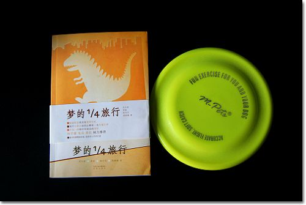
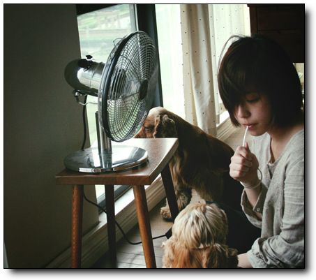
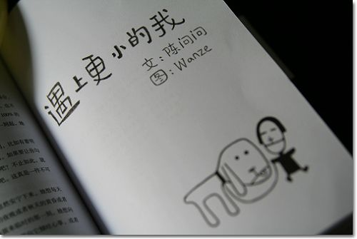
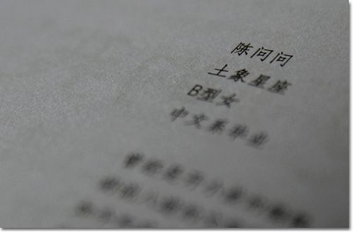
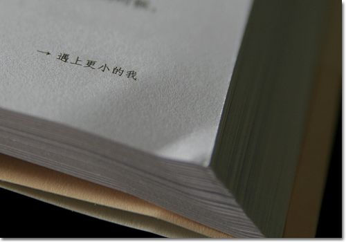
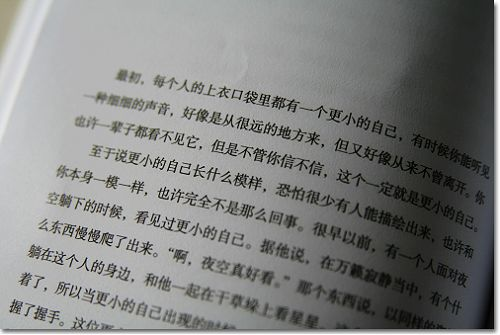
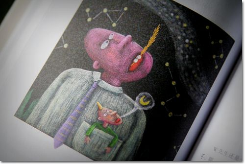
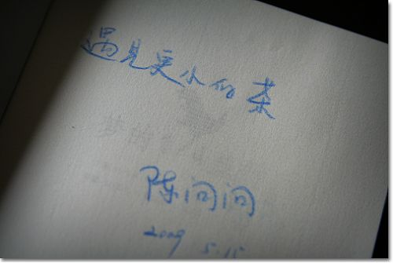
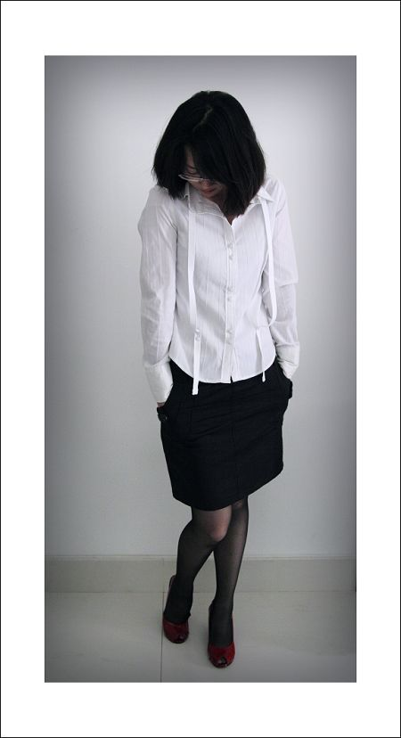
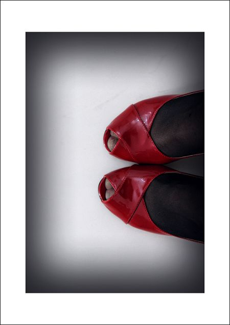

# 陈问问：遇上更小的我。

收到陈问问的礼物，一个给我，一个给luke。  
   
  
清新柔美的“陈问问”同学，超爱这张相片的氛围！  
她是一个低调的写手，往往低调又是和才华联系在一起的。  
   
  
[**“陈问问”**](http://mosquito511.blogbus.com/)遇上更小的自己~  
   
   
   
   
  
  
更小的她遇见更小的茶。  
  
注意到她写字用的笔，研究了下和“遇上更小的我”封页上差不多粗细风格，细腻女子。  
我的朋友们说看多了北京女病人风格的文字，当工作生活令人疲劳的时候，喜欢看问问同学这样清淡的、点到为止，让人立刻便能愉悦又喻意深刻的小文。她的文字给读者留下清新，没有世俗气，不矫柔造作的印象。如此清淡的风格没有一定的内功，是很难模仿的。记得以前有人曾说过，越是新手越喜欢用华丽的词藻，就是老罗讽刺的“文坛装B犯”。大师们写到后面词汇越来越简单......看来写作也有“禅”学在里面？  
  
陈问问的blog地址：[**http://mosquito511.blogbus.com**](http://mosquito511.blogbus.com/)  
先睹为快：[**梦的1/4旅行**](http://lz.book.sohu.com/serialize-id-12795.html)  
  
   
  
\*\*\*\*\*\*\*\*\*\*\*\*\*\*\*\*\*\*\*\*\*\*\*DRESS BLOG\*\*\*\*\*\*\*\*\*\*\*\*\*\*\*\*\*\*\*\*\*\*  
白色隐型竖条纹长袖衬衣，必须穿上长统丝袜。这时候的办公室比较冷。  
某年流行“背带”购进的衬衣，背后为交叉状背带，小酷一下。  
   

---

## 评论（11）

**喜刷刷** · 2009-05-18

小蚊子啥时开签售会？没有签名儿的偶不买，呵呵～～～

**Christina** · 2009-05-18

你先买一本，然后找她签名就好啦：D

**邃** · 2009-05-18

这身衣服超美，就喜欢黑白相配风格的衣服，爱死了。

**Christina** · 2009-05-18

用啊，类型很多，根据需要使用~

**邃** · 2009-05-18

陈问问同志的照片拍的也很有韵味，她叼着棒棒糖的样子很文艺，不知道这样说是不是很酸，呵呵。

**Christina** · 2009-05-18

ABCDE都用~

**Christina** · 2009-05-18

这么复杂的问题得写篇论文给你啊，呵呵~  
用香水看心情和环境，没那么刻意在里面。

**shao ye** · 2009-05-18

I like her as well. Hope I will receive the book by post soon.

**大姜炖去** · 2009-05-19

照片里的那只小狗和Luke长的好像

**Christina** · 2009-05-19

因为问问同学养了两只LUKE这样的可卡啊~

**coco** · 2009-05-20

7楼的是想让你在ABCDE后面注明各种香水名称。你就告诉人家一种来，阿急人啊，呵呵。

