# 有朋自远方来，不亦乐乎。

晚上在人民大会堂看苏格兰芭蕾舞演出，和Hellen约了在1912吃饭，这样车可以停在1912地下车库，吃完饭走到人民大会堂就可以了。  
  
Hellen这次回国比上次要丰腴许多，印象中很小巧玲珑的身材好象整个变大了一号。皮肤超好，让我这样锈掉了的肤色好生羡慕啊。她既是职业女性又是一个孩子的母亲，过着如意而安定的生活。质疑：从未怀疑过那些复制出来的生活方式吗？她很坚定地回答“没有”。也许正是没有反复折腾，人生才积累下多出常人的幸福吧？  
  
1912泰煌，我还是比较热衷泰国菜滴~  
南京最早的泰国餐厅在湖南路美食一条街，吃饭时间客人多的要排队，那钱赚的真过瘾！  
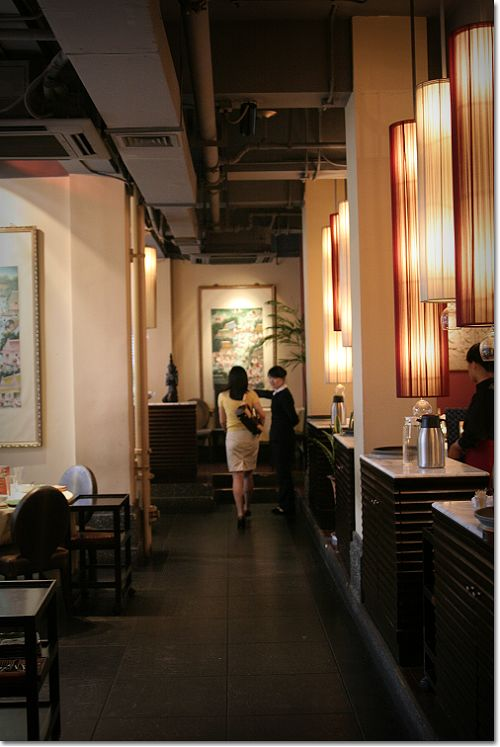  
  
Hellen点菜Ing~  
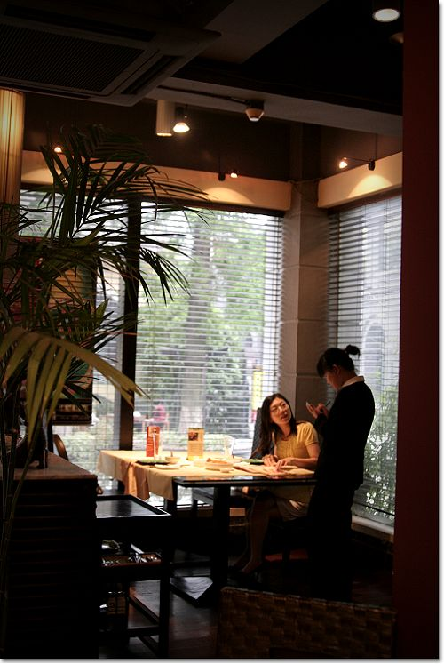  
  
餐前小点“虾饼”，巴黎的中餐厅餐前也是这种小点，国内大多是瓜子一盘，或酸豇豆和花生米各一碟。  
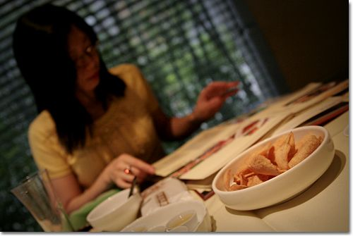  
  
位于镜头最边缘的我好象变形了？  
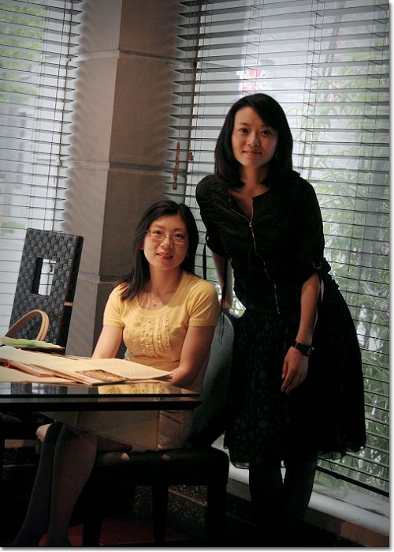  
  
哈，请一位拿炮筒的器材党帮我们俩拍的合影，电脑上一看...对焦在我们身后掩面的女人...两张合影均对焦在别人身上....汗！永远不要被“貌似”所蒙蔽~当然要宽容待人，可是高标准总是自然而然针对高配置的人啊~  
  
  
看完舞剧去喝一杯COSTA吧，这个来自英国的意大利口味、貌似快餐咖啡又保有浓郁咖啡味的咖啡.....恩哼...有点饶口.....颇受我们喜爱，每周来一杯就可以解决对咖啡的念想。这天晚上的两个女店员热情而可爱的帮我们拍照，热烈讨论相机和摄影，遇到喜欢摄影的人还是很有意思的~   
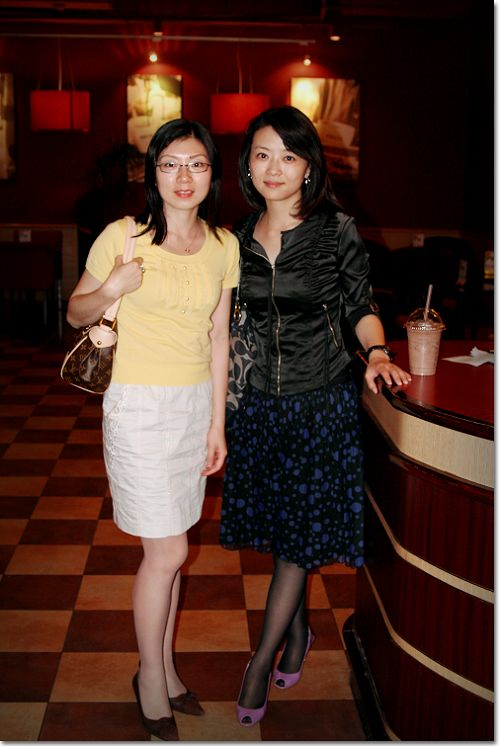  
  
鞋子颜色是今天DRESS BLOG的败笔，应该换双黑色鞋就好了。  
哪晓得我就是那么想穿这双鞋出门呢？  
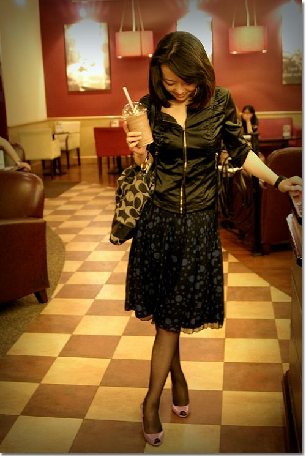  
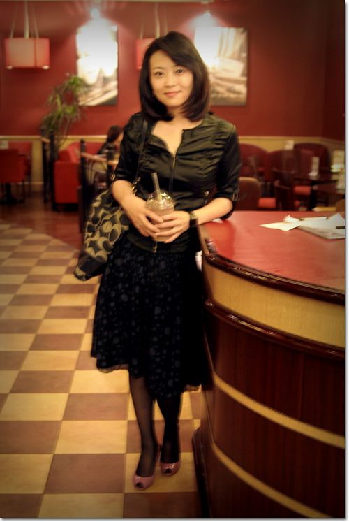   
  
好的音乐会让人毛孔张开，好的舞蹈会让我蠢蠢欲动，胸腔里蕴藏着舞动的激情。上一次看[**芭蕾舞剧《大红灯笼高高挂》是在2005年**](http://lifetea.org/article/301/)，多么久远的事了....看到那时的自己...用一个朋友的话讲：“那发型象被发配边疆的女教师。”今晚两段表演，更喜欢前者。后一段《喜从天降》看不出剧情，舞蹈动作相对简单，群舞不整齐。里面两个亚洲女舞者，鼻子塌得可以，不过舞蹈功底很扎实。  
  
一两个领舞并不能代表整个团队的水平，只要看看边上或后面演员的表现，就可以估量出这个舞蹈团的水准。Hellen说好喜欢在拉斯维加斯看的《歌剧魅影》，整个剧院就为这一部剧建造，常年演出，观众席俨然置身于戏中。对一个从未去过北美的人讲这些简直就是打击，这个先记下，等哪天看过之后再找你讨论~  
  
由于奔驰赞助演出，想来拿着免费票的观众较多，孩子们也不少........甭说着装，能安静就是万幸。摄影器材党也不少，我身旁两个男人为拍摄位置小争了一下...请多给这个城市增加些文化文艺演出吧，难得一场，大家受宠若惊地抗着大炮筒、自备折叠椅，往中间走道一坐，怪可怜的。  
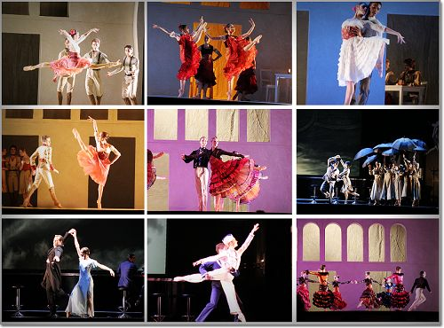   
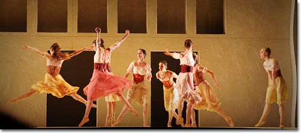   
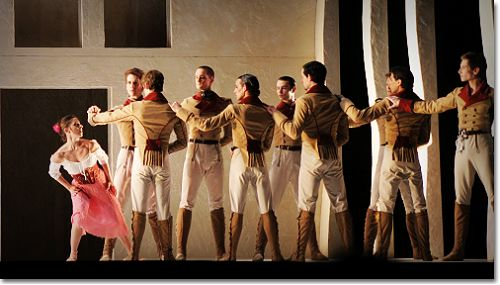   
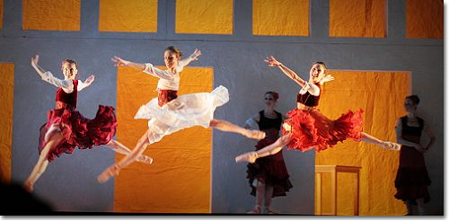   
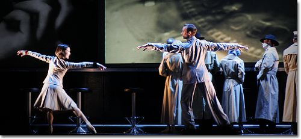   
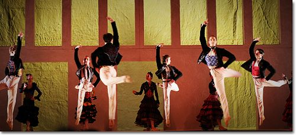   
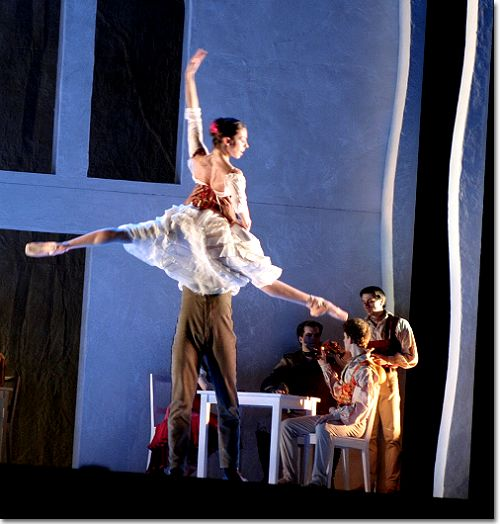   
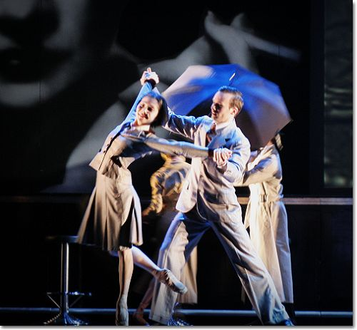   
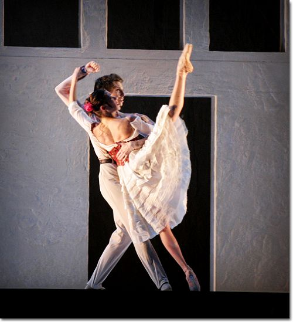

---

## 评论（16）

**Ivy** · 2009-05-20

我每次看完舞蹈表演都心情超好。自己也蠢蠢欲动。只是最近较忙。平时回去上上课。Christina还在学salsa 吗？

**[少爷](http://jennyshaoye.blogbus.com/)** · 2009-05-20

哇，茶那么快又到了北京？歌剧魅影，你朋友说的一点不假。我很乐意请你到该剧的故乡，伦敦来看喔：）

**Anyayaya** · 2009-05-20

去了你看大红灯笼的联接,果真有女教师气质啊,呵呵!

**Christina** · 2009-05-20

亲爱的Jennifer，南京也有人民大会堂啊，呵呵~《歌剧魅影》在英国也是常年演出的吗？

但凡教师都喜欢管人，有点变态，所以我最好还是别有类似形象的好！

**邃** · 2009-05-20

Hellen看上去很淡定，喜欢这种淡淡的气质。

**itsmin** · 2009-05-20

韦伯的音乐剧真的很棒。还没有看过现场的《歌剧魅影》，遗憾呐。

**coco** · 2009-05-20

喜欢这款裙子。只有足够苗条才能穿得这么好看、有女人味。咋、咋，想念咖喱蟹……

**Christina** · 2009-05-20

韦伯是指潘纬柏吗？请不要因为开个玩笑而晕倒啊~哈哈哈哈~~Webber的音乐剧我也没看过现场也，打击啊~Webber就是以《歌剧魅影》成名的吧？

**Christina** · 2009-05-20

Ivy，SALSA学习停了，呵呵~

**itsmin** · 2009-05-20

说的就是潘纬柏呀。好像他还会跳舞呢。哈哈。W是不是靠《歌剧魅影》成名有待考证。不过说该剧是W最成功的音乐剧大抵不会错的。。。众多大牌歌手演唱过里面的歌曲，最喜欢Babra Streisand的版本，呃，你知道的，巴巴拉，就是那个老布什的老婆，小布什的老妈啊；）

**Sherry** · 2009-05-20

舞蹈演员抓拍的不错啊~ 赞一个  
混搭是最难掌握的，已经不错啦。  
气质好不怕穿错衣服~

**lilian** · 2009-05-20

怎样才不算是复制出来的生活方式呢？我还是挺羡慕茶的生活方式的，但也许无论我们怎么折腾，生活最终都难免趋于雷同。

**wenzi** · 2009-05-20

最近聚餐比较多嘛。有吃有看，日子过的挺多姿多彩的喃。我也跟着过过眼瘾。

**[薇安](http://bulaoge.com/?vivianxu)** · 2009-05-20

我也喜欢泰国菜

**暴暴** · 2009-05-22

舞台照拍的很好哎，抓的瞬间都很有张力

**喜刷刷** · 2009-05-22

刚想说泰煌，一下就被芭蕾吸引了，可惜错过了～～～演出那部分拍得真好，尤其2，4，9。茶的位置一定不错。

