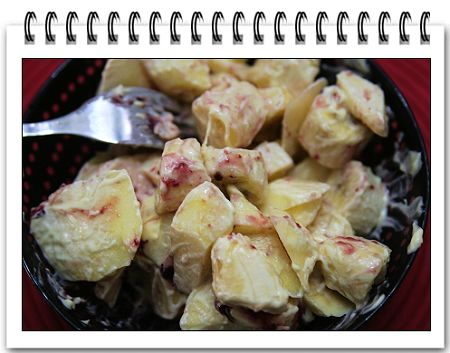
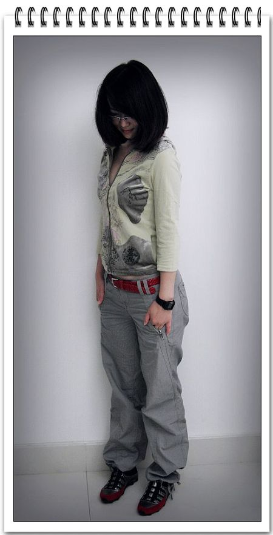
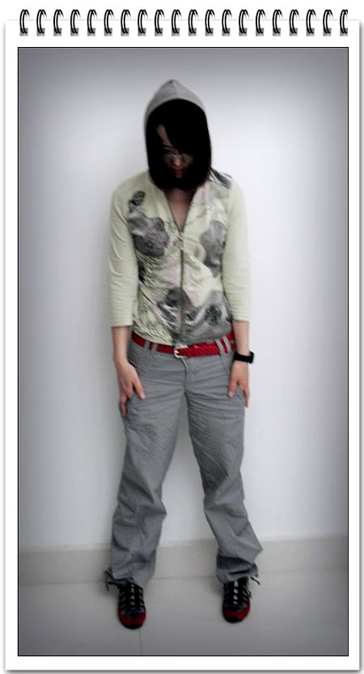
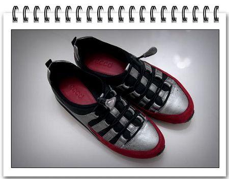

# 苦咖啡效应

一直等待天气预报中的雨天，怎么等也没等到...耐不住昨天中午洗了车，晚上就下雨了，NND~凌晨两点睡觉，一早8：36起床，8：50出门，9：04分按下指纹...早晨的飞车犹如喝下一杯苦咖啡之后...  
  
哇，刚看到《我猜我猜我猜猜猜》里的嘉宾有王若琳，不好看气质也一般.......真是应了“声音好听的一般长得都不好唉”。  
形象重要吗？不重要。  
重要吗？重要啊！  
尤其是文娱圈。  
  
自制水果色拉，图省事只切了苹果和香蕉，拌上蓝莓和色拉酱，要是加上冰箱里的西瓜块会丰富这份色拉的色彩。味道不错。  
   
  
\*\*\*\*\*\*\*\*\*\*\*\*\*\*\*\*\*\*\*\*\*\*DRESS BLOG\*\*\*\*\*\*\*\*\*\*\*\*\*\*\*\*\*\*\*\*\*\*\*\*  
不是去玩是去上班，睡得晚起的迟，哪有时间找衣服~  
   
   

---

## 评论（17）

**coco** · 2009-05-20

很不错啊！小周末么，休闲点无所谓。我一定要减！减！！减！！！你送的王若琳，无比性感的声音，常常伴我，在路上。亏好上次她来水游城签售没去成，呵呵，保留自己对她的想象……

**[quinn](http://simplenice.wordpress.com.cn)** · 2009-05-20

第二张要是一点脸都不露，用头发全遮住就好了，就会有点搞笑还带点恐怖的效果

**lilian** · 2009-05-20

第二张有点雷人的！昨天下班后想去找一条搭扣简洁的红皮带，没找着，只好捡了条黄色的回来了……

**nz** · 2009-05-20

茶的衣服真多！！：）

**邃** · 2009-05-20

鞋子很有特色的呀。

**shao ye** · 2009-05-20

I wish I could go to work in this sort of clothes…what a boring place I work at:(

**Jasper** · 2009-05-20

哈哈！！其实第二张带的头盔~~~日本声优长的都还不错啊~~

**Christina** · 2009-05-20

楼上的怎么扯到日本配音演员上去了呢？  
那不是头盔，是衣服自带的帽子~

**jeneffer77** · 2009-05-21

很喜欢这一身呢，鞋子也很赞，好像是ecco？

**Christina** · 2009-05-21

恩，是ecco，我自己也很喜欢~

**[薇安](http://bulaoge.com/?vivianxu)** · 2009-05-21

今天超酷诶～我有时是晚上找好衣服早上起来就省事啦

**[薇安](http://bulaoge.com/?vivianxu)** · 2009-05-21

另外哦，王若林唱现场真的很差呐，气都接部上了。自从看了一次电视转播的现场演唱后再也不喜欢她了。不知道当初是怎么包装出来的。

**Sherry** · 2009-05-21

换风格啦？

**[prettymom](http://prettymom.org)** · 2009-05-22

you don’t have time to look for cloths but have time to take pics? :p  
you still look very stylish in casual wear.

**喜刷刷** · 2009-05-22

很帅呢，好象又回到很多年前，偶遇你的时候，那时你也这样。

**Christina** · 2009-05-22

对的，早晨时间总是很紧张，拍照都是中午进行。：P  
喜刷刷，你在漓江吗？

**喜刷刷** · 2009-05-22

我在桂林，没忘记看茶。桂林暴雨两天，放晴两天，今天又雨，唉，老天爷也有举棋不定的时候哟。

