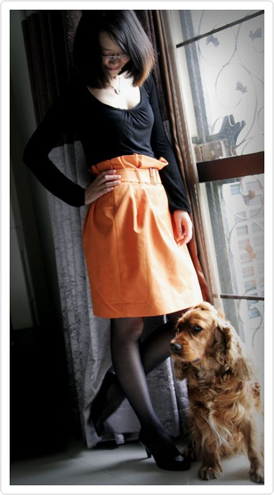
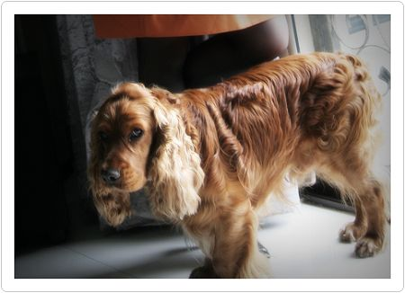
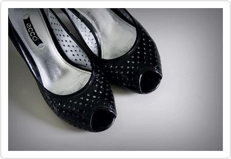

# “一股脑儿”

今天，雨。  
  
所谓走出家门才能了解世界，近期在附近的BLOG转悠多了，发现一股脑儿的扎堆真多，跟流行病似的：  
比如一股脑儿的张爱玲的“《小团圆》”；  
比如一股脑儿的“某某分割线”；  
比如数量单位一股脑儿改成“枚”，一枚苹果、两枚香蕉、三枚小心灵...；  
比如一股脑儿的日本风摄影......  
  
初遇“一股脑儿”，还是挺新鲜的。  
可身在圈外，倒也脱离了“复制风”：  
即使广播上烂播《小团圆》，不想看就不看；  
即使“某某分割线”盛行，依然用N多的小\*\*\*\*\*\*\*号；  
即使数量单位新奇到“枚”，咱还是一个苹果，两根香蕉，三颗小心灵；  
即使纯情日风犹如初恋般滋味，这里还是喜欢明朗而又实在的摄影画面。  
  
说话那么直，文字那么坦白，摄影如此写实，自得其乐在“一股脑儿”之外，这就是傻呼呼的茶风？要是一股脑儿的dress blog，多好玩啊~听说有个女孩儿用相机记录每天穿着，记录了三年，每天一张，三年下来是1095张相片，多么壮观的积累。  
  
\*\*\*\*\*\*\*\*\*\*\*\*\*\*\*\*\*\*\*\*\*\*DRESS BLOG\*\*\*\*\*\*\*\*\*\*\*\*\*\*\*\*\*\*\*  
   
  

---

## 评论（23）

**邃** · 2009-05-25

会呼吸的鞋子。广告上这么说的。  
裙子颜色很亮，赞一个。  
你家的窗帘很素，还有你住的房子挺高的吧，隐约间看到你旁边小高层的房顶了。

**Christina** · 2009-05-25

呵呵~不高，上面就一层。你看到的是我家空调外挂机：）

**[Sophie](http://www.flickr.com/photos/morena7/)** · 2009-05-25

这张视角真好, 象外国电影海报画。女主角悠闲地逗着狗，而身后又将有很多故事发生。。。

**[jansfer](http://www.jansfer.com)** · 2009-05-25

ecco

**[三月四月](http://11)** · 2009-05-25

LUCK好酷啊！超级抢镜啊！我那日买了双TATA的鞋，很喜欢，但是小了半号，又不想去换，准备委屈一下我的脚，撑大它到自己满意为止。

**Christina** · 2009-05-25

这是钟点工大姐给我拍的，哈哈~她的技术越来越好了。

三月四月，我帮你撑鞋子吧，嘿嘿~如果小的话最好去换一双，委屈脚是最痛苦的体验。

**lilian** · 2009-05-25

钟点工都能拍得这么好，茶把能利用的资源都利用了，呵呵，学习~~

**[三月四月](http://11)** · 2009-05-25

我准备送到修鞋的地方，用机器来撑大。今天你和LUCK那张拍的确实不错，角度和构图都很好。另：我也借了《小团圆》，但不知为什么，看了30页就看不下去了，觉得实在融入不进去，她的书，我唯一看完的，而且喜欢的就是《半生缘》，尤其那一句“我们再也回不去了”，让我之后的三个月，一想起来就要哭……（跑题了）

**Christina** · 2009-05-25

楼上的还没过完青春期啊~

**[三月四月](http://11)** · 2009-05-25

我今晚过30岁生日……555555，妈妈说因为下雨，她不想出门，叫我自己买蛋糕

**lilian** · 2009-05-25

哈哈，我最近正扎堆吃小龙虾呢，从杭州一直吃到上海~~

**Christina** · 2009-05-25

生日快乐~回忆起自己过这个生日时的感觉~

全世界过生日的男孩和女孩在吹灭生日蛋糕上的蜡烛之前都有人唱“祝你生日快乐”这首歌。它的词和曲都很简单上口，连三岁的小孩都能毫不犹豫地唱出来。这首歌原来叫“早安”，是米尔德里德和帕蒂·史密斯·希尔两姐妹在1893年创作的。她们的父母是一对非常开明的肯塔基州夫妇。他们坚信女子教育 ——在19世纪中期这还是个很新奇的观点——并把两个女儿培养成教师。姐妹俩，尤其是帕蒂，长期从事基础教育。作为幼儿教育的先驱，帕蒂取得了显著成就，并且几十年来一直是学前教育领域的主要发言人。从1905年到1935年，她在哥伦比亚大学师范学院任教，退休时成为哥伦比亚大学最早的荣誉退休女教授之一。

生日聚会上还一定要有插着点燃着的蜡烛的生日蛋糕。这可能是源于古希腊用插着一支蜡烛的一个圆形蜂蜜蛋糕来拜祭月亮和狩猎之神阿尔特宓斯的习俗。德国的面包师在中世纪发明了现代的生日蛋糕以后，人们就采用了类似的一种习俗，在生日祈求福神。早上做好的蛋糕点上一圈蜡烛，像是一个保护性的火环。蜡烛整天都点着，一直点到晚饭吃甜点的时候。

吹蜡烛的习惯也许跟生日蜡烛的双重意义有关。有人相信每一个生日都表示离死亡又近了一步。我们在生日聚会上庆祝的不仅是我们的成长，还有生命的短暂。因此，生日蜡烛象征着双重含义：生命与死亡，希望与恐惧，得到与失去等等。

**[三月四月](http://11)** · 2009-05-25

谢谢茶~~~~

**jiajialing** · 2009-05-25

哈，三十岁生日快乐！  
lz，现在连你们家钟点工都要给你拍照啦，我倒。。。。。同情。。。。哈哈

**小梨子** · 2009-05-25

你好，我看了你的dress blog里的搭配衣服，怎么觉得都有点搭配不对。恕我对你的评头论足！希望你更漂亮啦！  
我大概从04年就看你的博客了，还是很喜欢你的博客的。

**Christina** · 2009-05-25

哦~那请你来秀秀对的搭配~如何？呵呵~

**[红裤子](http://yongsr.blogcn.com/index.shtml)** · 2009-05-26

小团员，我倒是看完了，还同时看了胡兰成的《今生今世》。不过张爱玲的书，越看越觉得像上海又老又旧又潮湿的大房子，让人沉闷窒息。也许因为感情丰富的原因，胡兰成爱过无数个女人，光写出来的就有7—8个，真不知道张爱玲图什么。反正我不大能理解。

呵呵。。。房东阿姨借我的书看，她评论是：胡兰成一个大汉奸还把自己写的那么完美，那么多女人都爱他！

就是挺为张不值得。呵呵

**Christina** · 2009-05-26

胡兰成或许比现代男人还好些，爱就爱了，不爱就不爱…

现在好些男人明明不爱了，还死撑着骗着，外面一个接一个的换…多累啊~

**[红裤子](http://yongsr.blogcn.com/index.shtml)** · 2009-05-26

我觉得还是女人不自爱，为了生活宁愿被骗，颇有周瑜打黄盖的意味儿。呵呵。。。  
大多垃圾的男人都是被女人惯出来的。。。  
呵呵。。  
当然也是苍蝇不叮无缝的蛋，，说不清啊。。反正自重自爱我觉得对于女同胞挺重要的。

**Faye** · 2009-05-26

对于这种感情很丰富的男人或女人，一生中总是同时爱着几个，或者依次爱着几个，你有什么想法吗？

**Christina** · 2009-05-26

我的想法是最终将事情做正确就OK！

**coco** · 2009-05-26

LUCK！一股脑儿的天蝎座男人范儿。难以抗拒……呵呵。

**Christina** · 2009-05-26

Luke：“哼~~笨叔叔笨阿姨把俺的名字都给改了~~~”

