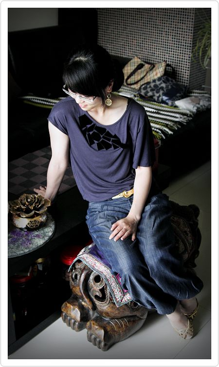
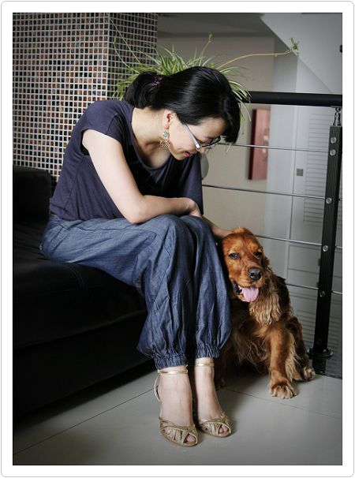
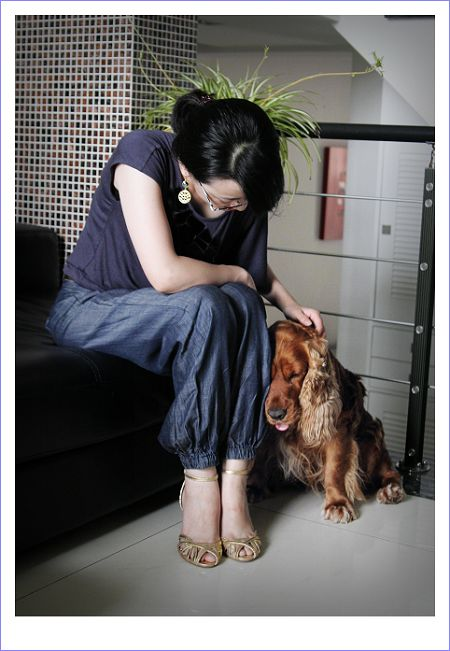
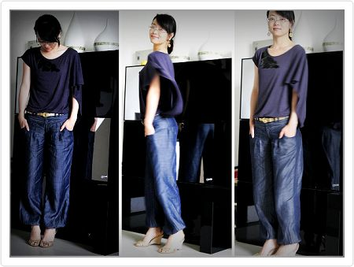
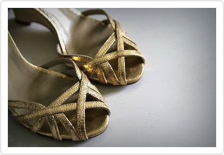
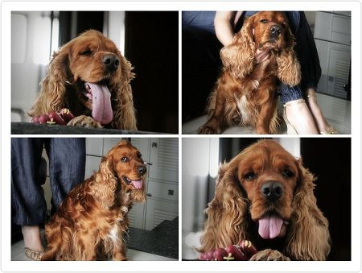

# 身体会说话

一路去上岛咖啡一路接电话，既让人焦急又令晚上的心情变得烦躁，到达时才要求挂断诉苦的电话...我必须一把倒进唯一一个人见人爱的停车位，就听哐铛一声，后保险杠蹭到树干上....靠，倒车技术好又如何？也会因为烦躁惹下另一个麻烦！不过送Grace回去的路上看到一辆后保险杆撞瘪的白色英菲尼迪G37...吼吼...G37哦...心里龌龊的舒坦开了。  
  
迷迷糊糊的Luke跟着我转悠到衣帽间，转悠到卫生间洗澡，再转悠到卫生间刷牙，然后倒在床边睡下，那时已经凌晨两点多。可我却比白天还要清醒，早晨8点起床，到公司整个身体坠啊坠啊......就要摊在地上...  
  
根据中医的看法：  
晚上9-11点为免疫系统（淋巴）排毒时间，此段时间应安静或听音乐；  
晚间11-凌晨1点，肝的排毒，需在熟睡中进行；  
凌晨1-3点，胆的排毒，亦同；  
凌晨3-5点，肺的排毒。此即为何咳嗽的人在这段时间咳得最剧烈，因排毒动作已走到肺，不应用止咳药，以免抑制废积物的排除；  
凌晨5-7点，大肠的排毒，应上厕所排便；  
早上7-9点，小肠大量吸收营养的时段，应吃早餐。疗病者最好早吃，在6点半前，养生者在7点半前，不吃早餐者应改变习惯，即使拖到9、10点吃都比不吃好；  
半夜至凌晨4点为脊椎造血时段，必须熟睡，不宜熬夜。   
  
因过劳而造成体内器官阴阳失调，就是体内器官起内讧，互相打架，最后造成器官衰竭而死，希望你不是下一个！  
  
\*\*\*\*\*\*\*\*\*\*\*\*\*\*\*\*\*\*\*\*\*\*\*\*\*DRESS BLOG\*\*\*\*\*\*\*\*\*\*\*\*\*\*\*\*\*\*\*\*\*\*  
   
  
下面两张主要是看Luke的嗲样儿~  
   
   
   
   

---

## 评论（19）

**[三月四月](http://11)** · 2009-05-27

第2张的LUKE同志的姿势和眼神，会引起所有男士的狂扁……今天这一身，我最喜欢的还是那对隐约可见的耳环

**Christina** · 2009-05-27

啊？今天的上衣和裤子我都好喜欢的~~~

**[三月四月](http://11)** · 2009-05-27

所以我说的是最喜欢，而不是只喜欢，嘿嘿……

**喜刷刷** · 2009-05-27

衣服上下都喜欢，夏日里一片及时的清凉。可是，这中医的观点怪擂人的，情愿昨晚没有过。你家狗狗越发地哀怨了。

**邃** · 2009-05-27

裤子很酷，超喜欢这样的胖腿裤，自在，舒服。

**Christina** · 2009-05-27

其实…咳、咳、咳….那是它笑的表情哎~  
姐姐养过狗狗吗？

**雯子** · 2009-05-27

衣服裤子都好看，但是我更喜欢你坐的那个大象凳子。

**coco** · 2009-05-27

女人，美不胜收。LUKE，……，有点受不了啦！

**lilian** · 2009-05-27

最近睡得太晚，又是浅睡眠，疲惫都反映在脸上了……

**[joanna](http://yanmer.cn/blog)** · 2009-05-27

超级稀饭今天的这一身，单看也都好看呢

**Sherry** · 2009-05-27

美啊，每天都好养眼~

**候鸟** · 2009-05-27

天啊，我有一条几乎是一模一样的裤子:)不知道是不是一个牌子的。布料也有点亮亮的，不过是7分裤。  
茶，你的耳环也好多啊。

**Christina** · 2009-05-28

偶的不是七分裤哎：P

**高原吧** · 2009-05-28

碰巧在这能够了解一个在南京生活的人的生活点滴．很不错．南京，南京．我又爱又恨的地儿．　但是从Christina’s　blog 我自今发掘的都是温馨．

**Christina** · 2009-05-28

感谢体会到温馨！

**[山树](http://shanshu.blogbus.com/)** · 2009-05-28

这双鞋不错。第一张照片坐在啥上面，感觉好特别。

**shuwua** · 2009-05-28

我有几乎一样的裤子，买来自己扎的裤腿，北方老太太都喜欢扎裤腿，哈哈。  
最近特别忙，昨晚一点收工，一边打字，一边与随时来到的瞌睡做斗争，作孽哦。  
今天终于放假啦。

**[光光](http://gaoguangguang.blogbus.com)** · 2009-05-28

我喜欢那面马赛克的墙。

**[少爷](http://jennyshaoye.blogbus.com/)** · 2009-05-29

这名LUKE男士好帅喔…

