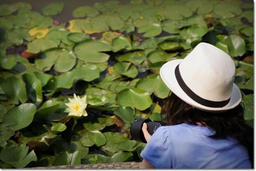
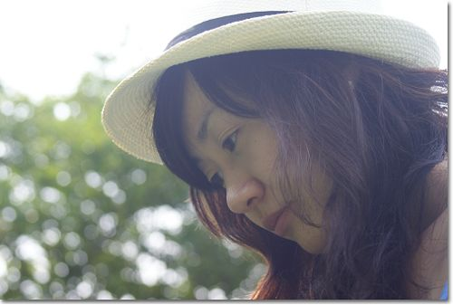

# 早起的鸟儿。。。

1865后的晚上两个人在COSAT开心地灌下一大杯咖啡，凌晨异常清醒地躺在黑暗中...睡意毫无踪影？大约凌晨三点我才渐渐睡着....不晓得她被蚊子骚扰到几点睡着的？  
  
第二天7：30接到Sherry，其实我就是为了能多拍拍照片，过过手瘾，对拍植物没有特别的兴趣，而恰恰她选的就是植物园。于是她拍植物我拍她。  
  
然而...两个人完全没有前一天的激情，犹如残兵败将拖着拖沓的身体和恍惚的意识，在闷热的空气中游走，皮肤上每个毛孔象被晒蔫了的植物一般酥软无力。我背着两个镜头和一架相机（缺一张反光布）...疲乏使我象只轻易就会被扎破的气球.....才理解“摄影是辛苦的爱好”这句话，即使起得创历史记录的早，到了植物园还是错过了树林里的晨曦......  
  
恩，摄影的后一天半把前一天半补的觉全还回去了：（  
我想过了，不搞专业不参加比赛，要娱己娱人轻松快乐。想让摄影在自己的小心灵里继续保有美好念想，千万别折磨自己。比如睡个饱觉再出门，想拍早起的太阳，前一天咱不喝咖啡，晚饭一过就扎被窝里睡觉去。  
  
更多照片：  
\*\*\*[**@1865**](http://photo.lifetea.org/v/life/0529/)  
\*\*\*[**初夏.南京植物园**](http://photo.lifetea.org/v/life/0530/)  
  
   

---

## 评论（15）

**[也许知道](http://sites.google.com/site/wsaelel/)** · 2009-05-31

现在越来越注重打扮了

**邃** · 2009-05-31

第三张的Sherry真美。

**ware** · 2009-05-31

不如穿长裙,太吓人了

**Christina** · 2009-05-31

不强求你的审美观非得和我一致：）  
要看到你本人的穿着品味，对我才会有说服力的哦~

**Ivy Xu** · 2009-05-31

SherryMM怎么瘦成这样了？看了叫人心疼呢！

**[三月四月](http://11)** · 2009-05-31

我倒觉得茶在那个MM的镜头里，特有女人味。茶好象很喜欢喝COSAT，比起辛巴克来说，是更有明智的选择。另：这么酷的场景，不带我们的LUKE去，实在太不够意思

**ware** · 2009-05-31

我在家只穿内裤,o o,没出去过

**Christina** · 2009-05-31

它。。。最近被剪成了光蛋。。。不适合出镜。。。

**Christina** · 2009-05-31

只穿内裤…没出去过…  
一个早熟的婴儿？不对啊，这天气婴儿在家光屁股兜尿不湿的~

**ware** · 2009-05-31

不是呀,到夏天了,又不出去,这样穿舒服呀

**邃** · 2009-05-31

哈哈，茶的回答真搞笑。  
不过，对于一个还没有脱离尿不湿的小P孩，就是这待遇啦。

**haohao** · 2009-05-31

能给我你的MSN麽？

**暴暴** · 2009-05-31

看了1865的片子啦，拍的很不错啊，给人的想象空间很大。你的色彩元素用的很不错啦。有的片子就好象色块组成的抽象与具像的油画

**Christina** · 2009-05-31

建议！建议啦~

**[shanshu](http://shanshu.blogbus.com/)** · 2009-06-01

第一张照片，太喜欢了。感觉很恬静。

