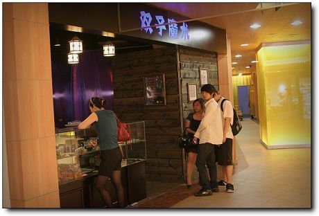
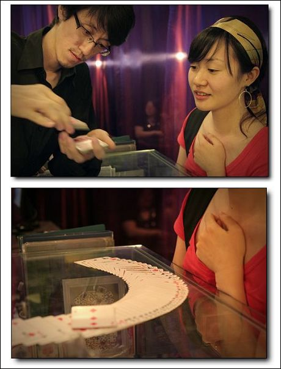
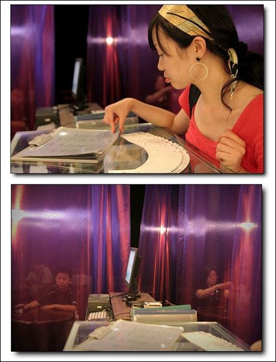

# 魔术&腔调

在水游城一楼某W.C.门口等Sherry，见一男戴着墨镜，很娴熟地在手间游走扑克牌，花样玩的很好看呢。一男一女拿一手机给玩扑克的拍视频，悄无声息之下，还是很吸引人的....突然一声“师傅，厕所在哪儿啊？”打破了魔术的诡秘气氛。  
  
我们俩去COSTA的走廊里看到一处“双子魔术”的店铺，在Sherry往里张望的瞬间，店家便手拿扑克让她看让她猜，以为是卖魔术道具的，哪知被紫色纱帘隔开的区域有专人教顾客玩魔术。我立刻想到爱玩魔术的泰森，人家几年前从网络上下载国外的魔术视频自己在家学，最拿手的是变硬币。如果我说我对魔术没多少兴趣，是不是显得很古董呢？事实上我的确对魔术没有兴趣啊~  
  
玩魔术的人一定要有腔调，现在很流行这个词哒。比如我穿着那双黑色花纹9分裤袜，即使吓着旁人依然我行我素甩出来一句“我喜欢”，比“范儿”更犀利、有型。不明白，摆渡一下就知道了：  
  
*“腔调就是夏天穿绵袄，冬天穿背心，这个叫腔调，就是做反事。   
  
另一种腔调就是能力、自信、高傲3合一就是腔调；  
比如跑步第一，考试时别人都在说这次试卷很难不知道能考的好不，而你却自信的对自己说小菜一碟。高傲就是不和低俗的人说话，无视某种人的存在，透露着一股霸气，灵气逼人的感觉，就是腔调。”*  
  
“呃，还行吧～”一定要淡淡的轻描淡写地说这话，这就是腔调。如今摆拍都不可耻了，更别说“腔调”！至少人家还掩饰在无形之中，至于掩饰技巧是否高超，看个人功力喽。  
  
玩魔术一定要有腔调，有了腔调才能增加更多魔术过程中神秘又奇异的氛围。魔术与腔调的关系就象鬼片与背景音乐，如果看到的是鬼怪灵异，听到的是喜洋洋，会是什么反应？所以说腔调很重要啦！你瞧你瞧，腔调下的魔术师手上至少戴两戒指，眼神变幻莫测大有左勾拳+旋风腿之式，形体摆动柔韧有度，腔调十足滴~  
  
Sherry抓着脑袋疑惑地走开，“我明明没看到那张牌，怎么就出现了呢？你看到了吗？”  
我，我。。。光顾着给你拍照了。。。  
  
悄悄补充一句：我很适合给自恋的人做朋友，因为我太喜欢拍人了。  
没人拍时还有自己可以拍，ayayayayaya，前面这串字母是某女友MSN名，每次看到总会浮现出她逗她家小丫头的情景，ayayayayaya~快乐啊~开心啊~就是这串字母~ayayayayaya~  
  
   
   

---

## 评论（21）

**ware** · 2009-06-01

请问茶同学是使用photoshop吗

**Christina** · 2009-06-01

你猜！  
一会问操作系统，一会问图形软件，准备打劫啊？

**喜刷刷** · 2009-06-01

不错哟，说话算话的家伙，这样迎来六一。哼哼！

**ware** · 2009-06-01

我看你没回答系统，看见图片了就问问图片了o o

**[三月四月](http://11)** · 2009-06-01

我对魔术也没兴趣，现在只要一看到刘谦，我就换台，一点也不想看

**jiajialing** · 2009-06-01

最近的片子很不错，看到你们两个。。想起了我和hankN年前在南京拿着相机，到处去扫街。。。。时光荏苒，美好的回忆。anyway，享受和朋友在一起的快乐。。enjoy,很想念你们！

**Christina** · 2009-06-01

我们也想念你，反正不是我们飞过去就是你们飞回来了~在南京相聚都腻了~

**jiajialing** · 2009-06-01

眼泪哗哗的。。。。。哈哈

**jiajialing** · 2009-06-01

BTW，“老沈”买a200了？

**Christina** · 2009-06-01

对哦~学习摄影可认真咯，目前在看什么“纽约摄影教程”，吓死我了~

**jiajialing** · 2009-06-01

我倒。。。。终于有个人可以满足你的自拍需求了，加油，sherry！

**lilian** · 2009-06-01

唉，我周围怎么就没好这一口的朋友呢，每次聚会拿出个卡片机都一惊一咋的，更不要说举个单反拍拍～～

**云过** · 2009-06-01

好时尚！！！常看到你们在一起。你坚持写了很多年了。

今天莫名的想到，几年前，一个名为“守望静静的麦田”的博客。是一个工科男生暗恋一个女孩的心情日志。细腻、感动，很温暖。 很想找到，但不知去向。

**coco** · 2009-06-02

希望多拍拍“自己”，呵呵

**Vodka** · 2009-06-02

WOW，魔术师都是帅哥，不帅简直就没了玩魔术的资格～

**Sherry** · 2009-06-02

肯定是在我眨眼的瞬间把牌换了。。嗯，一定是这样。  
佳佳，想你~ 何时回来看看？

**Jasper** · 2009-06-02

最近一段时间水游城出没很频繁啊..

**[薇安](http://bulaoge.com/?vivianxu)** · 2009-06-02

我申请做你的模特～～～～

**Christina** · 2009-06-03

好啊，找机会一起拍~呵呵~

**喜刷刷** · 2009-06-04

有腔儿的人现在真不多见了呢～～～

**[yao tao](http://none)** · 2009-07-10

we are what we were….

