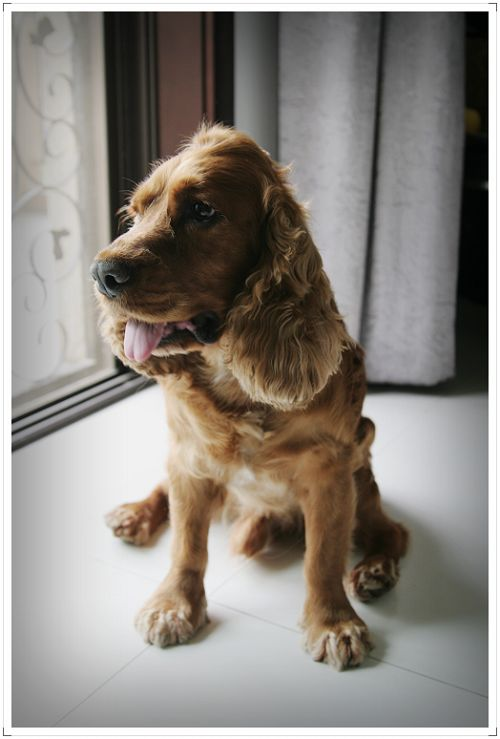
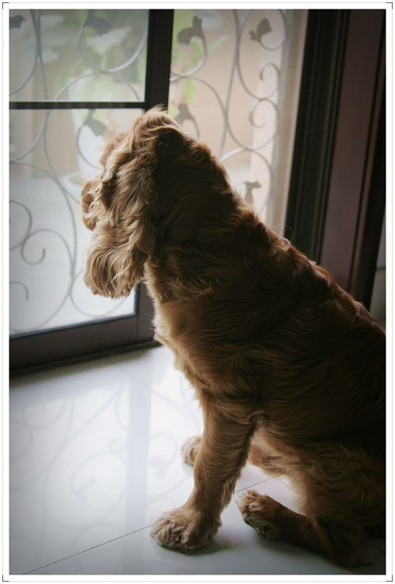
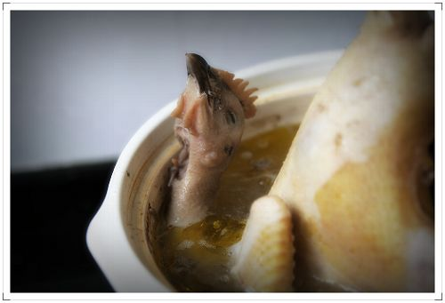

# 美味六一

六一这天Luke享用了很多的美食，一只母鸡和四只蟹黄包。  
  
这只鸡在冰箱里冰冻了2个月，找了一只最大的锅也未能完全装下它。于是它就这么硬棒棒地被煮熟，然后被剪刀剔下鸡肉放在Luke专门用来装美味的碗里。只要拿起装美味的红色塑料碗，Luke就会异常有耐心的抬头凝视着人类往碗里装各种食物的过程，那时侯的它很安静，很安静，很耐心，很耐心...  
  
可是今天Luke将便便居然排泄在家里$%^&\*#@!\*~有意思的是它貌似聪明地将便便解在厨房门口的地垫上.....被我一顿训斥后，低着脑袋两秒迈一小步(太空步)拣一个角落趴下，那摸样真有低头认罪，又希望被宽大处理的姿态。这时候让它干什么它都会逆来顺受，比如下面两张照片，太配合人类的镜头了~只是，上个假期它被修理成夏天的形状，宠物店的阿姨将它身上的长毛一根不剩的剪掉，一个夏天的光蛋诞生了！不知它是否感到清爽？反正人类看着是清爽了许多。  
  
夏天毋庸质疑的来到，白天的luke会分别捂热地面的每一处，不断的捂热，不断的更换...捂热。它一定喜欢夜晚的夏天，空调使它和人类共处一室，并美美地呼到天亮。  
  
六一的昨天，jiajialing奇迹的在茶上冒出来，就象他在MSN上某天奇迹地说话一样令人惊讶，在茶的反向连接里发现有人在网络上搜索jiajialing，既然想了解他，而他的blog终于弄好了，但不知道是否是最终版本？自豪地推荐一下“这个一起徒步旅行的1/8份子，这个跑去澳洲掩埋青春、08年暴雪从上海一起开11个小时汽车返回南京、我的单反相机启蒙老师”的blog：[**All the past has gone,try to remember something...**](http://www.jiajialing.org/wordpress/)  
  
   
   

---

## 评论（12）

**bing** · 2009-06-02

这鸡头的表情也很配合人类的镜头

**Christina** · 2009-06-02

倒~~~~~~~~~

**itsmin** · 2009-06-02

鸡在冰箱里冰冻了2个月！那一定是很僵硬，很僵硬。。。

**[三月四月](http://11)** · 2009-06-02

啊呀！那只鸡……太有镜头感了，绝对超过LUKE

**coco** · 2009-06-02

思索、遐想的狗狗和陶醉不醒的鸡。女主人呢？呵呵。澳洲的秋天，那个美啊！

**蚊问问** · 2009-06-02

系统障碍，我再试下！

**候鸟** · 2009-06-02

躺在鸡汤里的母鸡好安详啊。

**Sherry** · 2009-06-02

这只鸡，，，雷  
jiajialing’s blog上的照片都是他老人家拍的么？快成大师了~

**[少爷](http://jennyshaoye.blogbus.com/)** · 2009-06-03

LUKE这样子也挺不错哇. 我这里不太热的,就没必要去这么剃了

**大姜炖去** · 2009-06-04

这是只公鸡还是母鸡？

**Christina** · 2009-06-04

晕死了，是母鸡！

**喜刷刷** · 2009-06-04

怎么不show一下那只装美味的红碗？

