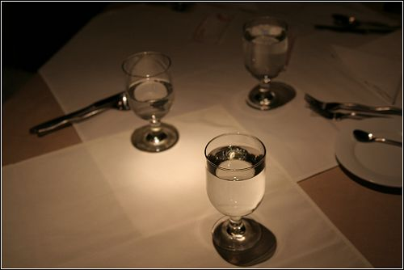
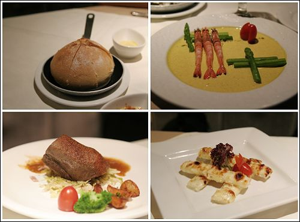
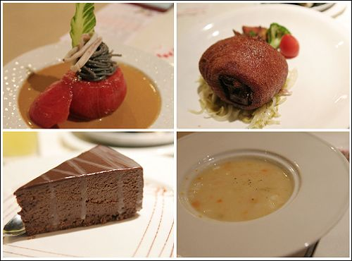
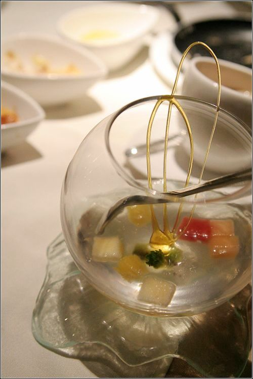
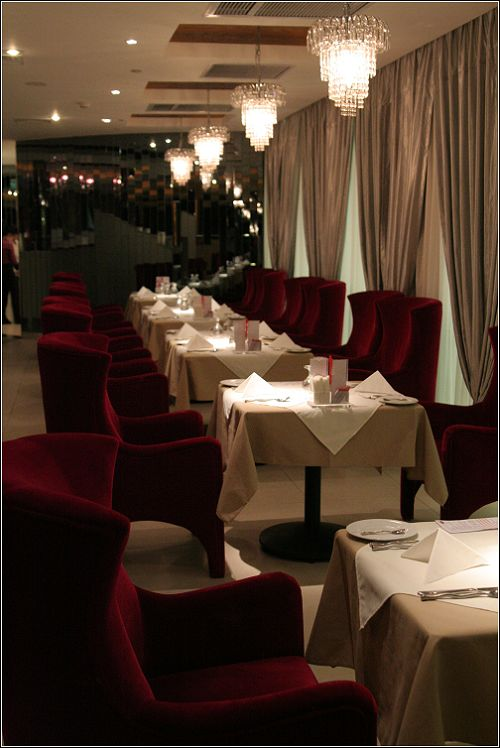
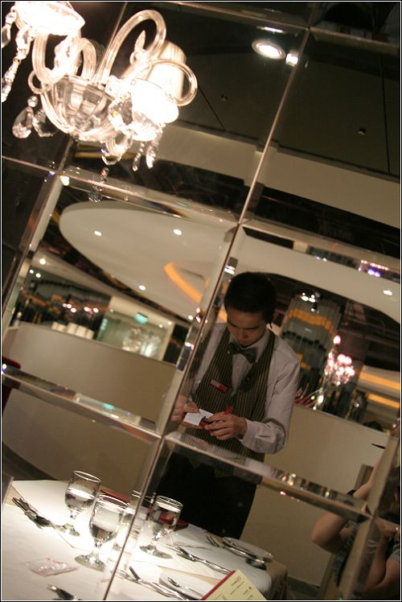
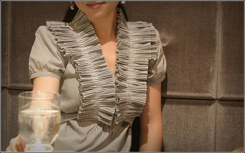
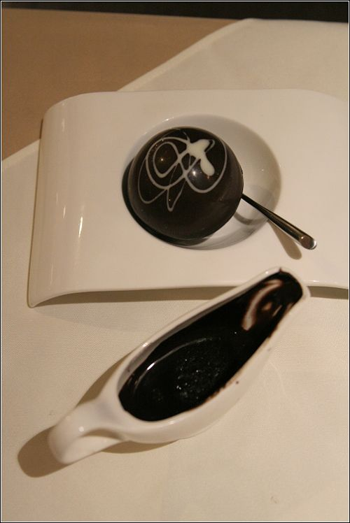
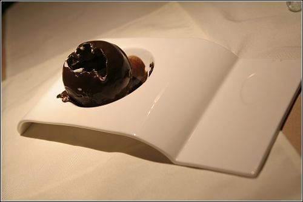

# 象美食一样满足。

下午三点多就饿了，终于盼来晚上的大餐。  
比起过去现在的我更热衷于美食。  
   
  
德国猪手让人失望，油腻炸得不彻底，隐约品出猪脚上的腥味。见另两人点的牛排很好吃的样子....我的胃都在遗憾。还有甜品可以期盼，不是吗？  
   
   
  
带果冻的甜品。  
  
  
上座率不高，但很安静，不用扯着嗓门说话了。  
  
  
服务非常好，准确地为各个客人上菜，不问一句话。   
   
  
蓬头垢面的今天。  
   
  
名为“毁灭地球”的甜品，里面冰淇淋，外面球状巧克力。  
将器皿里盛着的热巧克力浇灌在球体上食用。  
   
  
地球原来是这样毁灭的....  
名字很酷却没有我喜欢的巧克力慕丝好吃。  

---

## 评论（14）

**[一鸣](http://blog.sina.com.cn/wwsyyc)** · 2009-06-03

是在台塑？
很喜欢倒数第三张。知性的，也是优雅的，茶的优雅是由内而外的，很有质感：）

**Sherry** · 2009-06-03

这衣服从正面看，还是很不错的。

**盛夏的流星雨** · 2009-06-03

在王品台塑吧 去一次还可以 去多了就会觉得那西餐做的也不咋地 所以也别羡慕别人的牛排拉 ^!\*

**[shanshu](http://shanshu.blogbus.com/)** · 2009-06-03

总是很女人味。  
难以抗拒的美食，难以减下的肥肉。哈哈。太矛盾了。我现在不敢胡吃海喝的。肥~

**[三月四月](http://11)** · 2009-06-03

看上去很好吃的样子，任何美食对于我来说都是很致命的，很羡慕你怎么吃都不胖。食物拍得很有气质，器皿也很漂亮，衣服很好看，但拍得太少了

**[薇安](http://bulaoge.com/?vivianxu)** · 2009-06-03

却是很喜欢你今天的衣服呐，有超有女人味～

**lilian** · 2009-06-03

最近爆发了一次空前绝后的皮肤过敏症，怀疑是小龙虾惹的祸。

**Michael** · 2009-06-03

这衣服很漂亮, 有点像“千层雪“  
食物够精致

**lilian** · 2009-06-03

服装很应景，就是拍得少了点.

**蚊问问** · 2009-06-03

蝶家吗？  
每份东西看上去都好小小的一份

**Christina** · 2009-06-03

是王品旗下的西堤牛排，在金鹰天地六楼。

**Cindy** · 2009-06-03

喜欢今天的衣服，怎么不拍个全身照啊？

**[光光](http://gaoguangguang.blogbus.com)** · 2009-06-04

看到你的留言了，真有意思。我们在梦里有交情。而且我不歧视已婚人士的啦。

**TT** · 2009-06-10

是西堤,想去但一直没机会.

