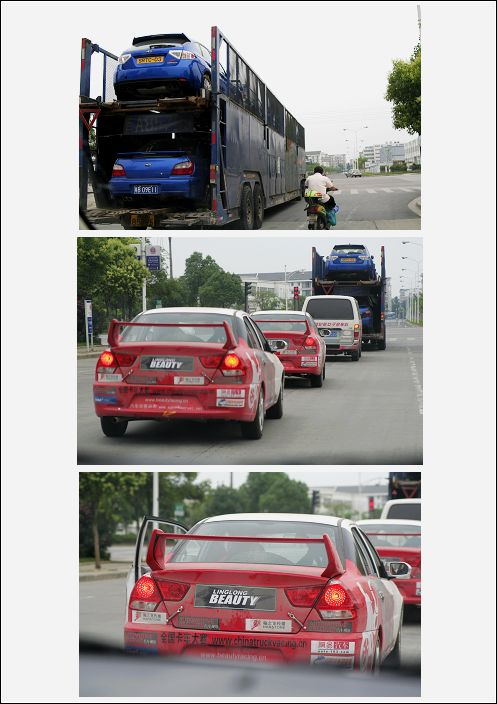
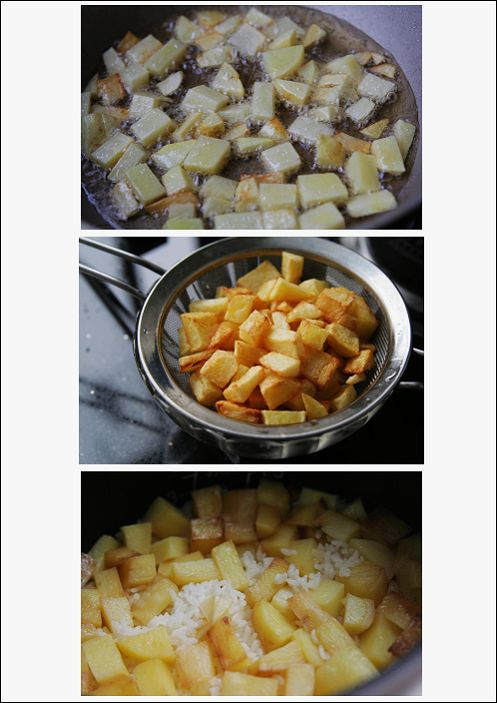
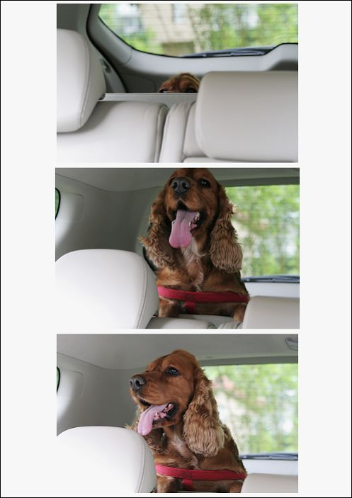
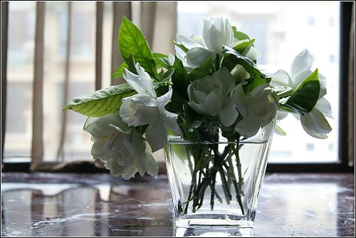

# 转瞬即逝的两天

昨天去菜场买菜的路上遇到下面这个车队，红色是LINGLONG女子车队的车，前面拖车上是8代和9代的STI。有点小激动，本应该直行的，见一行车队从眼前开过，立刻打右转跟在车队后面拍了几张照片，搞得跟狗仔队似的。前面红色车是用三菱LANCER改装的，开在路上的声音跟飞机起飞的噪音差不多分贝，那是一种低沉的噪音。怪不得最近在路上总能遇到光鲜亮丽的改装车，原来[**全国汽车拉力赛（CRC）**](http://auto.ifeng.com/culture/hurricane/20090608/47684.shtml)首站将于6月12-14日在南京江宁区举行，从车手报名情况看，包括韩寒、林志颖、刘斌、短道速滑名将杨阳等诸多明星将参赛。  
  
南京有个车手参加，据说是做手机生意的。这种车手资格证书自己可以花钱去北京培训，整个培训费用为6000 元，包括执照费、训练费以及一套连体赛车服和一双赛车鞋。此外，车队还会安排专车接送学员往返于市区和训练场。接着考一本D级赛车驾，然后改装一辆赛车，参加一次比赛，如果有厂商看中你，你就可以成为一名真正的赛车手。  
  
前些时候杭州开EVO撞死阳光青年的那小子，从小也是开卡丁车的，据说“一般20岁左右没人看中你的话，基本没什么希望做一名出色职业赛车手了，当然这是针对极速赛车而言的。而不是那种需要丰富经验的沙漠越野拉力赛的车手。”不知道这样的说法是否正确？  
   
  
前一日见文怡教人做懒汉饭，第二日见蚊子象模象样地做了一份，第三日我也做象模象样做了这份“土豆饭”，我打算日后将土豆换成蔬菜粒（包含玉米、胡萝卜和青豆）试试。  
   
  
这是带它去洗澡，然后再次剪短它耳朵上的毛，希望散步时耳朵不要拖在地上扫灰尘。牺牲点形象，换来好的卫生，值得。  
   
  
周六早晨钟点工阿姨发来短信：在你家门口放了一把花，给你的。  
我打开门一看，一个小塑料袋里装了一把栀子花，心里一暖。  
赶紧找了玻璃器皿放上水将这些花插在里面，摆放在卧室的窗台上。  
夜晚整个卧室分外清香，今天连客厅都香了。  

---

## 评论（12）

**[shanshu](http://shanshu.blogbus.com/)** · 2009-06-08

栀子花引小虫~

**候鸟** · 2009-06-08

钟点工阿姨真好：）

**鸟人** · 2009-06-08

小小的举动,很是让人窝心

**Christina** · 2009-06-08

我对她也好呀：D

**bing** · 2009-06-08

你开的什么车呀

**喜刷刷** · 2009-06-08

色香味俱全，有滋有味好生活！不过，这一篇资讯够丰富的啊，招架不过来罗，呵呵～～～

**[mercy](http://mercysong.blogbus.com)** · 2009-06-08

栀子花真好看~~

**[selina](http://selinatea.blogbus.com)** · 2009-06-08

阿姨真浪漫啊～

**[joanna](http://yanmer.cn/blog)** · 2009-06-08

哈哈，阿姨很浪漫。如果是摘的小区里的花，要有公德心意识哦，杭州现在也是满城到处开栀子花的季节，某晚等人时候摘下一朵，总感不安:-)

**lilian** · 2009-06-09

最后一张让我浮躁的心绪沉淀下来。

**Christina** · 2009-06-09

这个阿姨还留着长长的黑发呢~

**[薇安](http://bulaoge.com/?vivianxu)** · 2009-06-10

我最近也买了本文怡的书看。

