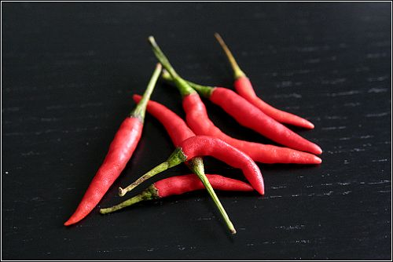

# 剥辣椒

   
  
剥辣椒籽之后，双手象被火烫过一样，手指挠过的左面颊也是，朝镜子里一看红红的一片。真是特别烫、特别热、特别辣....让人不能忽视的感觉，暗自庆幸没用手挠眼睛。用冷水冲，洗手液洗，似乎稍微好一些，可是洗澡之后双手再一次剧烈的灼烧起来，不知道是怎么睡着的？这种红辣椒特别小，还没有我的手指长，却能折腾你到翻天覆地！

---

## 评论（12）

**hkz** · 2009-06-09

小尖椒，千万不要用手碰辣椒籽，否则手会很烧。

**[shanshu](http://shanshu.blogbus.com/)** · 2009-06-09

我就折腾过，弄到眼睛里面，要生不得，要死不能啊。真是惨不忍睹。

**itsmin** · 2009-06-09

下次剥完用一点食醋或者医用酒精搓下手，就不会辣了:+)

**喜刷刷** · 2009-06-09

你这双手可以做多少事啊，怎可以直接剥辣椒呢?图省事了吧,下次不可以了～～～

**Christina** · 2009-06-09

从来没戴手套剥过辣椒啊，没想到这次这么辣！

**lilian** · 2009-06-09

碰这么刺激的东东，换我又该皮肤过敏了~~

**michelle** · 2009-06-09

有点奢侈的方法是把手泡在牛奶里，多泡会。去痛，不会像其他液体那样伤皮肤，反而美手呢。另外脸上的可以用医用冷敷止痛药膏，能收紧冷却灼热的神经末梢和血管。

**mandy** · 2009-06-09

通常我会用冰块直接擦拭手，暂时可缓解吧~~

**rain** · 2009-06-09

摸了这种 朝天椒 后 用 酱油 洗手，就会好啦，摸了脸，就在脸上 也沾点酱油 就会好啦：）

**问问** · 2009-06-10

系统有问题，我昨天留言内容又消失了。。。  
我是说，你做什么菜需要用到这种辣椒？

**Christina** · 2009-06-10

啊哦~留言留不上啊？肯定是不是程序的问题，一定是网络有问题。

我是用它炒土豆丝的：P同时还有个头大的青尖椒。主要是颜色搭配一下，嘿嘿~

**大姜炖去** · 2009-06-10

其实可以用剪的，给小辣椒开膛破肚  
酸辣土豆丝，哈哈，我喜欢

