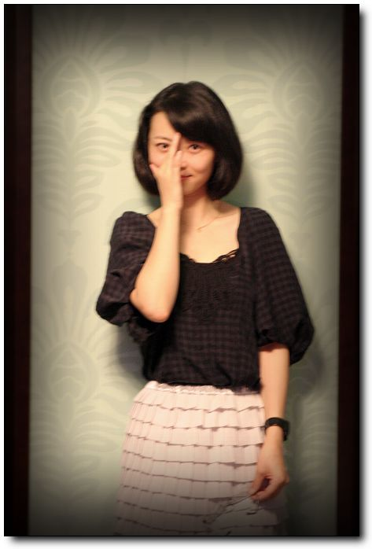
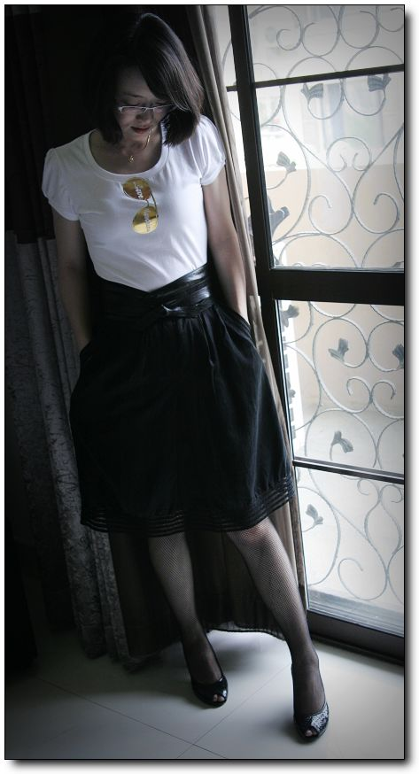
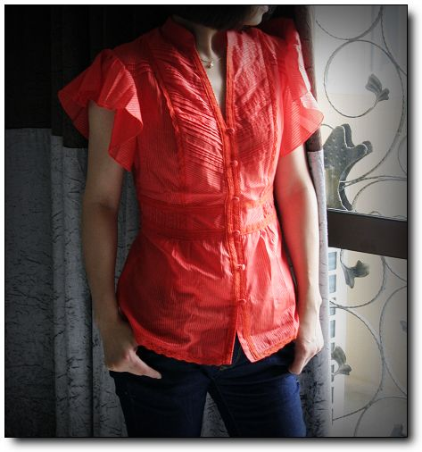

# 等。。。待。。。

等待下雨，好让雨水冲刷掉车身上的泥点。  
从晚上等到早晨，还要等到午后？  
午饭吃完满脸是汗，还有半天的工作便可暂且轻松。  
周末有我满心等待的活动，喜悦。  
  
\*\*\*\*\*\*\*\*\*\*\*\*\*\*\*\*\*\*\*\*\*\*DRESS BLOG\*\*\*\*\*\*\*\*\*\*\*\*\*\*\*\*\*\*\*  
这周工作比较忙，偏休闲搭配多，今天集中上传了。  
忘记星期一穿了什么......  
尤其喜欢昨天的长体恤+7分牛仔裤+平底鞋，以后补拍。  
  
@星期二  
   
  
@星期三   
  
  
@星期五  

---

## 评论（12）

**jiajialing** · 2009-06-12

喜欢这张，搭配的很好。。。

**[shanshu](http://shanshu.blogbus.com/)** · 2009-06-12

几天没看到DRESS BLOG了  
这身很甜心的感觉。嘻

**兔子田** · 2009-06-12

真漂亮！  
有时，从你这儿也找到搭配衣服的灵感捏！

**COCO** · 2009-06-12

都很好看。DRESS BLOG，期盼坚持啊。

**lilian** · 2009-06-12

是啊，日子偶尔也需要夺目的色彩点缀一下。最近脖子上的过敏还没好，没啥心情打扮自己，只好吃着葡萄籽胶囊，用着雅漾，盼望着那个神清气爽的自己重新回归。

**Christina** · 2009-06-12

lilian是不是经常过敏？  
无论过敏与否，每天吃葡萄紫对女性都有好处的。

**lilian** · 2009-06-12

也不是，以前是换季的时候偶尔会有过敏，今年特别严重。在网上查到葡萄籽对抗过敏有效，葡萄籽提取物的抗氧化效果，是维生素C和维生素E的30-50倍。呵呵，吃了总比不吃好吧。

**雯子** · 2009-06-12

红色上衣那张来个全身照嘛！

**Christina** · 2009-06-12

是橘红色的，哎呀，今天没拍全身的，下面是宝蓝色九分牛仔裤，黑色高跟凉鞋。

**[横戈](http://hengge.blogbus.com/)** · 2009-06-13

原来就是这样~~

**michelle** · 2009-06-13

还是夏天更好，多姿多彩。期待鞋子们的特写。

**姗娜** · 2009-06-13

好会配色的妹妹，赞。  
你喜欢在那里购物，说不定也能遇上哦

