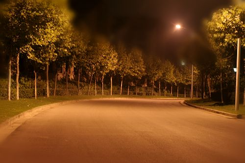

# 静止的图画

空无一人的街道，两边的梧桐树叶子纹丝不动，世界仿佛被白天的太阳烤灼后完全静止了，没有风，没有灰尘，橘色灯光笼罩下的洁净，连青蛙的叫声也没有了？心中浮出一串小小的惊叹号！走进这样一副图画中，就在昨夜。  
  
   

---

## 评论（6）

**喜刷刷** · 2009-06-26

是不是你描述的那个画面只能用文字表述啊？

**Christina** · 2009-06-26

晚上不下雨，我去拍一张给你看啊~

**候鸟** · 2009-06-26

很喜欢这张照片的感觉：）昨天在家听到尖锐的知了声了。

**大姜炖去** · 2009-06-27

这个镜头好像在你以前的一篇日志中出现过  
橘色灯光  
墙上斑驳的树影

**[山树](http://shanshu.blogbus.com/)** · 2009-06-27

衣服上的花可真大啊，来张正面的哈

**喜刷刷** · 2009-06-27

merci vraiment

