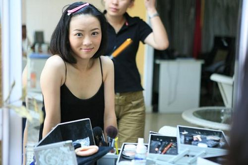
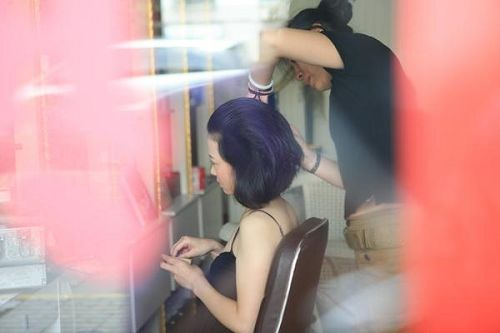
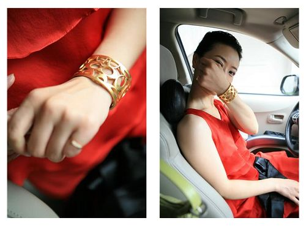
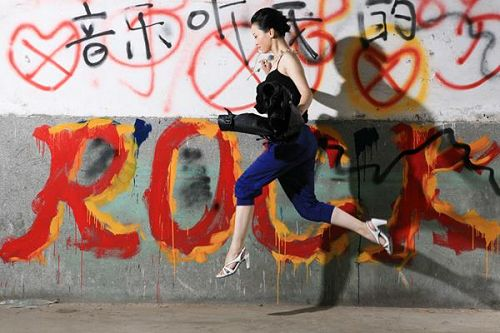
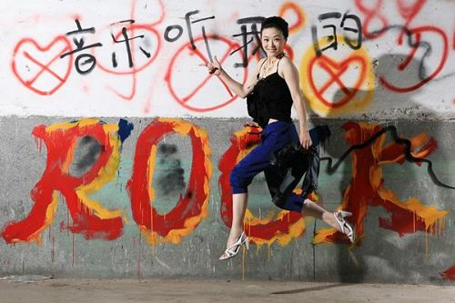
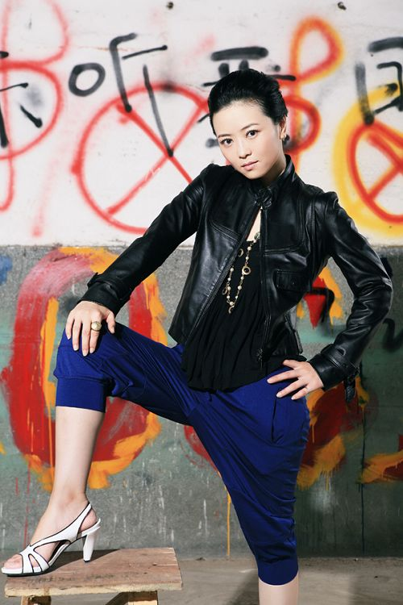

# 拍摄花絮

化妆师给我化完妆，在做头发。  
  
  
发型其实很简单，直接上了发胶，后面盘起来。  
  
  
第二阶段拍摄即将开始，我刚换好连衣裙，准备扎进闷热的空气中。  
  
  
拍摄过程很顺利也很愉快，最最有意思的是忽然冒出来的灵感，最重要的是和摄影师的沟通。  
  
  
这些还不是“最终作品”，先要来几张过过瘾。  
没想到我跟猴子似的，跳得还挺高，呵呵~  
尤其喜欢跳跃在ROCK前，以及“音乐听我的”的手势。  
  
  
既然有人询问这次拍摄的详细价格情况，我把价格表贴在这里[**第15楼**](http://lifetea.org/article/2342/?commented=1#c009186)了，真不是广告贴啊，我也是第一次尝试拍写真的。  
  
对的，我还带了皮裤，可惜没用上，因为天气实在是太热了。  

---

## 评论（20）

**itsmin** · 2009-06-29

传说中的金箍？重现江湖。。。

**[shanshu](http://shanshu.blogbus.com/)** · 2009-06-29

红红火火啊

**aimda** · 2009-06-29

最后一张不错。和过去的风格大不一样。

**[薇安](http://bulaoge.com/?vivianxu)** · 2009-06-29

好看的紧～～～赶紧上大片啊！别让我们的口水流太久

**[三月四月](http://11)** · 2009-06-29

真不错，妆面很自然清爽，皮衣还是用上啦，好酷

**Fangfang** · 2009-06-29

挺个性的。期待更多~

**Michael** · 2009-06-29

WOW!!! Great ones!!  
红色与金色的手镯配效果不错哟！那几张起跳的看起来很轻盈。喜欢最后一张，但是我感觉背景太乱了一点，这个背景可能后期处理一下会好一点

**richard** · 2009-06-29

在菲利普.哈尔斯曼看来,不同的跳跃动作,可以反映出不同人的个性特征和心理状态。他认为人在跳跃的时刻,才能消除心理障碍以及作为社会的人的表象,显露出真实性格。

**shao ye** · 2009-06-29

cool~~~~~~~~~~

**喜刷刷** · 2009-06-29

小飞茶，身轻如燕啊～价目表看过了，佩服！

**Sherry** · 2009-06-29

哇，明星。

**[shanshu](http://shanshu.blogbus.com/)** · 2009-06-30

你的表现力真好。  
喜欢你在镜头面前的不做作的感觉。很真实。

**mandy** · 2009-06-30

我喜欢倒数第三张~

**COCO** · 2009-06-30

期待所有的照片，呵呵。别说贪心啊，是胃口吊得太足了……

**lilian** · 2009-06-30

真的不贵哦,我年初预订了拍写真,正好在搞活动打了折还要六百多.可惜自己的衣服只能带三套,我最想拍的还是时装照,顺带加几张穿旗袍的.所以一直不太提得起劲来,拖到现在还没拍呢……

**Christina** · 2009-06-30

现在拍就热了~  
好多人都喜欢拍旗袍照，呵呵~

**Jasper** · 2009-06-30

最后一张，咋一看：董卿….

**大姜炖去** · 2009-07-02

音乐听我的  
不错不错

**Jolie** · 2009-07-08

茶，你这是在哪家拍的？很有菲林！

**Christina** · 2009-07-08

13770770741 摄影师姓杨。

