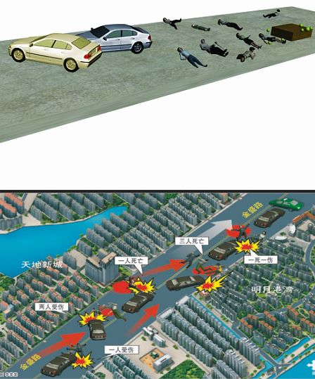

# 太惨了

昨晚8：20左右南京[**江宁区岔路口金盛路发生了交通事故**](http://news.google.cn/news?hl=zh-CN&q=%E9%87%91%E7%9B%9B%E8%B7%AF%E8%BD%A6%E7%A5%B8&um=1&ie=UTF-8&ei=9LhKSvbJKZDy6gPbnOS-BQ&sa=X&oi=news_group&ct=title&resnum=567720417)，5死4伤，非常惨，其中有个孕妇肚子里的孩子都被撞出来了，据说是个男婴.....昨晚得知武警封锁道路将近半小时。  
  
居住在附近的同事说，夜里能听见外面哭泣的声音，想必是那些受害者家属痛不欲生了一夜。肇事车为苏ATH900的别克君越，车主姓王，在检查院工作。王某已将车卖给张某，但未办理过户手续。那么发生车祸车主要承担连带责任。而谁是肇事司机目前还不能确认，有消息说是张某的另一个男性朋友。无论是谁，酒后驾车连续撞死5人撞伤3人，应该判处死刑！！！否则还会有源源不断的人酒后驾车！有一朋友说枪毙不过瘾，应该凌迟，可以让老百姓剐上几千刀。  
  
早晨google了一下，发现现在的媒体报道新闻非常不严肃，有写事故发生时间是晚上11点，有写肇事司机是检察院、高尔夫俱乐部副总或房产公司技术副总等等...新闻内容可以是未经确认的信息吗？  
  
想起我父母经常叮嘱：不要主动邀请人家乘坐我的车，如果出了事故，车主要承担相应的责任。还有尽量不要将车借给别人开。还好我没有“借车”这么不靠谱的朋友。  
  

---

## 评论（6）

**陈问问** · 2009-07-01

哎。。

**[Jansfer](http://jansfer.com)** · 2009-07-01

太可怕了。。。

**雯子** · 2009-07-01

太惨了啊！肇事司机一枪毙了他算是便宜了他了哦！酒后驾车害人啊。

**Nana** · 2009-07-01

太可怕了，以后走路不能太“专心”，要东看西瞅的，发现不对劲的车辆，赶紧避让。  
最近的空难，公车事件，地震，流感，搞得人心惶惶的。。。

**itsmin** · 2009-07-01

酒后驾车害己更害人！真的应该立法从重处治。

**okdata** · 2009-07-02

胎儿掉在皮卡后箱挡板上，另一人腹内物抛洒，惨！  
江宁人是猛，昨天下午在海通大厦以北花神大道见一白色雅阁不顾左道车辆突然悄悄的向左平行闯入，吓人。  
开车者貌似男性手扶拖拉机手，仅见下巴以上部分。  
江宁，手扶拖拉机手出没地，小心。

