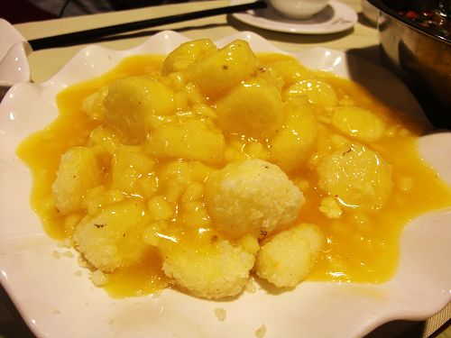
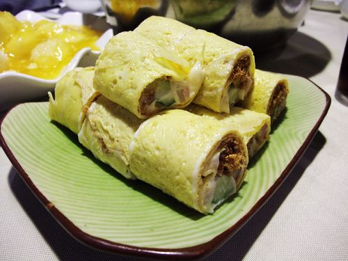
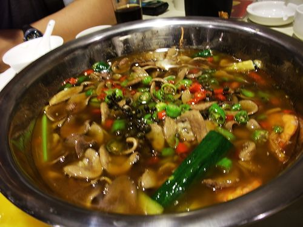
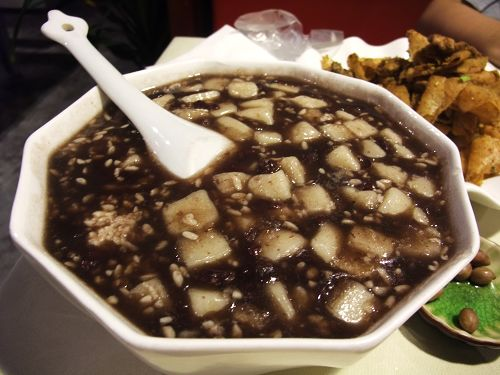
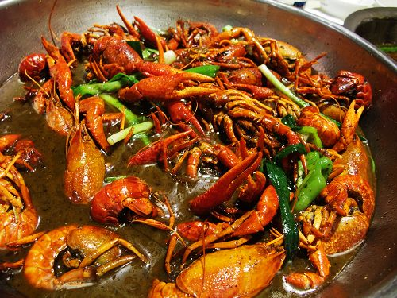

# 我爱美食

这是位于太平南路科巷12号的饭店：香锅里辣。  
除了龙虾，下面的菜都喜欢，尤其是豆腐、腰片和酒酿赤豆元宵。  
  
水果日本豆腐  
  
  
五色蛋卷   
  
  
猪腰片  
  
  
酒酿赤豆元宵   
  
  
龙虾  

---

## 评论（10）

**ware** · 2009-07-03

油而不腻，恩，好吃

**[Jansfer](http://jansfer.com)** · 2009-07-03

自己做的吗？猪腰片都加了哪些料

**Christina** · 2009-07-03

当然不是，是饭店的。

**雯子** · 2009-07-03

想吃猪腰片。貌似很好吃啊！

**陈维** · 2009-07-03

想吃1，3，4，唉，没得吃。。。

**[少爷](http://jennyshaoye.blogbus.com/)** · 2009-07-04

看得我好饿喔

**[shanshu](http://shanshu.blogbus.com/)** · 2009-07-04

龙虾比较有诱惑力：）

**Sherry** · 2009-07-05

你的着装越发性感。。

**lilian** · 2009-07-06

为什么说除了龙虾呢？我已经听过不少人夸南京的龙虾好吃了。

**Christina** · 2009-07-06

龙虾清洗的不干净啊~

