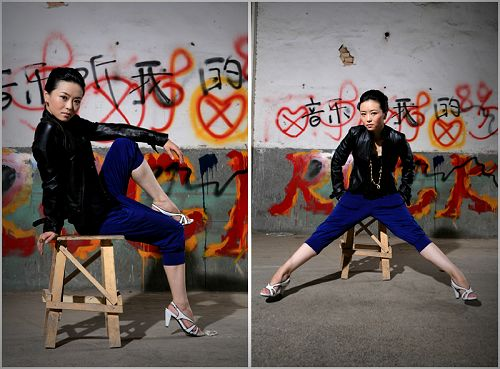
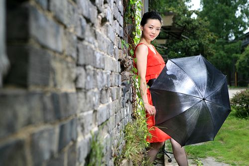
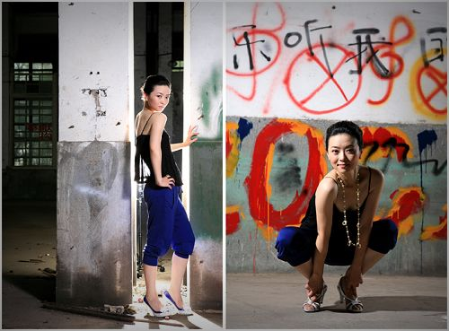
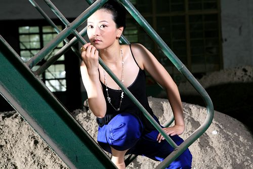
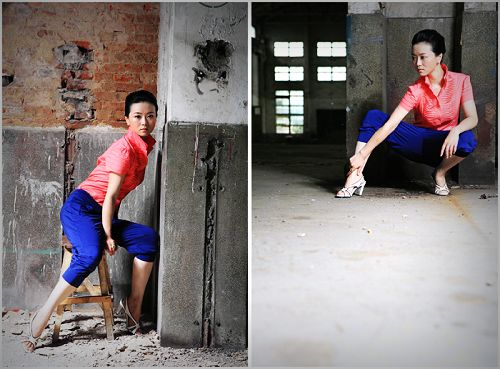

# 继续上照片

   
   
   
   

---

## 评论（25）

**shuwua** · 2009-07-08

我也想多拍点夏天的照片。裸露的皮肤很好看。

**Sherry** · 2009-07-08

前面一堆路人是给你做对比的么？呵呵，真是没啥看头。。你的照片喜欢第三行左1，第四行，第五行左1。。另，你蹲在地上练功哪？ ：p

**vodka** · 2009-07-08

真实的第三世界国家。

**Christina** · 2009-07-08

haha~练功~~练功~~haha~

**lilian** · 2009-07-08

同意Sherry的

**陈问问** · 2009-07-08

肤如凝脂

**Michael** · 2009-07-08

3左 有味道  
5右 看向焦外这张不错  
要说是练功,有点像,这些POSE不好摆…:)  
人物与背景感觉反差大了点.

**mandy** · 2009-07-08

可我还是喜欢前一次那张在涂鸦的墙前面跳跃的照片

**[彝](http://no)** · 2009-07-08

很个性！但还是更喜欢你的生活照！  
一直都在关注你，今天留个记号，祝你天天开心！

**[prettymom](http://prettymom.org)** · 2009-07-08

like your pics. is it for magazine shoot?

**shao ye** · 2009-07-08

so many difficult poses. well done

**喜刷刷** · 2009-07-08

每一次看都是不同的感觉，慢慢有些看得懂了～

**StA** · 2009-07-08

你的照片大多数都不错，蹲着的两张感觉不太好。也喜欢跳跃的那张。不过涂鸦墙面的背景，看着有些做作，刻意为之的感觉，不如不要，只留你自己。

**绿恐龙** · 2009-07-08

这组没一张喜欢。。把你做试验品了。 要求退款。。  
不喜欢的理由：虽然系列 但是无主题 服装和环境有意的去配合 但是又不搭。。总之太另类。。。

**Christina** · 2009-07-08

答复如下：  
不是为杂志拍摄，仅仅是自己拍一套玩的；

感谢彝同学的关注：）

我挺喜欢蹲着的两张：P

恐龙，地点和服装都是我的想法，和摄影师没关系哦~知道你最近的照片拍的很赞滴~

**supernova** · 2009-07-09

还是喜欢你自己给自己拍的照。

**itsmin** · 2009-07-09

这一组没有突出的。。。最后那张有点雷，让我想到了电影《少林寺》里面会打螳螂拳的师傅。。。

**Christina** · 2009-07-09

汗。。。。。

**itsmin** · 2009-07-09

嗯。这天是太热了:+)。注意补水啊。

**[hengge](http://hengge.blogbus.com)** · 2009-07-09

太硬了

**Christina** · 2009-07-09

“硬”是我的另一面：）

**alexli** · 2009-07-09

你身上的女人味越来越浓，迷人！

**bing** · 2009-07-10

蹲着。。。。

**香蕉梨** · 2009-07-11

差一点就雷了

**DUDU** · 2009-07-12

化妆后比较显老哈，特别是第二张~~

