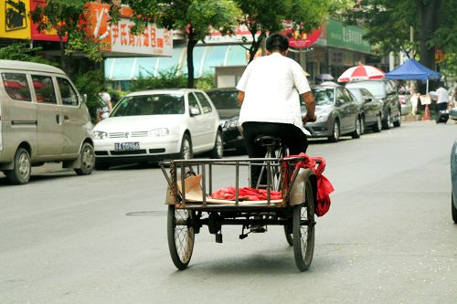
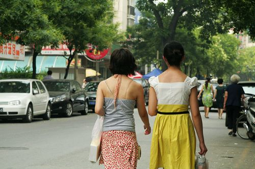
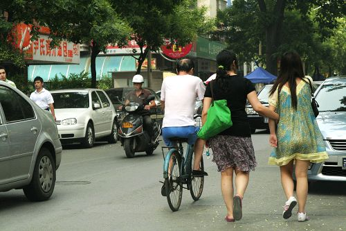
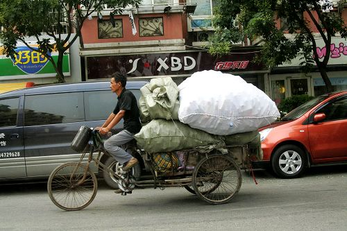
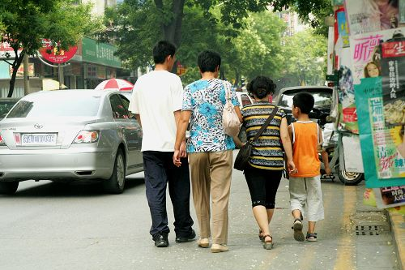
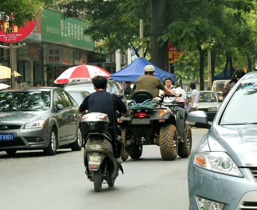
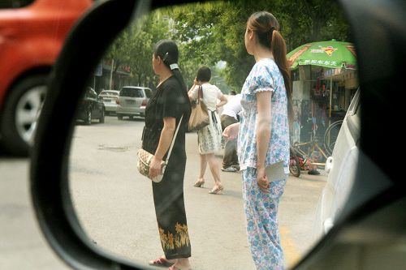
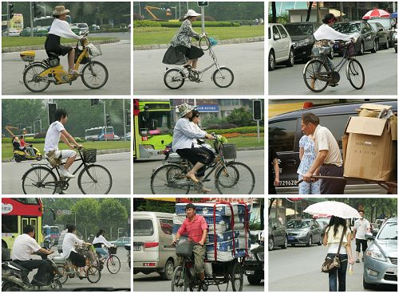

# 夏日街头：鼓楼 & 北门桥

夏日炎炎，空荡荡的三轮车，双重压力；  
  
  
清凉夏装。美美的后背多了两条透明带子；  
  
  
虽然MM们穿着裙子，看上去还是很热；   
  
  
如今买卖废品和小白领收入差不多，甚至更多；  
  
  
外地来的一家人，从高到低；  
  
  
这哥们儿真摆，弄一沙滩摩托车上街拉风，还没有牌照限制；  
  
  
睡衣永远是中国街头特色；  
  
  
中国多的是环保人士。  

---

## 评论（6）

**兔子田** · 2009-07-08

空荡荡的沙发俺喜洋洋滴坐……话说刚打开时，你的博客首页图片还没变呢，横横，传说中的粉丝啊，每天都要来几遍。

**兔子田** · 2009-07-08

睡衣永远是中国街头特色——秀逗了！

**mandy** · 2009-07-08

这里有家绍兴人家，菜做的不错，对面好象是火锅啊~~

**Christina** · 2009-07-08

北门桥有“绍兴人家”？  
优雅的女性常来逛逛，俺脸上也有光哎~

**喜刷刷** · 2009-07-08

哇赛，中午空啊，居然杀到了北门桥！敬佩～

**jeneffer77** · 2009-07-11

突然失声笑了，笑自己不用那么郁闷减肥了。

