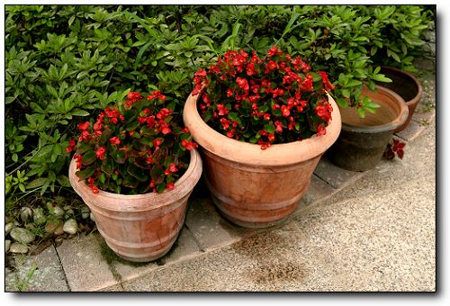
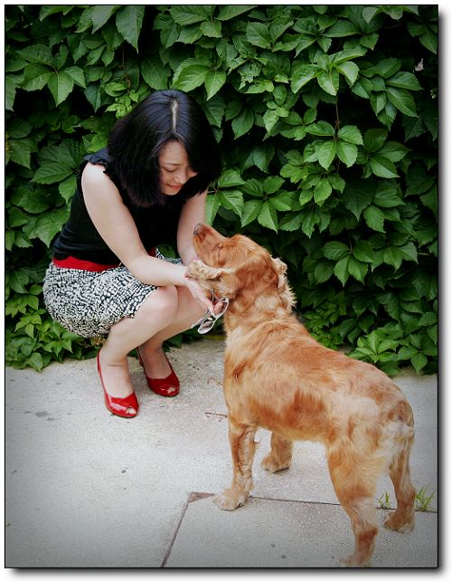
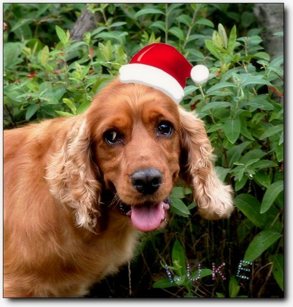
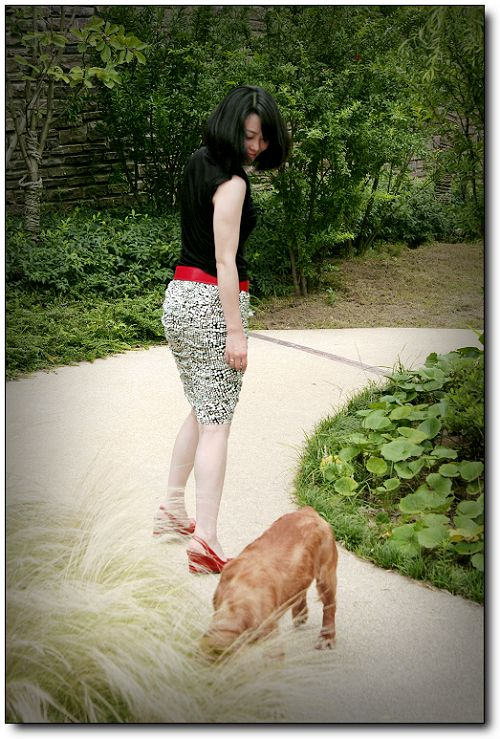

# 最爽的时刻

我爱这画面中的一切；  
  
  
夏天狗狗掉毛很严重，半天地面就象长上了小草坪。不得不把Luke的长卷毛都修掉，成了光猪壮士，体型更健美~；  
  
  
夏天戴小红帽的狗狗；  
   
  
  
每天下午下班回家的路上，有种小鸟展翅飞翔的感觉，最近车上在听“Short List”的CD，只有三四首不喜欢，每每跳过去听其他所爱。就这样打开天窗，放下门上的窗户，一路听着音乐吹着风往家开，终于又度过了一天，好象这一生特别漫长，下班的路上是人生中最爽的时刻。  
  
最爽的应该还有每年的休假时间，去年因为种种原因没有安排外出休假，今年卯足了劲儿准备等到秋季，那时正是澳洲的春天，[**jiajialing**](http://www.jiajialing.org/)说可以请假带我在澳洲转一圈，打算租辆车从悉尼开到墨尔本，虽然在地图上是很短的距离，也会有段难忘的旅程！在放弃五月西藏自驾游，Sherry新疆之行的邀约之后他工作开始忙了，这时候改变计划实在是有些郁闷。。。其实什么时候去那儿都可以，就象yucheng一样，那里反正有人，也不会从地图上消失的。说到yucheng，有意思的是她所在的英国公司在经济危机中倒闭，上海的公司也随之关门，她在这家公司工作了十几年。当别人忙于寻找新工作，她却跑去肯尼亚半个月自由行。“一切等回来再考虑”她说，就这么简单？  
  
夏季的夜晚跑步是否也很爽？浑身大汗淋漓，还有两只狗狗作伴，一只拉布拉多，一只英卡。跑着跑着它们就趴在草地上休息了，不是累是太热了吧？夏天少有机会出汗，白天在办公室，回家路上有空调，到家还是空调，能大把大把出汗。。。。很爽的。。。。

---

## 评论（29）

**New Yorker** · 2009-07-10

好奇的问一句，希望你不要介意。你怎么跟异性朋友相处才不让自己另外一半没有意见呢? 好像很多人婚后都跟以前的异性朋友走的远了，生活圈子窄了很多。不过还能保持很紧联系一般都是超越很多东西的神交。我还没结婚，但是对婚姻有莫名的恐惧。

**Christina** · 2009-07-10

真能扯，“神交”都整出来了？就是好朋友这么简单，什么人看事情就是什么样！你自己这样看别人，其实你自己就是这样！祝愿你和你的伴侣心理足够健康，自信且有能力信任对方！实在不行，就分手呗，听从你内心的召唤吧~

**lilian** · 2009-07-10

平时尽管有假期但也走不出，只能充分利用国定假了。这个十一打算在歌诗达日韩游和澳洲之间选一处。

**Christina** · 2009-07-10

歌诗达是意大利邮轮吧？昨天才看电视上宣传的：）

**lilian** · 2009-07-10

有意大利的，也有日韩的，我看过别人的邮轮日志，很捧哦!如果选择邮轮我就打算带上家人；如果澳洲那就我跟老公两个人，嘻嘻！http://www.etripsh.com/chujingList.asp?Cate\_ID=350&Cate\_Par\_Id=289

**Sherry** · 2009-07-10

哇，去澳洲啊~ 我亦心而往之啊~ 口水。。。

**Michael** · 2009-07-10

最好放在1月左右去,那里天会热一点可以下海. 但景色是很美的

**Edward** · 2009-07-10

Melbourne may be still cold by then, but a lot to see there, great ocean road, penguin, vineyard…

**[薇安](http://bulaoge.com/?vivianxu)** · 2009-07-10

羡慕羡慕～能去坝上已经算今年的计划了。

**shuwuua** · 2009-07-10

下班的路上最爽，周五的下午最爽。休假开始的前一个晚上最爽！

**雯子** · 2009-07-10

我也看了歌诗达邮轮的介绍，我在考虑去日本。每年到了7-8月份就开始心痒痒想出去玩。

**mandy** · 2009-07-10

我感觉下班就象逃出笼子的小鸟~~深呼吸~~开着车喜欢听小野丽莎的左岸香颂（附庸风雅：）。我的假都生病生完了~~可还想出去，今年特别想~就想一个人到陌生的地方走走（法国南部小镇）~~醒醒！开会了

**lilian** · 2009-07-10

万绿丛中一点红，喜欢这组的色彩搭配。裙子好有女人味哦，是弹力面料的伐？

**喜刷刷** · 2009-07-10

亲爱的luke，好多天没出镜都害羞了啊？你主人想去澳洲玩呢，没人给你做好吃的了～

**Christina** · 2009-07-10

楼上写到LUKE好嗲啊~~~旅行计划好象写了延后了呀？LUKE这是笑的表情还好呢，它从来不害羞的，尤其在吃的时候。裙子是弹力+皱折的。

**[shao ye](http://jennyshaoye.blogbus.com/)** · 2009-07-10

Any plan coming to England??

**itsmin** · 2009-07-10

靓裙子衬托出好身材。

**michelle** · 2009-07-10

Sydney的气候很好，推迟些旅游赶上夏天也不会有大碍的，喜欢它南部的KIAMA小镇。墨尔本天气总是非常多变的。如果有时间去昆士兰大堡礁一带，夏天会比较热，但可潜水。推荐Lady elliot island。澳洲的海滨大都很美，但并不各个特色鲜明的。刚提到的那个也许会让你觉得难以忘怀。祝你有个悠长的快乐假期在“大岛”。

**[Violet](http://www.violetgl.com/)** · 2009-07-10

你的行程是怎样的？我刚刚出了票了～～～我也准备自驾，但恰好是从MEL到SYD

**HANK** · 2009-07-10

听JIAJIA说起过你要来，不能和你们同行，只能帮着他计划计划。  
可惜的是，这个计划要延迟了。不过，那也好啊，呵呵，也许还能带着我家小Q在你们后面跟一段呢。

**aimda** · 2009-07-11

LUKE的眼神已没过去忧郁了。带的不错。

**jeneffer77** · 2009-07-11

给自己的心放个假，挺好的。所有的担心和压力随它去吧－－我就计划回国内给自己放假6个月。希望不要太浮躁。

**Christina** · 2009-07-11

HANK，考虑到你有小孩子，所以就没打搅你了，嘿嘿~小Q现在会走路了吧？

**兔子田** · 2009-07-11

第一次来茶的博客，被吸引的就是茶微笑的模样。很沁人心脾。。。

**vodka** · 2009-07-12

我看到了婚戒～婚戒是戴在右手无名指的吗？

**Christina** · 2009-07-12

那是枚五十元的藏银楼空雕花戒指，尺寸大小只适合无名指，戴戒指有那么多讲究，得错过多少独一无二的设计啊～

**[三月四月](http://11)** · 2009-07-13

我如果要出汗，就去走长江大桥

**Christina** · 2009-07-13

走长江大桥？归归~老长老长的路啊~~~~~~~~~~

**[I.M.P](http://mixpretty.blogbus.com/)** · 2009-07-13

喜欢第三张，小狗真可爱~

