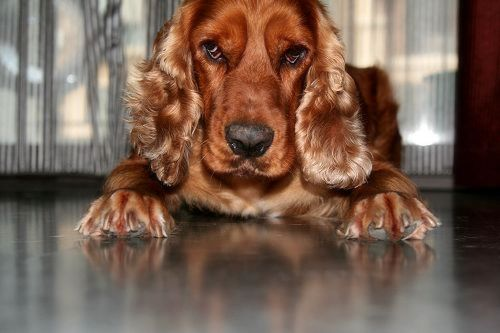
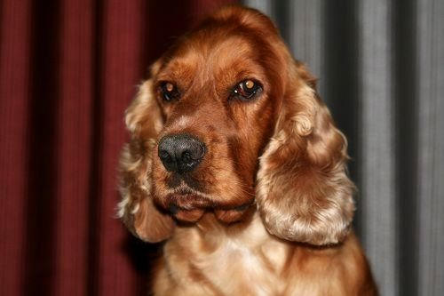
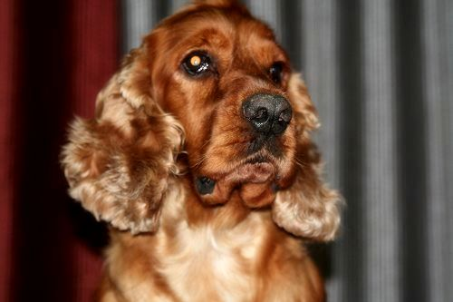
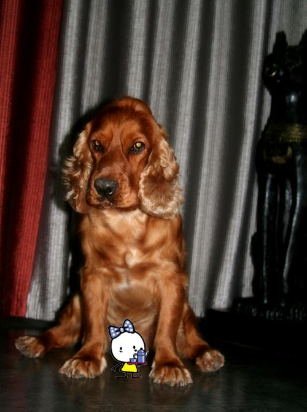

# 拍．宝贝

周末洗车的路上，听到101.7频道播了一档节目叫[**《豆豆向前冲》**](http://www.xici.net/b1135211/photo.asp)，讲宠物的。  
  
说某教练家里有只哈士奇，他的教育方式就是打，有一次狗狗在外面拣东西吃，被他用脚踩用拳头夯。狗狗趴在地上留眼泪，从此后只要教练在它就不会在外面吃东西，包括别人给它的。有次有人给它食物，哈士奇先环顾四周看看教练在不在，不在就吃，在就不吃....这样的教育方式挺吓人的，我是下不了手！  
  
广播里提到[**“大中桥溜狗大队”**](http://www.xici.net/b958689/d92057574.htm)，主人宠物一起约着出去玩，太有意思啦~  
有时外出吃饭，真想把它带上，可是一般的餐厅是不允许狗进去的。  
象我这样想法的主人一定不少，如果南京搞个宠物餐厅、宠物公园，让主人和宠物一起happy，会有些生意吧？  
  
刚睡醒就被折腾着拍照；  
  
  
拍就拍吧，还是很配合滴；  
  
  
换个角度，瞧瞧我的品种是不是很纯呢？  
  
  
等冬天长出长卷毛，还是超级帅哥。  

---

## 评论（11）

**喜刷刷** · 2009-07-13

L~u~k~e~,抱抱～～～

**Christina** · 2009-07-13

哎呦~~~~我的腿都软了~~~~~~~

**Nana** · 2009-07-13

最后一张 哈哈哈  
你太人性化了

**shuwua** · 2009-07-13

北京这里三里屯本来有一个狗餐厅，里面都是卖狗饼干、狗饮料、狗饭，主任带狗去就是付钱的角色，最多混瓶可乐喝。

**[山树](http://shanshu.blogbus.com/)** · 2009-07-13

感觉LUKE的毛发很棒，特别有光泽。

**[三月四月](http://11)** · 2009-07-13

小样，还挡住关键部位……

**mandy** · 2009-07-14

哎太不厚道了，没睡够就叫醒，还要摆POSE，一副委屈样~~哈哈。。。

**Christina** · 2009-07-14

亲爱的，它是刚睡醒。。。。所以不活跃的样子。。。

**[shao ye](http://jennyshaoye.blogbus.com/)** · 2009-07-14

Lucky Luke, he has right to go to master’s bedroom. He looks really cool~~~~

**jason** · 2009-07-15

LUKE挺有贵族气质啊 不过怎么老是拍照的时候带着这种忧郁的眼神 ：D

**Christina** · 2009-07-15

这个犬种不笑的时候就是这个表情，下面有张笑的戴小红帽的。

