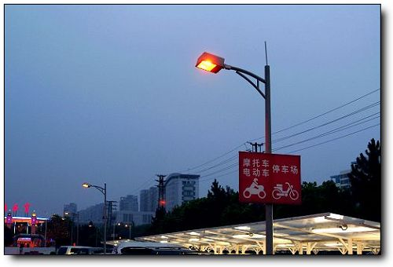
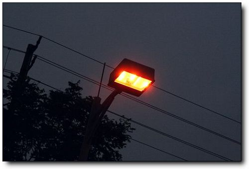
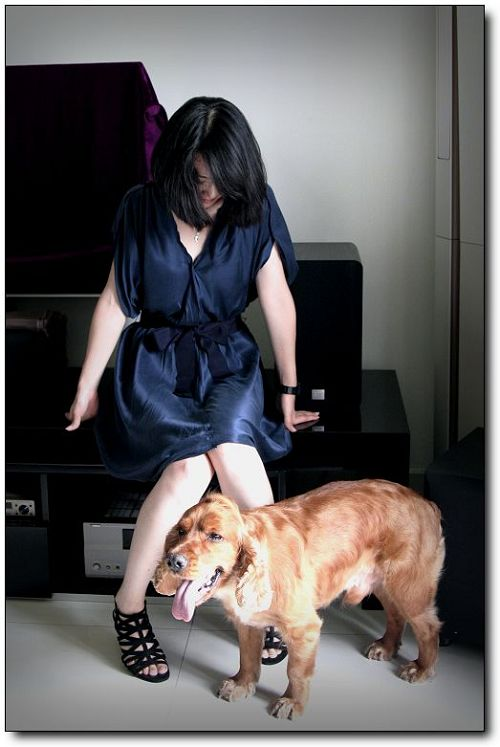
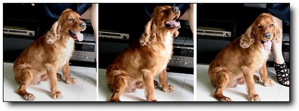
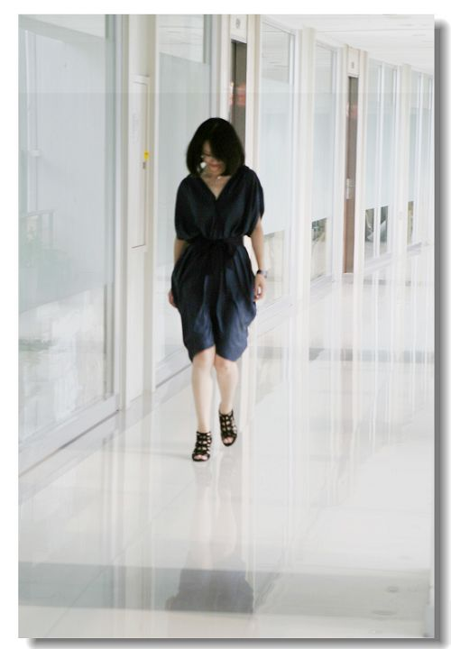

# 早．晚

**\*\*\*晚\*\*\***  
   
  
  
来了一个女孩儿，89年出生，未成年开始做模特。现在在1912酒吧里做酒托儿，就是酒吧招些所谓年轻漂亮的女孩子，整夜坐在酒吧里吸引（招揽）男人们能常常光顾，并且她们会促进男人们消费，并从中获得提成，月收入4、5000元，她的BF因为贩毒被抓进去了。晚餐刚刚开始她便呈现出醉意，眯着眼睛，眼神飘忽不定，每5句话中必定带着脏字。她的“醉意”却并不是因为酒精。。。  
  
我：“你下班的时候已经没有车了，怎么回家？”  
她：“我爸来接我。”  
我：“你当着你父母的面也抽烟？”  
她：“对啊，我爸还发烟给我抽呢。开始反对，后来我经常带好烟回家，我爸跟我要，渐渐就不反对了。”  
我：“有很多客人会约你吧？”  
她：“一般不罗嗦。”  
。。。。。。  
  
她无所顾忌的表情看着既天真又快乐，丝毫看不出生活能给她造成什么负担，不时掏出手机来收发短信。我忧心重重地望着她，没了过去的憎恨和鄙视，只有轻微的心痛和同情。  
  
**\*\*\*早\*\*\***  
  
   
  
  
这段时间空气又闷又热，如果不开空调，总感觉呼吸不畅似的。就要出梅了，下面会是连续的高温，担心中午遛它，它会中暑，没准儿人也会中暑呢？所以今早七点四十就带LUKE出门了，穿上体恤短裤带上MP3，边走边听早间新闻。  
  
早晨静谧而凉爽，有令人熟悉而愉快的味道，我们俩迈着轻盈的脚步悠闲地路过小水渠穿过花园小径，回家后洗澡换衣吃早点出门上班。这样的早晨比睡懒觉令人喜悦！计划以后进行慢跑之类的晨练，提高体质对现在的我很重要。

---

## 评论（8）

**陈问问** · 2009-07-14

任何职业，做的有职业道德就好。可以不分贵贱高低 ：）

**mandy** · 2009-07-14

你是七点四十出门和LUKE晨练，我七点四十出门上班。即使不慢跑，走走都很舒服~~

**[joanna](http://yanmer.cn/blog)** · 2009-07-14

七点四十遛狗？夏天基本每天6点半以前起床，上班时间是10点，中间这段时间总觉得很浪费，太虚度了

**喜刷刷** · 2009-07-14

luke,你喜欢听音乐吗？

**Christina** · 2009-07-15

不知道luke是不是爱听音乐，不过它有时会唱歌，呵呵~有时放音乐拉着它跳舞，它也好开心的样子！

**lilian** · 2009-07-15

想到提高体质，我试着早睡，多吃水果和营养素，但健身房已经很久不去了，实在舍不得把晚上少得可怜的几小时花在那上面……

**mandy** · 2009-07-15

狗会唱歌呢！当我在家弹钢琴时我家的嘿嘿就会仰脖子发出噢~~噢~~的声音，通常会唱两三分钟呢，得~~我弹琴，它练声：）

**[三月四月](http://11)** · 2009-07-15

狗嘴巴一裂开，就是在笑

