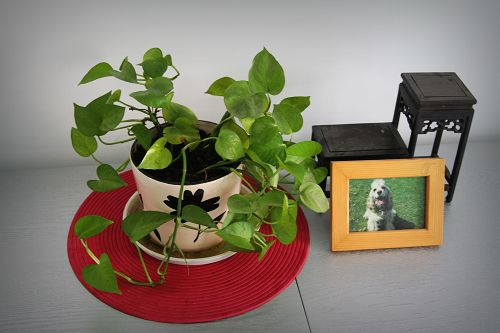

# 名义重要吗？

昨天三个人辞职，经济危机时期辞职出去单干，显然不是钱的问题。  
  
今天会议上谈到“名义很重要吗？”  
会后问他人：“你觉得呢？”  
“不重要，他哪一年拿的钱不比某人多啊？！你觉得呢？”  
“重要。”我说。  
  
好比一个男人同时和两个女人交往，和其中一个结婚。另一个则从恋爱对象转变为二奶角色，即使二奶得到这个男人更多的爱和实惠，她依然是寄人篱下、名不正言不顺的二奶。愿意一辈子给人做二奶，那真是让人肃然起敬的二奶。一个有能力做大奶的二奶，必然要反抗，必然要去改变现状。但凡现象背后总有不为人知的目的，所有看似结果的结果也都只是暂时状况。女人首先断了一段腐烂的关系，她将得到最大的尊严。这个世界上，每天都有誓言被抛弃，也总有一些会兑现。有时认真总带来伤口，而轻浮却能快乐。  
  
下面的哲理故事很有意思：  
1、孔子的一位学生在煮粥时发现有肮脏的东西掉进锅里，他连忙用汤匙把它捞出来，正想把它倒掉时，忽然想到，一粥一饭来之不易，于是便把它是了。刚巧孔子走进厨房，以为他在偷食，便教训了那位负责煮食的同学。经过解释，大家才恍然大悟。孔子很感慨地说：“我亲眼看见的事情也不确实，何况是道听途说呢？”  
  
启示：找出事情真相，不是轻易相信谣言。  
  
2、乌鸦站在树上，整天无所事事，兔子看见乌鸦，就问：“我能象你一样整天什么事都不用干吗？”乌鸦说：“当然，有什么不可以呢？”于是，兔子在树下的空地上开始休息，忽然，一只狐狸出现了，它跳起来抓住兔子，把它吞了下去。  
  
启示：如果你想站着什么事都不做，那你必须站的很高，非常高。  
  
\*\*\*\*\*\*\*\*\*\*\*\*\*\*\*\*\*\*\*\*\*\*\*植物带来的喜悦\*\*\*\*\*\*\*\*\*\*\*\*\*\*\*\*\*\*\*\*\*\*\*\*  
  
  
  
这盆绿萝起先用水栽培，从小小的绿叶到一点点长大，一点点长出无数的须根。上周把这些绿萝栽进花盆，日日担心它是否能坚强存活下去，每天用手摸一摸它的茎干叶片，感受它是否茁壮。到了这周便没了担忧，它已经适应花盆里的生活，越发滋润了。

---

## 评论（18）

**itsmin** · 2009-07-16

名义这东西完全取决于个人需要，并非一成不变。二奶位子不稳固的时候不会在乎名分，一旦坐稳位子了，上进心就来了。也是人之常情。

**陈问问** · 2009-07-16

我看见你爱犬的照片了……

**Christina** · 2009-07-16

不是LUKE，是几年前养的妞妞，被偷掉了。。。。这是它的相册，不是很纯的英卡：http://photo.lifetea.org/v/pets/niuniu+lovely/

**喜刷刷** · 2009-07-16

喜欢你的红垫子

**[三月四月](http://11)** · 2009-07-16

反正我在公司是钱和名义都木有！555555

**彝** · 2009-07-16

好一个比喻！真有创意！  
职场上我还是愿意做个受宠的“二奶”，  
爱情上我坚决要做“大奶”，坚决消灭“二奶”于萌芽状态。哈哈

**kevin** · 2009-07-16

也许不是“名义”和“钱”的问题，既然是自己出去单干，我个人觉得这样做还是值得鼓励的。

**[少爷](http://jennyshaoye.blogbus.com/)** · 2009-07-17

养任何东西都是很花心思和时间的呢

**乐天儿** · 2009-07-17

种绿萝的土是专门去买的吗

**Christina** · 2009-07-17

对，花盆里的土是那种一袋一袋的营养土。  
我想养活更多的植物。。。。

**lilian** · 2009-07-17

第二则寓言很受启发~

**mandy** · 2009-07-17

其实看问题也有两面性，名义重要。大奶有名义，但是如果没有爱.没有实惠，也只落的人比黄花瘦，顶着那副尊严，背后还在强忍哭泣~~其实关键还是看你想要什么，你就会认为什么重要~~

**jeane** · 2009-07-17

喜欢这个观点:认真总带来伤口。可钻进去了很难出来，怎么才能不认真呢？

**Sherry** · 2009-07-19

最后一句很有道理。。

**兔子田** · 2009-07-20

好几天都没有更新了。。。很忙一定。。。  
南京热啊，夏安。

**shwua** · 2009-07-21

恩。我也常来看。祝快乐！

**候鸟** · 2009-07-22

这些天都到哪里去了呢？~~天天到你这里都变成习惯了。

**幸福恒久远** · 2009-07-23

名义很重要,但还不是最重要的,当它成为心头累赘的时候,就扔掉吧.所谓的名义,是先有名后有义,而名和义大多数时候是无法摆在一起观赏的,看你取舍了,换了我,舍生取义是一定不干的,自然是“舍义取生”

