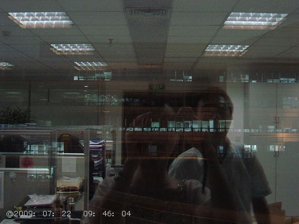
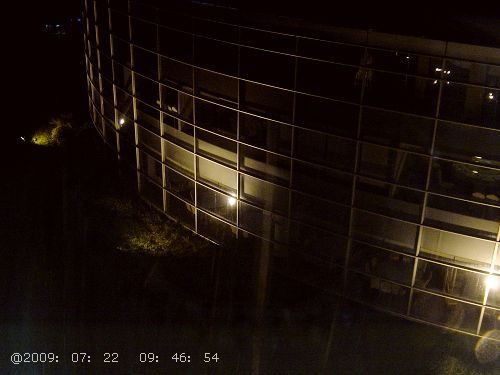
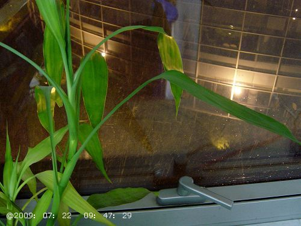

# total solar eclipse @ Nanjing

日全食这天南京下暴雨，不过同事们还是很兴奋地站在走廊尽头的窗户边迎接早晨的黑暗。9点钟的马路上渐渐亮起路灯，新闻再三强调要注意行车安全。同一个地方平均要300年才能见到一次日全食，那么下一次日全食将是2309年，300年后写博看博的人灰是灰，尘归尘了。。。相对这场天象盛宴我更喜欢下暴雨，那种天气下令人更享受家的安逸。整个自然界就象是一套内分泌系统，日全食会影响到潮汐影响到动植物，不知道股市是不是也会受到影响？  
  
   
   
   
   
   

---

## 评论（18）

**喜刷刷** · 2009-07-22

天哪，变化好大～

**[Jansfer](http://jansfer.com)** · 2009-07-22

我这张  
http://www.jansfer.com/wp-content/uploads/2009/06/e59bbee5838f0085.jpg  
傻瓜数码拍的  
http://www.jansfer.com/200906/23/%e5%a4%a9%e4%b8%8e%e5%9c%b0/

**[Jansfer](http://jansfer.com)** · 2009-07-22

记错了，是用Nokia 5310拍的，台风要来的时候

**光光** · 2009-07-22

你周末是不是吃了什么好吃的？:)

**[薇安](http://bulaoge.com/?vivianxu)** · 2009-07-22

今天好清爽啊～没看到日全食，只是感受了下天黑黑？

**jiajialing** · 2009-07-22

好爽啊，sydney看不到。。。

**Christina** · 2009-07-22

对滴，日全食的时候南京下暴雨。9点钟马路上的路灯就亮了，天黑持续了大约几分钟。周末的确吃了好吃的，但这脸好象是浮肿现象：D

**HANK** · 2009-07-22

呵,脸肿是为了补日食的缺?

**Christina** · 2009-07-22

哈哈哈哈~脸肿是为了配合这场天象盛宴，不知道吧？所以昨晚睡前拼命喝水喝水喝水。。。。哈哈哈哈哈哈~早晨起来脸就肿了~

**陈问问** · 2009-07-22

喜欢你的鞋子 红军野地草鞋来的。。。

**[shao ye](http://jennyshaoye.blogbus.com/)** · 2009-07-22

I feel that I haven’t seen you for ages. hope you are fine

**joanna** · 2009-07-22

杭州一开始天阴，9点半左右上班路上终于看见日全食，城市一片黑暗，日冕的光环，运气不错。之后才开始下雨

**幸福恒久远** · 2009-07-23

股市显然没有受到影响

**大姜炖去** · 2009-07-23

上海也是暴雨……  
就是看了个天黑

**Christina** · 2009-07-23

看来江浙一带都下雨了，可怜那些追日迷。。。

**宋宝** · 2009-07-24

怎么突然觉得最后那张象李湘？哈哈

**Christina** · 2009-07-24

角度原因吧~我长的还是象我自己：D

**luohong** · 2009-07-25

haha,我知道你的衣服在那里买的，我也有一件。是在外单店吧，也许会撞衫哦。

