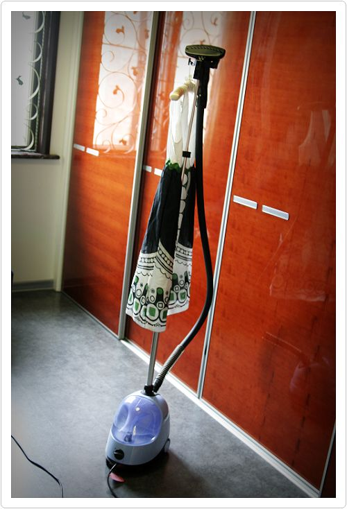
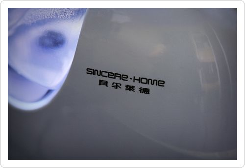
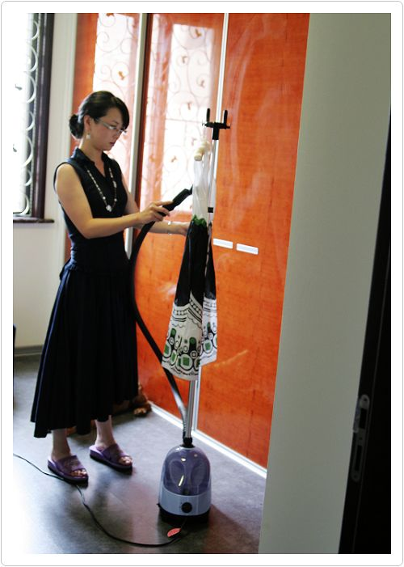

# 挂烫机

这篇专为[**Smile**](http://summerforever.blogcn.com/diary,26994637.shtml)MM所写。  
  
家里虽有熨衣板，且闲置时折叠在橱柜里一点不占地方，但还是在卓越网购买了[**贝尔莱德挂烫机**](http://www.amazon.cn/mn/searchApp?fea=related&ix=sunray&keywords=%E8%B4%9D%E5%B0%94%E8%8E%B1%E5%BE%B7&searchType=6&showType=4&sortType=&searchKind=keyword&uid=475-2160414-4766065)，放在衣帽间里使用。尤其熨春夏秋轻薄的、皱痕浅的衣物，挂烫机的优势就显现出来了，每天使用也方便，打开开关约20几秒蒸汽便漫出来，根本用不了说明书上的45秒。配件有毛刷、专门熨裤缝的塑料夹，可惜没有配备挂衣架。我买的[**挂烫机**](http://www.amazon.cn/mn/detailApp?qid=1248413427&ref=SR&sr=1-4&uid=475-2160414-4766065&prodid=jcjd010199)358元，性价比不错，目前还没出过问题。  
散件，按图纸安装，不难。  
  
  
  
大约10平米的房间，被橱柜用去部分后，变成一个小房间。瞧，那个小跟屁虫趴在我的脚后面，粘人的很呐~  
  
  
钟点工阿姨拍了十几张就这张还算清楚。。。差点说出要她去上摄影课的话。。。  
有了挂烫机之后，这件[**Decoster**](http://www.decoster.com.cn/decoster_main.html)丝绵面料的长裙可以增加穿着频率，并放下顾虑多多使用真丝衣物。顺便推荐一下我喜欢的Decoster品牌，很有设计感。几年前卖到日本市场，颇受顾客推崇，南京新街口金鹰店有售。  

---

## 评论（13）

**Anyayaya** · 2009-07-24

搞失踪一个礼拜以后终于又出现啦！而且继而搞博文批发呀，一下子这么多篇。最近生活内容挺丰富啊，大到300年一次的日全食（我本来早上想赖着看完凤凰卫视的直播再去上班的，可是后来要开会等不及啦：(）；小到喜滋滋添置得心应手小物件。不错不错！

**Christina** · 2009-07-24

你也消失好久啦~  
要狠狠地过好日子（咬牙切齿状）哈哈~

**喜刷刷** · 2009-07-24

被你请进家门的东东都有很好的待遇啊，这挂烫机就住了10平米，它能不好好为你服务嘛～

**lilian** · 2009-07-24

看了茶的生活，我才发现我只能算是在混日子。如果说生命的过程是痛苦的，那么就让我用得过且过来缓释这种痛苦罢：b

**Christina** · 2009-07-24

“得过且过”积累下来的事情，终有一天还是要解决。加油啊~

**[shao ye](http://jennyshaoye.blogbus.com/)** · 2009-07-24

Unfortunately I haven’t seen this item in shops here, otherwise I will buy one.

**[Jansfer](http://jansfer.com)** · 2009-07-24

不知道是否一样，京东便宜了很多。考虑也整一台  
http://www.360buy.com/product/127267.html

**Christina** · 2009-07-24

少爷，查一下这个网站www.amazon.uk，在英国的亚马逊在线销售网站，主页最下面应该有世界各地amazon的连接。我们公司也给amazon供货：）

不过各地区amazon供货渠道不同，产品区别会比较大。实现从中国amazon购买，在海外收货目前还不行。不过可以通过http://www.lightinthebox.com/网站购买中国商品~

**mandy** · 2009-07-24

我一直想买一个，今天终于知道价格了，每次看商店里的营业员使用的那么自如真是羡慕了，改天我也要买一个~~

**smile** · 2009-07-24

这下想偷懒都不行啦，谢谢Christina这么细心。我也终于知道懒惰的女人是优雅不起来的。

**Sherry** · 2009-07-26

不错，考虑购入一个挂烫机。。

**[山树](http://shanshu.blogbus.com/)** · 2009-07-27

我有一个挂着可以烫衣服的熨斗，可惜，没有挂的东西。每次只能挂在门把上，很累人。所以闲置在那里。

**Freya** · 2009-07-29

挂着的那件什么时候穿一下啊，貌似也很好看哦。

