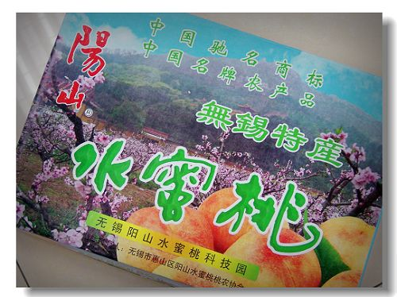
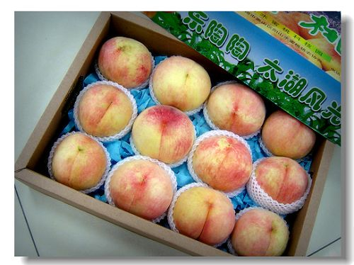

# 水蜜桃的伤

同事在南京买了6只所谓的无锡水蜜桃，花了18元。假的！  
  
如何辨别真正的阳山水蜜桃？  
1、一定是12只/箱；  
2、12只桃子个头大小差不多；  
3、桃子皮轻轻用手撕即能撕掉；  
4、色泽鲜嫩，果肉多汁；  
5、70~90元/箱。  
  
俗话说：桃饱人，杏伤人，李子树下埋死人。下班回家饿得不行的情况下，会先吃只冰凉的桃子抵抵饱，然后再去做事。年年夏季的水蜜桃大派送，难怪有人嚷嚷着吃伤了~今天又有桃子送来，冰箱里还有没吃完的。难道夏季最好的礼物就是送桃子？  
  
   
   
  
大多数时候我象只大虾米一样，驼着背。大概这个姿势让人可以完全没有任何负担的松弛，处于最自然状态中。卖点破绽，卖点破绽啊！  
  
  
看“反恐”看得专心，连衣裙的腰带早晨是万万没时间找的，随手系了前面宽，背后窄的所谓“糖果”腰带。不晓得为什么起这么个嗲兮兮的名字？  

---

## 评论（13）

**[左道](http://zuodao.org)** · 2009-07-27

背景，虚化的太严重

**[shao ye](http://jennyshaoye.blogbus.com/)** · 2009-07-27

I like your dress.but I like your peaches more:)

**Christina** · 2009-07-27

就是不要看到背景的杂乱，嘿嘿~

少爷，夏天回来吧，来吃桃子：P

**itsmin** · 2009-07-28

这莫不是传说中的峨嵋十三式之一的卖破绽式？  
无锡出产的桃子还真没吃过，有机会得去试试。

**Christina** · 2009-07-28

峨嵋十三式..哈哈~~~  
这下我有两套武功了，螳螂拳和峨嵋十三式之一。。。

**lilian** · 2009-07-28

只尝过南汇的～

**quinn** · 2009-07-28

呵，我们公司也刚发了无锡阳山的水蜜桃，和你们的一样一样的，觉得还可以，只是若不放冰箱里的话两天就要烂掉了，我们公司里就烂了一些，可惜啊

阳山的水蜜桃倒真的是蛮好吃的

公司也是买来送客户，发给员工的，看来真成了夏季的好礼品了

**itsmin** · 2009-07-28

嗯，现在复合型人才才有竞争力。上次让你考虑加入俺们这一行的事考虑好了没有？ 哈哈。

**lilian** · 2009-07-28

裙子很嗲，是连身的吧~

**Christina** · 2009-07-28

看过24小时之后就不考虑了，哈哈~  
俺们是供货商送，公司才没那么慷慨呢~是连身裙~

**陈问问** · 2009-07-28

你真是桃子之夏啊。。有没有办法可以延长保存期，我觉得桃子真是娇嫩之物呢。

**Christina** · 2009-07-28

除了放冰箱就是装肚子里啦，没别的保存法~

**shuwua** · 2009-07-28

我在北京吃的平谷大桃，怀疑是无锡种，水蛮多的，但是有点面。也满足了，呵呵。  
在北京期望值不能太高。

