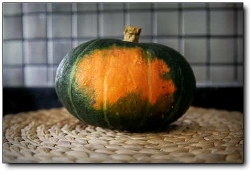
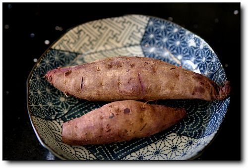
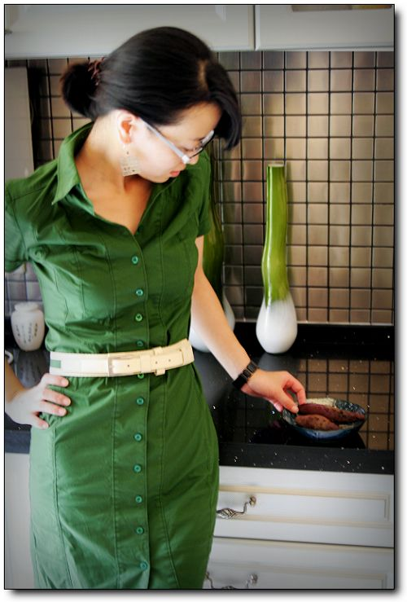

# 送．桃．子

“我要吃桃子，晚上请你吃饭？”女友说道。  
“不想出去，想回家，不见。”  
  
下班前工厂又送来两箱桃子，决定必须将桃子送掉，如果来不及吃烂了就太可惜了。这世道自觉懂事的人越来越少，收到桃子的人皆回送以小礼物，啧，啧，啧，都是家教很好的女孩子啊！最后一箱桃子送的颇费周折，转了好几个街口才找到她公司，想到她正吃着山珍海味，悔得我肠子都绿了，早知道答应一起吃晚饭了。饿得我回到家立刻拣了只最大的紫薯吃。  
  
蚊子回送的日本小南瓜，给我真是可惜了，她应该自己留着吃。  
  
  
紫薯，比红薯密度高，吃一个就饱。感觉跟压缩饼干似的。  
  
  
最高兴的是见到蚊子收养的流浪狗ZAKKY，眼睛会说话，象极了妞妞。ZAKKY比LUKE小一号，好象还是青少年的摸样。比较之后才知道LUKE真的是好壮啊。  
  
  
最近感到好累，永远有睡不醒的觉。上午请了半天假睡觉。必须起来上班时还是觉得累。我姐姐说我脸色很差，天天熬夜看“反恐”能滋润吗~  
  
依然是我家餐厅，背后是具有防水功能的不锈钢马赛克，我非常得意的创作。  
  
Decoster 制服裙，原配腰带，裙子面料有弹性。  
  
  
（明天还有女友的小礼物照片）

---

## 评论（13）

**陈问** · 2009-07-29

你这碟子放番薯也太般配了吧！真是日本的山村人家……好象日本人也很爱吃紫番薯

**Christina** · 2009-07-29

坚决拥护紫薯，性价比高，吃一个就饱。~

**itsmin** · 2009-07-29

不锈钢马赛克。。。酷！是创作？还是创意？还防水。。很不错。

**候鸟** · 2009-07-29

不锈钢的马赛克，太棒了。在这样的厨房做饭，心情都会好。

**[山树](http://shanshu.blogbus.com/)** · 2009-07-29

我不太喜欢吃南瓜  
紫薯我买的都是很小的个头，一次吃几个，不会觉得太撑。

**喜刷刷** · 2009-07-29

为了不锈钢马赛克大家握握手，超赞！今天我眼里的南瓜和紫薯都是卡通模样，好可爱的～

**mandy** · 2009-07-29

房子装修都是自己设计的？饰物都很喜欢

**Michael** · 2009-07-29

最后一张的颜色不错

**[shao ye](http://jennyshaoye.blogbus.com/)** · 2009-07-29

I like 日本小南瓜

**Violet** · 2009-07-29

马赛克的效果真是好，我也想尝试尝试了

**[三月四月](http://11)** · 2009-07-30

我也想吃紫薯！！！！

**[三月四月](http://11)** · 2009-07-30

哈哈，买到紫薯啦！麦德龙8元一袋！

**不羁之舟** · 2009-07-31

放紫薯的碟子我也有~~

