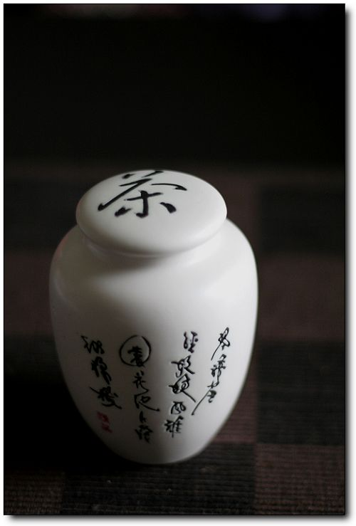
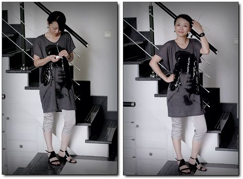

# *茶*

特别喜欢这个放茶叶的罐子，从ANGIE那里搜刮来的小物件。  
与那些热爱咖啡的MM相比，我更热衷于喝茶。  
  
  
  
今天如此繁忙，就象橡皮人，可以很忙很忙，也可以很闲很闲。可以很富有也可以很贫穷。如此凉爽的天气心情怎么也清爽不了，有压力的工作让人变得暴躁不安。  
Decoster裤子+小店买的无牌体恤+前年的凉鞋  
  

---

## 评论（8）

**itsmin** · 2009-07-30

很清雅的罐子。

**[Sutra](http://shuqun.com/)** · 2009-07-30

娃娃哇，我也喜欢这个，我要去偷。

**喜刷刷** · 2009-07-30

安静的小茶罐，酷酷的T-shirt，好别致的life style～

**Mavis** · 2009-07-30

太喜欢你了，虽然我们一南一北，但是天天关注你写的东西~  
这次很看好你的鞋子~好漂亮

**richard** · 2009-07-30

为啥你的衣服天天不重样呢？

**Christina** · 2009-07-31

想不重样儿呗~谢谢喜欢~

**mandy** · 2009-07-31

瘦子穿啥都好看~~

**shuwua** · 2009-07-31

喔唷，谢很好看的。  
茶叶罐也蛮好的。

