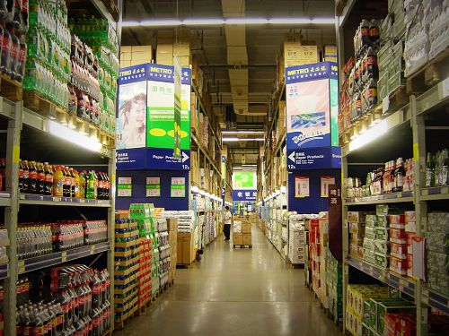
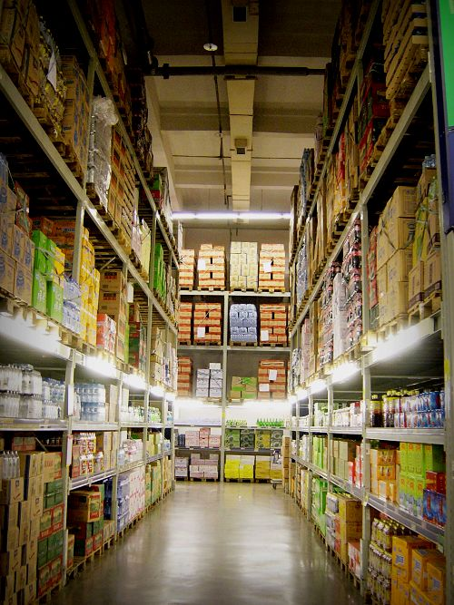

# 逛超市

如果可以在家附近的超市购买到所需要的食品的话，自然不会舍近求远下班后去麦德龙。南京有两家法国超市及一家德国超市卖杂货，还有N家国产苏果、华联、好又多.....最青睐德国超市麦德龙（METRO），货舱式销售，除了购物环境、服务因素，商品卖相比其他超市要好许多之外，在这里能找到其他超市买不到的食品，比如奶酪粉、金枪鱼、T骨牛排等等，停车也方便。晚上最满意新买的拖鞋：）搬了一箱摩卡咖啡冷藏在冰箱里，这个天喝冰咖啡也很爽。看到包装一模一样的阳山水蜜桃卖99.9元/箱，也忒贵了吧？  
  
以前不会比较商品克重，后来看到有人在超市里除了比较价格外还会比较克重，当然不会因此而发财，但过日子不任意浪费，就是学习的榜样~晚上边看“反恐”边炖麦徳龙买回的牛后腿肉，牛肉炖好了接着炖小母鸡。因为看“反恐”生活质量一降再降，快成脱水蔬菜了，这也是下班后必须去超市大采购的原因。  
  
喜欢人少的超市。  
  
  
用随身携带的卡片机拍摄，拍了三张后便专注于货架的五颜六色了。  

---

## 评论（12）

**[少爷](http://jennyshaoye.blogbus.com/)** · 2009-07-31

看起来这个地方象个批发的,也搞零售吗?

**joanna** · 2009-07-31

杭州的麦德龙须办卡才能进去，这种必须以单位名义办的会员卡没几个人会不嫌麻烦的去申请……猜测NJ也一样，才是人少的原因吧。我不喜欢，唯一的好处是买到一些家乐福也买不到的进口食品

**[三月四月](http://11)** · 2009-07-31

南京进入不需要卡，付款时需要，但主要靠在郊区，所以人少，市区大超市太多，但真要算价格，还是麦德龙的划算，就是每样量都很大，比较适合大采购。每次去麦德龙，都感觉又兴奋又头疼……还有那肉库……真不是人待得住的地方

**[Jansfer](http://jansfer.com)** · 2009-07-31

厦门也是要办卡才能进去。所以都没有去过

**Anyayaya** · 2009-07-31

天！这是中国的超市么？人少得简直令人神往！

**Christina** · 2009-07-31

南京麦德龙会员卡面对企事业单位办理，批发零售皆有，比如可乐，就不是一个一个卖，还是三个或五个一起卖，但是蔬菜、水果、肉食之类的农副产品和菜场一样是零售，以及进口食品比如橄榄什么的是一瓶一瓶卖的，洗发水护发素什么的和普通商店一样零售卖，价格也稍微优惠一些。一次性采购还是很方便的。

**jason** · 2009-07-31

会员卡就是结账的时候需要刷一下 随便找旁边人借一下就行了 麦德龙的进口商品相对其他卖场种类比较多

**[山树](http://shanshu.blogbus.com/)** · 2009-07-31

苏州麦德龙也是这样，面对企事业单位办卡。进去就觉得人很少，轻松购物。不然大卖场，手推车不好推，结账要排长队。

**mandy** · 2009-07-31

我喜欢那里人少，不嘈杂~~喜欢看看西式调料和卖酒店用品的地方~~

**喜刷刷** · 2009-07-31

住那边真是方便啊，IKEA，MRTRO，B&Q，月星，红星。。。。

**vodka** · 2009-08-04

这是什么卡片机？效果狠好～

**Christina** · 2009-08-04

SONY的卡片机。

