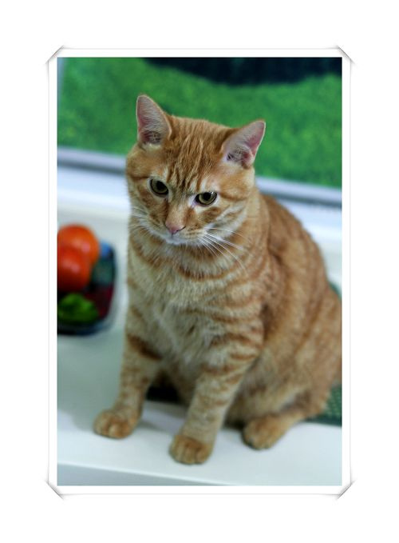
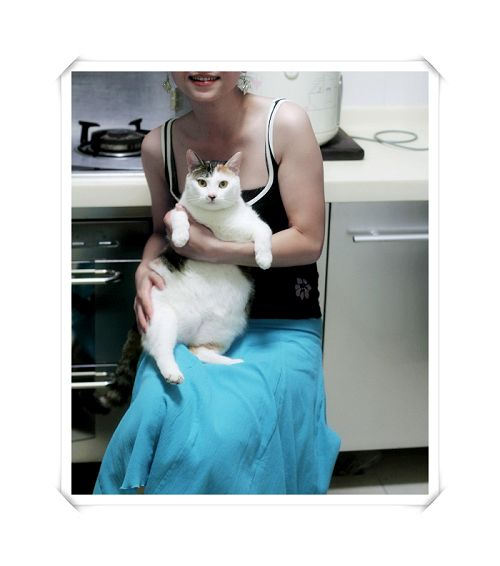
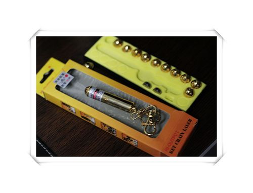
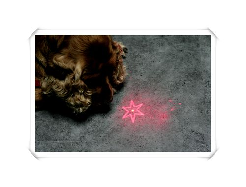
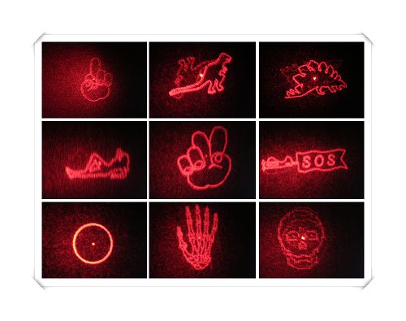
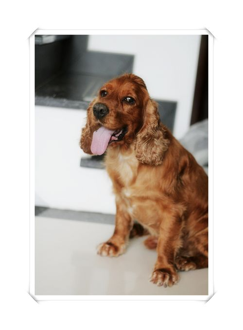

# 家有爱宠

下午去人家家里看猫眯，[**两只做过绝育手术的猫咪**](http://lifetea.org/article/2249/)现在长成＂球＂状了！前年的《心理月刊》上有篇专门讲猫的心理的文章，那期杂志被人借去一直没还我，至今耿耿于怀。文章大概意思是说猫是不认为人在逗它玩，甚至不屑于被人逗着玩，它就是自娱自乐的主儿，即使在和人类的游戏中，它认为它和你也是平等的。所以不难理解主人对它不好，它就会自谋出路的行为了，从另一个角度看猫还是很有主见的动物。  
  
狗就不同了，狗的生命中只爱主人，将主人视为它的上帝。你对它再不好，它还是爱你。当代“傻根”啊！  
  
他叫＂奥特曼＂，真的叫这个名字哦～擅于和人交流，好吃鬼，据说每到吃饭时间他就坐在这里陪着，一动不动。  
  
她叫“小咪咪”，比奥特曼胖很多很多啊。以前可是细脚伶仃的豆腐西施哦。  
  
上个世纪购买的KEY CHAIN LASER，射程1200米，可换不同灯头，射出来的光会是不同形状，比如星星、恐龙、VICTORY、SOS....居然还有“竖中指”形状 ，呵呵~有CE及FDA认证，顶级配置的玩具。  
  
LUKE盯着那些各种各样的形状追啊追啊，用嘴咬啊咬啊，运用了各种战术，结果还是扑了个空。这么高科技的玩意儿，它怎么能弄明白呢？只好望着它们发呆。。。  
  
  
  
好没劲啊，总是追不到那些东西。  

---

## 评论（8）

**候鸟** · 2009-08-01

真胖啊这些猫，像个肥坨！  
不过还是喜欢狗，总觉得猫看起来邪邪的~~

**Christina** · 2009-08-02

以前我也不喜欢猫，但是接触多了渐渐也喜欢它们。

因为有LUKE，所以一山难容二虎。LUKE要吃亏的，肯定是猫逗着LUKE玩，LUKE干着急，谁让它不能上窜下跳呢~有次我家里来了只猫，LUKE激动地浑身发抖，追着猫跑啊，人家猫蹦到高处便悠闲自得用爪子在上面挠LUKE脑袋，LUKE在下面傻眼了。。。。

**喜刷刷** · 2009-08-02

比起老徐的，这两只猫咪都不胖。不过还是LUKE帅，k也帅。

**候鸟** · 2009-08-02

想象猫咪挠LUKE脑袋的样子，哈哈，最后一张照片LUKE的吐舌头的表情，有点像动画片里的样子，分明是：我的天我的天，什么世道？累晕我了！

**Violet** · 2009-08-02

Luke的这个样子，真是让人想去亲一口

**[光光](http://gaoguangguang.blogbus.com)** · 2009-08-02

那只大白猫需要减肥了。它已经和龙猫一样胖了。

**[三月四月](http://11)** · 2009-08-03

还真像龙猫！

**lilian** · 2009-08-04

裙子的颜色很ＰＬ～

