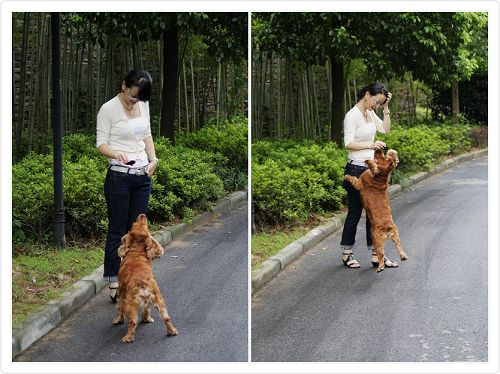
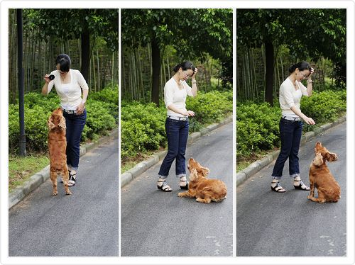
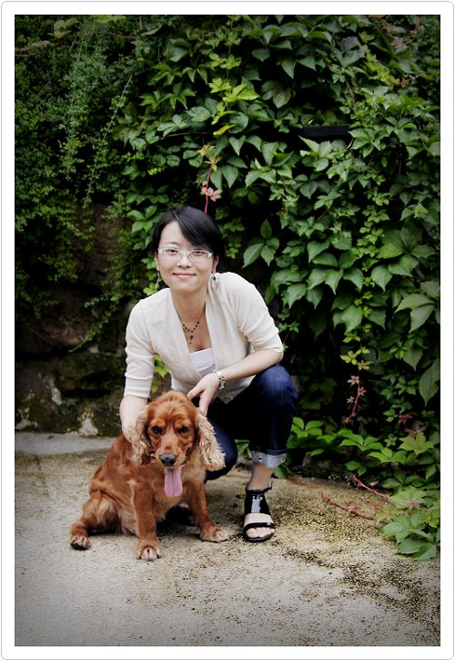
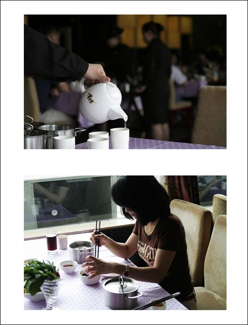
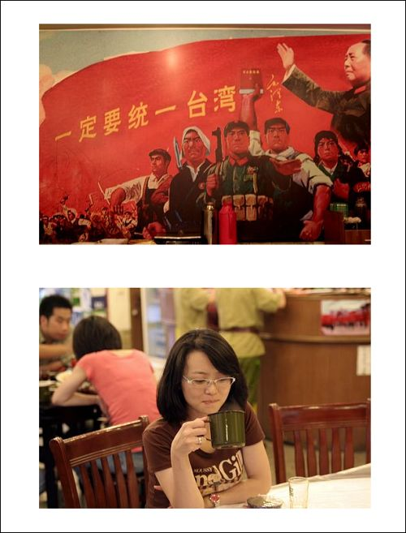

# 游戏 & 吃货

秋天一样的夏日，和LUKE做游戏，好开心，也希望它好开心。  
  
   
   
  
  
\*\*\*\*\*\*\*\*\*\*\*\*\*\*\*\*\*\*\*\*\*\*\*\*\*沦为吃货\*\*\*\*\*\*\*\*\*\*\*\*\*\*\*\*\*\*\*\*\*\*\*\*\*\*  
\*\*\*一尊皇牛\*\*\*  
所有的火锅店我最钟情于“澳门豆捞”。如果想吃“滑”和海鲜就去豆捞，因为它家的“滑”真的好有弹性，还有可口的配料。如果想吃肉，皇牛的羊肉还是很便宜的，反正我对羊肉没有特别的需求，感觉都一个味道儿。  
   
  
\*\*\*朱四公社\*\*\*  
这家店老板还开了狗肉店和羊肉店，前者是万万不会尝试的，后者的口味还不错。这家公社里的各种标语很雷人，估计那些从文革中坚强走出来的中老年人，见着这些标语以及红卫兵打扮的服务生（注意第2张我身后穿军装的服务员），准保心惊肉跳，太甩！就差拿着枪看着顾客进餐了。招牌菜是油焖鸭，只有这一个菜还能接受，其余就算了吧。有些饭店你只会去一次。  

---

## 评论（21）

**[三月四月](http://11)** · 2009-08-03

真羡慕你的生活状态……

**Christina** · 2009-08-03

只要你想，就可以~生活本身很无聊，全靠个人经营，对吧？

**Anyayaya** · 2009-08-03

在澳洲这个大农村生活，也是同理。2个基本点：1)companionship 好的同伴 2) create your own fun 自己找乐子。

**Christina** · 2009-08-03

楼上，你居住的“大农村”可是世界上最美丽的城市之一哦~我也想住在那样的“大农村”里：D开博了没？要看要看呀~

**邃** · 2009-08-03

你的头发又留起来了  
和LUKE玩的那套衣服很清爽。  
可是我们这边却是桑拿天。

**Nana** · 2009-08-03

Luke长大了

**兔子田** · 2009-08-03

最后一张很可爱。  
以及，生活经营得很美好。赞啊。

**Christina** · 2009-08-03

Nana，LUKE6、7个月就已经成年了，今年的他3岁，所以不是长大，是步入壮年：P

对，头发又留起来啦~

**[三月四月](http://11)** · 2009-08-03

我现在主要还被父母管教着，等再过几年就好了，现在只能见缝插针地享受一下

**Anyayaya** · 2009-08-03

秀才造反，三年不成。懒人开博，半年一篇。败好意思，还没有开。。。

**[三月四月](http://11)** · 2009-08-03

妞妞从来不会为食物跳起来，它会用史莱克上面的那个小猫的眼神看着你，看到你心里发毛内疚……不过时间长了，我可以做到无视，它就死叫，但是绝对不跳！

**Mavis** · 2009-08-03

茶，看到你家Luke，总让我想到我家皮皮的儿子傻小子，他被送到山东去了~~小狗总是这样被做人情。。。  
同一“鞭长莫及“的说法，一段好姻缘呀，呵呵，我在北京，每天关注你的生活，希望你美丽快乐~

**Christina** · 2009-08-03

LUKE也不会跳，一样一样的眼神坐在那里看着你。。。很可怜的样子！有时候口水还滴答滴答滴。。。

不过有次很好玩，有个小朋友到我家作客，手里拿着饼干站在墙边，LUKE微微抬起头就把饼干吃了，呵呵~谁让小朋友和它一般高呢~

LUKE在南京好难找女朋友啊，它偏偏喜欢高大的萨摩耶.....每次在街上看到貌似英卡的狗狗，都会追问人家公的还是母的，留个电话如何。。。MAVIS，哪里可以看到你家可卡的照片啊？

**陈问** · 2009-08-03

去这类地方吃饭，真是一次就够了。火红岁月也差不多嘛，进去就感觉自己被批斗了……

**shuwua** · 2009-08-03

是中山陵吧？凉爽的夏天去真的很美好。

**Christina** · 2009-08-03

呵呵，吃饭时候是有被批斗的感觉。  
这不是东郊，这是在我家小区里：）

**[薇安](http://bulaoge.com/?vivianxu)** · 2009-08-04

一尊皇牛的桌布好漂亮。呃，最近迷布，看到它就想拿过来裁剪

**lilian** · 2009-08-04

经常外食很容易胖哎，只有你这样苗条的体型才不用怕。

**Mavis** · 2009-08-04

我家可卡照片~~似乎我不放到网上来~她模样很不错的,总有公狗追求她,可惜我在北京,你在南京,异地恋好辛苦~~

**I_mu** · 2009-08-04

朋友喊我看美女，原来是你啊，小空间经营的不错啊！老同事！：）

**不羁之舟** · 2009-08-04

什么时候带狗狗给我玩啊:)相机是单反的吗?好看~

