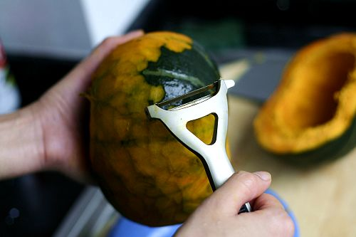
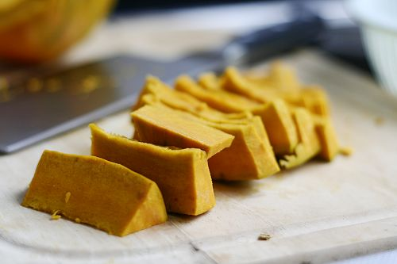

# 经前综合症

事实上今天我的情绪非常糟糕，没有缘由的时候都会被归结到经前综合症。有人说如果将这几天冰冻起来，等一切烟消云散之后再解冻，就不会被不良情绪折磨。而我在想有没有一种药可以让女人平静地度过周期性反应？因为钟点工请假而一次没有打扫的地面已经让我无法忍受，这是否属于精神洁癖范畴？睡前看“反恐”，睡眠质量明显下降，早晨6点多钟就醒了，白天浑身散了架似的。anyway，正视自己的不良情绪总好过无缘由的抱怨发火，顶多折磨折磨亲近的人，发泄一下想死的情绪，当然不会真的想死，只是不良的程度到了可以用想死来比喻。  
  
有人看到我写下的这些，一定会减轻自己的苦楚感，因为让我们自己高兴起来的方法之一就是听/看别人难受又沮丧的状况，没瞧见大街上那么多喜欢凑热闹围观的么？他们比谁都过得简单而开心，虽然非健康常态，但人类总是如此龌龊又真实的嘛。所以你想让别人高兴，你就大声说：“嘿，我活得很糟糕啊，我活得生不如死。。。”偶尔造福众人，也是善事一种。  
  
\*\*\*\*\*\*\*\*\*\*\*\*\*\*\*\*\*\*\*倒完苦水，来道甜点吧！\*\*\*\*\*\*\*\*\*\*\*\*\*\*\*\*\*\*\*\*\*\*  
终于对这只日本小南瓜开工了，硬度堪比紫薯，不信你经历一下从刮皮到切成丁的过程？！同时也说明“浓缩的就是精华”。我是这样操作的：将泡好的银耳和南瓜丁一起放入水中，加入冰糖，按下电饭煲“煮粥炖汤”键，第二天一早就有现成的补品等着你去享用，盛出来凉了后放入冰箱冷藏，晚上睡觉前吃一小碗。我们没有燕窝，可以用银耳代替啊：）LOOK！取悦自己一点不困难。  
   
   

---

## 评论（13）

**喜刷刷** · 2009-08-05

分我一碗吧，今晚又没吃好：-（

**Christina** · 2009-08-05

你少吃点没关系的~

**雯子** · 2009-08-05

一个月总有那么几天情绪低落、易怒、敏感。我一直在努力试着管好自己的情绪。  
南瓜和绿豆做羹也很好吃。

**itsmin** · 2009-08-05

倒出苦水，未必就造福众人．．．但我认为这是试图改善情绪的正确方法．当然啦，茶博士这种＂今天我不开心，说出来让大家开心＂的精神还是很值得肯定的;+)．好啦，苦的倒出来，甜的喝下去了, 那就have a nice day lah.

**陈问** · 2009-08-05

南瓜和银耳一起煮，不会很烂很烂么？

**mandy** · 2009-08-05

南瓜这么粉烂啊？我上周买个一个本地的老南瓜，做个白果南瓜，还不错~~就是觉得南瓜有点水唧唧的，不够粉，我喜欢粉粉的~~这个日本南瓜啥口味？

**Christina** · 2009-08-05

Mandy,那这个小南瓜完全符合你的要求。  
放在一起烧不会烂，密度好高的南瓜啊。

**Sherry** · 2009-08-05

对，有什么不开心的，说出来让大家开心一下。。  
呵呵

**陈问** · 2009-08-05

哈哈，真的么？以前买的国产南瓜都是最后才放的。这个南瓜甜么？

**Christina** · 2009-08-05

甜啊，切它的时候手都染黄了，很硬很难切。

**[三月四月](http://11)** · 2009-08-05

我也有这个综合症

**Mavis** · 2009-08-05

红糖水，冲一杯，心情好而且肚子也会喜欢~

**[shao ye](http://jennyshaoye.blogbus.com/)** · 2009-08-07

There are some tablets for releasing stress before period. I used once, it works.

