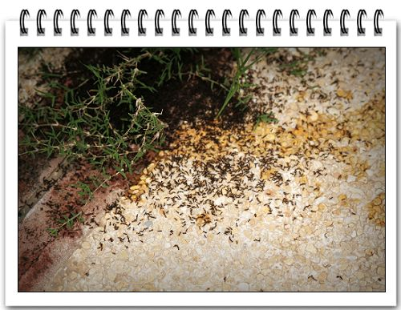
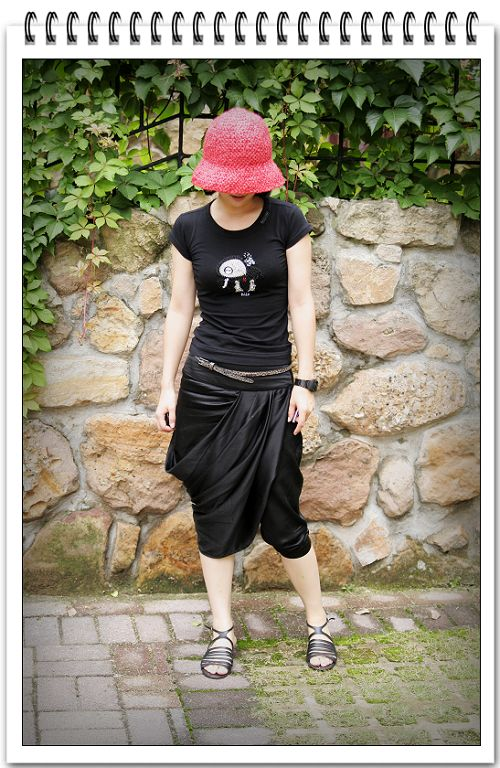
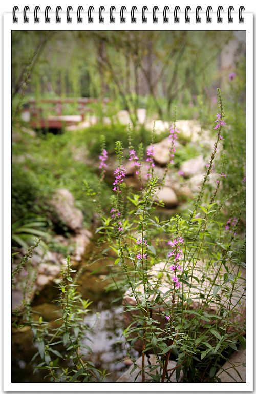
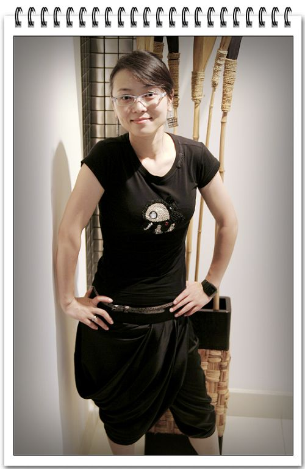

# 夏末MIX

失去夏日的感觉有段时候了，送一首久石让的[**“summer”**](http://218.71.239.110/music/uploads/20090712/110602946.mp3)怀念一下。  
昨天吃到无锡蠡园产的绿葡萄，有香草和荔枝的味道，神奇。  
  
   
   
   

---

## 评论（18）

**itsmin** · 2009-08-05

光影的效果让最后一张手臂很有肌肉感．．．erh,变形金刚茶？

**Christina** · 2009-08-05

以前是有肌肉的，不锻炼十几年后，就成面包状了，哪里还有什么肌肉感啊~

**itsmin** · 2009-08-05

基因真好啊，不锻炼十几年还能有这身段！强！

**[薇安](http://bulaoge.com/?vivianxu)** · 2009-08-05

黑T恤不错啊～～

**quinn** · 2009-08-05

第一张是什么啊，没看出来：（  
tea 全身黑色啊，居然连手表都是黑色，只有帽子那一滴红 特意的搭配，呵呵

**Christina** · 2009-08-05

第一张是蚂蚁搬家。

**[三月四月](http://11)** · 2009-08-05

久石让的曲子都好经典…………

**[三月四月](http://11)** · 2009-08-05

如果让我听到他的《幽灵公主》，我会有哭的冲动

**Sherry** · 2009-08-05

怪裤子。。

**喜刷刷** · 2009-08-06

头发长了？扎起来了？好奇最后一张里，你背后桶里插着几把什么东东？show一下吧

**Christina** · 2009-08-06

竹竿+芭蕉叶，叶子被作成金色和黑色。简单吧~

**lilian** · 2009-08-06

呵呵，最后一张，又见到你的经典poss.

**Michael** · 2009-08-06

LZ鞋子狂多, 每双都蛮好看地:)

**Weiqiang** · 2009-08-06

有人觉得你有点像赵涛吗,感觉

**Christina** · 2009-08-06

从来没人觉得我象她，我个人认为一点一点都不象。

**Weiqiang** · 2009-08-06

好吧,因为刚看了任逍遥,可能有点印象重叠…

**[山树](http://shanshu.blogbus.com/)** · 2009-08-06

还是用脚架拍的么？

**[shao ye](http://jennyshaoye.blogbus.com/)** · 2009-08-07

i like your hat, nice colour with your black dress

