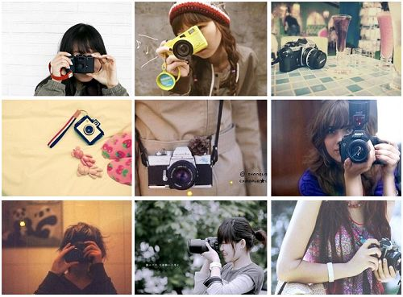
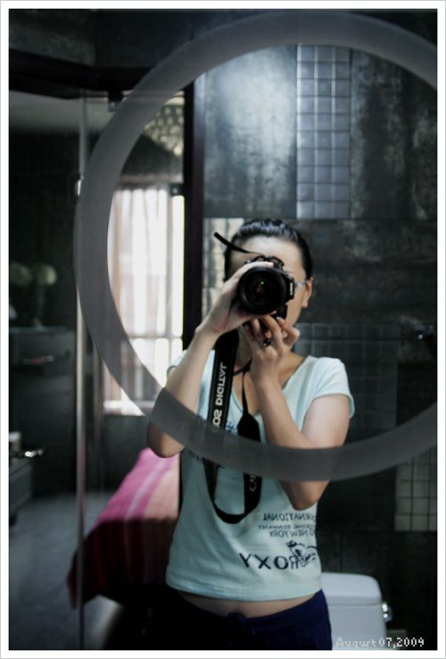

# camera c.o.m.p.l.e.x.

  
  
  
  
   
  
配上这首Dr Dre [**“the message ”**](http://video.525show.com/RAP/BEAT/%5bMR%5dDr.Dre_-_The_Message.mp3)的纯乐版，很中国风。  
附[**“the message ”**](http://musiccache01.socbay.com:88/music/new_music/1/462/94db406a5cd5cfbc349035ea77b01037.mp3)歌词版。

---

## 评论（9）

**喜刷刷** · 2009-08-07

镜子里那个家伙好酷～

**[山树](http://shanshu.blogbus.com/)** · 2009-08-07

最后一张在你家卫生间？好酷的卫生间啊。

**[shao ye](http://jennyshaoye.blogbus.com/)** · 2009-08-07

I become one of them now:)

**[光光](http://gaoguangguang.blogbus.com)** · 2009-08-07

这个不错。喜欢第二行中间那个相机。

**Christina** · 2009-08-08

那是海鸥牌相机～

**[jiajia](http://www.imissme.net/blog)** · 2009-08-08

這些圖片真喜歡！christina是哪里找來的呀？

**Christina** · 2009-08-08

欢迎少爷加入摄影爱好者行列：）  
对啊，这是我家卫生间。  
图片从泡泡网找的。

**[光光](http://gaoguangguang.blogbus.com)** · 2009-08-08

你的卫生间好好看啊。

**灰子** · 2009-08-08

哇，收集这么多相机女孩～

