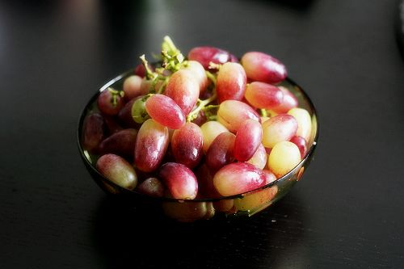
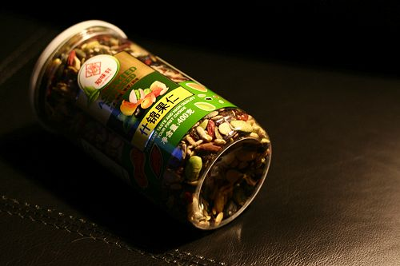

# 清.空.大.脑

和Sherry随机选在水游城的TACOS解决晚饭，如果阿英煲打死卖糖的，那么这家TACOS则打死卖盐的，每道菜都咸。分店和总店的差距怎么那么大？  
  
德国烤肠数量没减，体积只有总店的1/2；色拉里除了一只球型土豆泥+一片黄瓜+一些生菜叶，没其他内容。那片黄瓜被我抢先吃下，一股鱼腥味儿冲出来；加酥皮的罗宋汤咸得我直发汗，锔饭、色拉、猪手也咸。好在没点巧克力蛋糕，怀疑上来会是份咸的甜点。每张桌子上立着一只高高的TACOS标记的玻璃瓶子，里面加一两片柠檬的免费白水，瓶子看上去脏兮兮的。  
  
埋单时我禁不住又废话了：“你们店的厨师和老板有仇吗？”  
服务生：“为什么？”  
“每道菜都那么咸！”  
。。。。。。9折帐单共计182元。  
  
就着咸菜咸饭倒出的都是无奈。  
  
我以为多休息一天可以很快活，快中午的时候起床，阿姨打扫卫生我做饭。忙完这些还有一袋子的脏衣服要洗。。。经济危机下的美国诞生了许许多多的家庭主夫，那些从基金分析师以及金融系统回归家庭的男人们和我今天一样以为可以很快活，如果你的身边还有一两个孩子的话，一旦陷入家庭职业是无论如何闲不下来。“想做什么就做什么”得在夹缝里见缝插针，看着那些真假开心走进婚姻的男女，那些与第二选择结婚的男女，有人嘴角掠过一丝冷笑。  
  
人在每个阶段要面对不同问题，年轻的时候忙着找好工作，忙着谈无果恋爱，到了婚嫁年龄却找不到好男人，真找到结婚了又要负责柴米油盐酱醋茶，同时还要承担起工作上的压力，适应好了却发现原来的好男人不过是匹种马，从不间断地搞三搞四，女人于是被锻炼出十八班武艺，当一切烟消云散没准儿又遭遇无性婚姻的无奈，这之后翩翩而至的中年危机、更年期。。。没完没了的问题等着我们去解决，没有停止的时候，也少有完美片段。  
  
忘了在谁那里看到一项有关婚姻的调查：俄罗斯专家针对1500对夫妻做了跟踪，其中97%因为爱结婚，2%把结婚当作任务完成，1%因为利益结合。最终只有1%因为利益结婚的夫妻过得最幸福。真的？真的吗？（对不起，用了鲁豫的台词）简直太讽刺了，对那些前赴后继追逐爱情梦想的人是个讽刺，不是吗？  
  
这就准备就着无锡蠡园的紫葡萄和什锦果仁看反恐去了。看到第四季有两个明显的印象：一个是有关Tony和Michelle，Tony因为救爱妻Michelle而放弃事业生涯，结果两人离婚。因为Tony一直没有找到工作酗酒如何如何的原因。想来人们的知恩图报一定是排在满足自己需求之后的，感情上尤其如此。  
  
第二个印象是Jack，一个伟大的英雄人物没有大脑是无法持续作为一个英雄存在的，Jack除了特工技能外，还具有非凡的表演力和语言组织能力，否则如何能够迷惑敌人，如何让谎言屡屡得逞？如果你恰恰找到这么个所谓好男人，要么一辈子被他骗，一辈子蒙在鼓里也不错。要么就离他越远越好。  
   

---

## 评论（13）

**Sherry** · 2009-08-07

这家餐馆可以进黑名单了。。菜难吃，服务也不好。。

**候鸟** · 2009-08-07

第一个服务生的笑话我已经跟家人分享了，逗得他们哈哈大笑：）  
显然第二个服务生不是暑期工。

**陈问** · 2009-08-07

我就说嘛，TACOS，这下我能看明白了 ：）

**农妇某人** · 2009-08-07

婚姻就像押宝的，有人输有人赢。运气是一方面，我觉得真性情最重要。那个所谓俄罗斯的婚姻调查，嗯，怎么说呢，我只能说当然在俄罗斯会有这种结果：现在欧洲国家有很多很多来自俄罗斯乌克兰卡萨克斯坦的女性，年轻漂亮的非富翁不嫁；中等姿色的或者在酒吧工作或者选择经济条件不差的中产阶级嫁人生子；再差一点的随便找个人嫁了，拿到居留证就跑人……她们的天性上来说就是把钱看得很重的，这跟国家的大环境也有关。但如果你说她们的婚姻很幸福，我不肯定。不知道我是不是在以偏概全……

**喜刷刷** · 2009-08-07

下次来总部时叫上我～

**[shao ye](http://jennyshaoye.blogbus.com/)** · 2009-08-07

healthy food, good for you

**itsmin** · 2009-08-07

这葡萄看上去很甜。

**mandy** · 2009-08-07

人在每个阶段要面对不同问题，年轻的时候忙着找好工作，忙着谈无果恋爱，到了婚嫁年龄却找不到好男人，真找到结婚了又要负责柴米油盐酱醋茶，同时还要承担起工作上的压力，适应好了却发现原来的好男人不过是匹种马，从不间断地搞三搞四，女人于是被锻炼出十八班武艺，当一切烟消云散没准儿又遭遇无性婚姻的无奈，这之后翩翩而至的中年危机、更年期。。。没完没了的问题等着我们去解决，没有停止的时候，也少有完美片段。真实？确实~~

**大湖** · 2009-08-07

Outstanding analogy on relationship/life

**候鸟** · 2009-08-08

姻缘有时候是需要一点运气，门当户对也是比较重要的。以前看过一本小说，是巴尔扎克写的，《两个少妇的回忆录》，挺典型的两例婚姻。有这样一段话：两个女主人中的一个，勒南代表理智，她爱给女友的信中写到：“婚姻产生人类，爱情只产生快乐。快乐消灭了，婚姻依然存在，且更诞生了比男女结合更可宝贵的价值。故欲获得美满的婚姻，只须具有那种对人的缺点加以宽容的友谊便够。”勒南，虽嫁了一个年龄比她大而她并不爱的丈夫，终于变得极端幸福。反之，他的女友鲁意丝虽然是由恋爱而结婚的，却因过度的嫉妒，把她的婚姻生活弄得十分不幸，并以嫉妒而致丈夫于死地，随后自己亦不得善果。而巴尔扎克的论见是：如果你联合健康，聪明，类似的家世，趣味，环境，那么，只要一对夫妇是年轻康健的，爱情自回诞生。“这样，曼斐都番尔说，你可以在每个女人身上看到海伦。”

**Anyayaya** · 2009-08-08

在水游城的选择看来不是costa就是tacos反正就这5个字母的组合哈。。。

**[光光](http://gaoguangguang.blogbus.com)** · 2009-08-08

东西难吃还可以忍受，但如果不干净，比如那个腥的气味，脏兮兮的瓶子，啊，简直要死人啊。

**lilian** · 2009-08-13

话很在理哦，不过茶太理性了~

